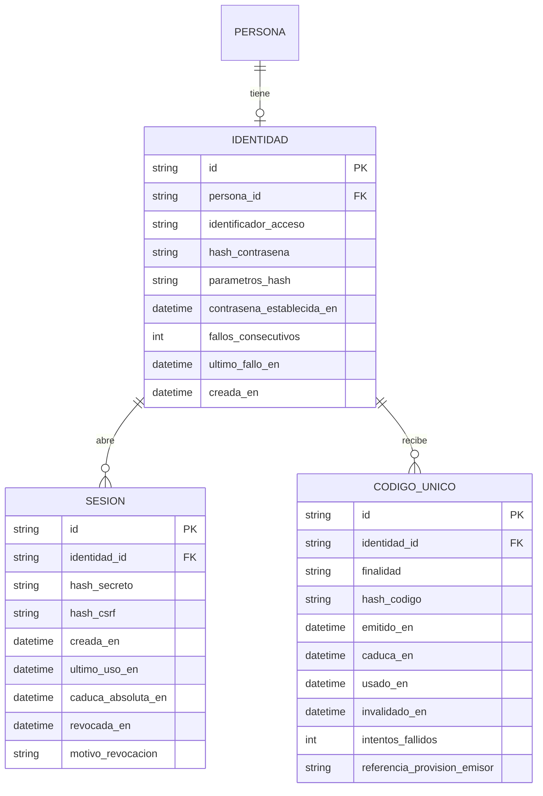

# ADR-002 — Autenticación y acceso de SMARTWORK

| | |
|---|---|
| **Estado** | **PROPUESTO** hasta resolver el mecanismo operativo de la provisión. La **arquitectura técnica de referencia** (sección 2) está aprobada por la persona responsable |
| **Versión** | 0.3 |
| **Fecha** | 2026-11-06 |
| **Relacionado con** | PA-12, RN-33 a RN-35, RN-38, RN-61, RN-64, RN-96 a RN-99, RN-102, RNF-08, IR-34, IR-37, IR-38, DM-07, DD-04, DD-05; ADR-001 |
| **Documentos complementarios** | `docs/modelo-datos/modelo-datos.md`, `docs/api/indice.md`, `docs/api/m1-m5-dependencias.md` |

Este ADR desarrolla la propuesta de autenticación. La persona responsable aprobó como arquitectura técnica de referencia los ocho puntos de la sección 2; lo que sigue **sin aprobar** es el mecanismo operativo de la provisión (secciones 7 a 11) y los valores de los parámetros. No decide el despliegue (DT-07) y no toca el alcance, el PRD, las historias ni el modelo de datos: su impacto estructural se presenta aparte (sección 10) para aprobación. No contiene credenciales, claves ni valores secretos.

## 1. Contexto y requisitos

| Requisito | Qué exige a la autenticación |
|---|---|
| RN-61 | Solo las personas identificadas acceden |
| RN-64, RNF-08 | Las credenciales nunca se muestran ni se registran en claro |
| RN-33 a RN-35 | Provisión administrativa controlada, sin tercer rol funcional ni panel avanzado; primer acceso seguro, individual y de un solo uso |
| RN-96, RN-97, IR-37, IR-38, DM-07 | La desactivación de acceso es inmediata y se comprueba en cada operación; una persona sin pertenencia vigente no opera |
| DD-05 | Recuperar una credencial no reactiva un acceso desactivado |
| RN-98 | Un supervisor con acceso desactivado no ejerce funciones |
| RN-102, IR-34 | Toda operación de provisión tiene autor identificable y trazabilidad, sin credenciales |
| ADR-001 | Flutter Web, FastAPI y PostgreSQL; autorización centralizada en el backend |

Quedan abiertos en PA-12: caducidad del acceso inicial, credencial propia en el primer ingreso, medio de entrega, verificación de identidad al recuperar y reactivación administrativa.

## 2. Arquitectura técnica de referencia (aprobada)

1. Identificación mediante credenciales propias (identificador y contraseña). El identificador lo asigna la provisión; no se exige correo electrónico.
2. Contraseñas protegidas con Argon2id.
3. Sesiones revocables en servidor, gestionadas por FastAPI y guardadas en PostgreSQL. Un identificador opaco viaja en una cookie con `HttpOnly`, `Secure` y `SameSite`.
4. Protección CSRF y HTTPS.
5. Código temporal de un solo uso para el primer acceso y la recuperación. La persona fija su propia contraseña al canjearlo.
6. Desactivación inmediata del acceso y revocación de sesiones en la misma transacción.
7. Provisión administrativa controlada, sin tercer rol funcional ni panel avanzado.

Fuera del MVP, por no tener respaldo en ningún requisito confirmado: autenticación multifactor, inicio único (SSO) con un proveedor de identidad externo, recuperación por autoservicio y envío de correo.

**Lo que este ADR propone y sigue sin aprobar:** el medio de entrega del código, la verificación de identidad al recuperar, la identificación y autorización de la persona operadora, la reactivación del acceso y los valores de los parámetros.

## 3. Alternativas consideradas

| Alternativa | A favor | En contra | Resultado |
|---|---|---|---|
| **A. Sesión en servidor con cookie** (propuesta) | Revocación inmediata; sin secretos en el cliente; el navegador gestiona la cookie; sin infraestructura nueva | Exige CSRF y un solo origen; estado en base de datos | Propuesta |
| B. Tokens (JWT) en el cliente | Sin estado en el servidor | Revocar es difícil y por eso habría que consultar el estado en cada petición de todos modos; guardarlos en el navegador los expone a XSS | No propuesta |
| C. Proveedor de identidad externo (OIDC) | Delega credenciales y MFA | Dependencia externa y coste; la organización quizá no tiene proveedor; más superficie de integración | Descartada para el MVP; reevaluar si la organización ya lo tiene |
| D. Enlace por correo («passwordless») | Sin contraseñas | Exige infraestructura de correo y que el correo sea el canal de confianza | Descartada para el MVP |

## 4. Modelo de identidad, sesiones y códigos temporales

Son estructuras **técnicas fuera de las nueve entidades de dominio**. Se necesitan porque RN-64 impide guardar credenciales en `PERSONA` y porque el modelo (principio P8) ya reservaba la identidad para esta decisión.

| Estructura | Reglas |
|---|---|
| `IDENTIDAD` | Una por persona (relación 1 a 0..1). `identificador_acceso` único y normalizado; no es un dato de contacto. `hash_contrasena` vacío hasta completar el primer acceso. `parametros_hash` permite volver a calcular el hash al subir los parámetros. No contiene la contraseña ni nada reversible |
| `SESION` | Solo se guarda el hash del secreto de la sesión y del token CSRF, de modo que una fuga de la base de datos no entrega sesiones vivas. El secreto se genera con un generador criptográfico. Nunca se reutiliza un identificador de sesión |
| `CODIGO_UNICO` | Se guarda solo el hash. Finalidad: primer acceso, recuperación o reactivación. Un solo uso, con caducidad y contador de intentos. La referencia del emisor es no secreta y coincide con `referencia_provision` de la auditoría |
| Dominio | `PERSONA.acceso_desactivado_en` (aprobado) sigue siendo la fuente de verdad de la desactivación. La política de autorización lo consulta en cada operación (DM-07) |
| Auditoría | Se usa `AUDITORIA` con `tipo_autor` igual a provisión (IR-34). Nunca contiene contraseñas, códigos, hashes ni secretos de sesión |

## 5. Ciclo de vida de las sesiones

1. **Creación.** Tras verificar la contraseña se genera un identificador nuevo (se descarta cualquier identificador previo, contra la fijación de sesión) y un token CSRF asociado.
2. **Uso.** En cada petición, la política comprueba por orden: la sesión existe, no está revocada ni caducada → la identidad existe → `acceso_desactivado_en` vacío (IR-37) → pertenencia vigente (IR-38) → para métodos que modifican, el token CSRF. Solo entonces se evalúa la autorización del recurso (convenciones de la API, 3.2). La actualización de `ultimo_uso_en` se limita en frecuencia para no escribir en cada petición.
3. **Caducidad.** Dos límites impuestos en el servidor: inactividad máxima y duración absoluta. Los valores son parámetros de configuración (sección 14, decisión A9). Borrar la cookie no invalida la sesión: la caducidad y la revocación viven en el servidor.
4. **Revocación inmediata** al: cerrar sesión; cambiar la contraseña o completar una recuperación (todas las sesiones de la persona); desactivar el acceso (misma transacción que fija `acceso_desactivado_en`); reactivar el acceso (se parte sin sesiones). La finalización de la pertenencia no necesita revocar: IR-38 deja de permitir operar en la fecha efectiva.
5. **Sesiones simultáneas.** Se permiten varias por persona (varios navegadores). Un límite de sesiones no está requerido.
6. **Mantenimiento.** Una purga periódica de sesiones caducadas y de códigos usados o caducados limita el tamaño de la tabla. Es mantenimiento del propio mecanismo, no una funcionalidad.

## 6. Primer acceso y recuperación

**Primer acceso** (RN-35)

1. La provisión crea la persona y su identidad (sin contraseña) y emite un código de un solo uso. La orden lo muestra **una sola vez** a quien opera; no se guarda en claro.
2. La persona recibe el código por el medio de la sección 8.
3. En el canje, la persona presenta el identificador de acceso, el código y una contraseña nueva. En una sola operación atómica: se comprueba que el código es válido, no está usado ni caducado, y que el acceso no está desactivado; se establece el hash de la contraseña; se marca el código como usado; se revocan sus sesiones.
4. La persona inicia sesión de forma normal. No se abre sesión automática, para que haya un único camino de creación de sesiones.

**Recuperación** (RN-34)

1. La persona avisa a la organización de que perdió el acceso. La provisión verifica su identidad **fuera de banda** según el procedimiento de la organización (decisión A5).
2. La provisión emite un código de recuperación. El canje es igual al del primer acceso: fija una contraseña nueva y revoca todas las sesiones.
3. **Si el acceso está desactivado, el canje se rechaza** (DD-05): recuperar una credencial no reactiva el acceso.

**Respuestas uniformes.** Un código desconocido, usado, caducado o de un acceso desactivado produce la misma respuesta, para no revelar cuál es el caso. Un identificador de acceso inexistente y una contraseña incorrecta también producen la misma respuesta (sin enumeración de identificadores).

## 7. Parámetros de duración, caducidad e intentos, con fuentes

**Cómo leer las fuentes.**

- **NIST SP 800-63B-4** es una guía de identidad digital pensada para los servicios de las agencias federales de EE. UU. No es una obligación legal para SMARTWORK: se usa como **referencia técnica**. Sus requisitos dependen del nivel de garantía de autenticación (AAL1, AAL2 o AAL3) y del tipo de autenticador. Dentro de la guía, «obligatorio» (SHALL) es lo que exige a quien la aplica, «recomendado» (SHOULD) admite excepciones justificadas y «opcional» (MAY) deja libertad. Aquí se indica la fuerza de cada cifra tal como figura en el texto leído el 2026-11-06.
- **OWASP Cheat Sheet Series** reúne **buenas prácticas** de la comunidad; no son normas ni requisitos.
- SMARTWORK no declara conformidad con ninguna de estas guías. Cada valor se propone y la persona responsable lo aprueba.
- Las cifras de OWASP sobre tiempos de sesión y limitación de intentos no se pudieron verificar y no se usan.

| Parámetro | Fuente y fuerza | Alcance y condiciones | Propuesta (no aprobada) |
|---|---|---|---|
| **Duración total de la sesión** | NIST §2.1.3 (AAL1): hay que establecer un plazo total, recomendado de no más de 30 días. §2.2.3 (AAL2): recomendado no más de 24 horas. §2.3.3 (AAL3): obligatorio no más de 12 horas | Los niveles dependen del tipo y número de factores. SMARTWORK usa solo contraseña (nivel comparable a AAL1), así que NIST admitiría más tiempo del propuesto | **24 horas**: se toma la referencia de AAL2 por prudencia, ya que hay información laboral de personas y posibles equipos compartidos. Es una decisión de riesgo, no una exigencia de NIST |
| **Inactividad de la sesión** | NIST: opcional en AAL1; recomendado no más de 1 hora en AAL2 y no más de 15 minutos en AAL3 | Ídem | **1 hora** (referencia de AAL2). La actividad reinicia el contador |
| **Intentos fallidos de inicio de sesión** | NIST §3.2.2: obligatorio limitar los intentos fallidos consecutivos de un autenticador de una cuenta a no más de 100, deshabilitándolo; es un tope y se pueden fijar límites menores. Opcional: esperas crecientes, «por ejemplo, de 30 segundos hasta una hora». Recomendado reiniciar el contador tras un acierto | Se aplica a la verificación de autenticadores como la contraseña | Espera creciente de 30 segundos a una hora y deshabilitar la contraseña a los 100 fallos consecutivos (recuperable con M1-09a). Los extremos de la espera son el ejemplo de NIST, no un valor exigido |
| **Código de un solo uso: entropía** | NIST §4.2.1.1: obligatorio al menos 64 bits en un código de recuperación guardado. §4.2.1.2: obligatorio al menos seis dígitos decimales en uno emitido, con limitación de intentos | Cada sección describe un caso de recuperación de cuenta concreto; el código de SMARTWORK se asimila por analogía | **128 bits**, con 64 como mínimo si la usabilidad lo desaconsejara |
| **Código: validez** | NIST §3.1.3.2: obligatorio como máximo 10 minutos para un secreto fuera de banda, de un solo uso. §4.1.2: 10 minutos y un solo uso para un código de vinculación. §4.2.1.2: máximos de 10 minutos por texto o voz, 24 horas por correo y 21 o 30 días por correo postal | Cada máximo corresponde a un canal; no se aplican en bloque | **10 minutos** con la entrega directa de la sección 8. Si se adoptara un canal asíncrono, el máximo de referencia es 24 horas |
| **Código: intentos de canje** | NIST §4.2.1.2: la verificación de un código emitido queda sujeta a la limitación de §3.2.2. §3.2.10 fija 10 intentos para secretos de activación | §3.2.10 es una referencia indirecta, no un requisito para este código | Invalidar el código tras **10** canjes fallidos |
| **Contraseña** | NIST §3.1.1.2: obligatorio un mínimo de 15 caracteres si es el único factor; recomendado admitir al menos 64; obligatorio **no** imponer reglas de composición y **no** exigir cambios periódicos (salvo evidencia de compromiso); obligatorio compararla con una lista de contraseñas conocidas o comprometidas | Las cifras de longitud cambian si la contraseña es un factor entre varios | **15 caracteres**, hasta 64 o más, sin composición ni caducidad. La lista de contraseñas comprometidas es una dependencia que hay que decidir (A8) |
| **Hash** | OWASP Password Storage Cheat Sheet: Argon2id con un mínimo de 19 MiB de memoria, 2 iteraciones y paralelismo 1 (recomendación) | Buena práctica, a calibrar en el entorno real | Parámetros no inferiores a ese mínimo |
| **Identificador de sesión** | OWASP Session Management Cheat Sheet: al menos 64 bits de entropía (recomendación) | Buena práctica | **128 bits** |

## 8. Entrega segura del código inicial y verificación de la identidad al recuperar

### 8.1 Entrega del código

| Opción | Evaluación |
|---|---|
| **a. Entrega directa, en el momento de emitirlo** (recomendada) | Una persona operadora lo emite y se lo comunica a la persona, presencialmente o por una llamada en directo tras verificar su identidad. Encaja con la validez de 10 minutos. No necesita infraestructura nueva |
| b. Enlace por correo corporativo | NIST admite hasta 24 horas con este canal, pero el código queda en una bandeja de entrada y exige que ese correo sea de confianza |
| c. Mensajería corporativa | El código queda en un historial fuera de nuestro control |
| d. Correo postal | NIST admite hasta 21 días; inviable para el uso previsto |

**Procedimiento propuesto (opción a):** (1) la persona operadora verifica la identidad de quien recibe el código (8.2); (2) emite el código, que se muestra una sola vez en su terminal; (3) se lo comunica en directo; (4) la persona lo canjea de inmediato y fija su contraseña (M1-03b); (5) si pasan 10 minutos, se emite otro; (6) el código nunca se escribe en tickets, chats, correos ni documentos; (7) quien opera no conoce la contraseña.

### 8.2 Verificación de la identidad durante la recuperación

| Opción | Evaluación |
|---|---|
| **a. Verificación fuera de banda por la persona operadora** (recomendada) | La persona operadora comprueba la identidad por un canal independiente de la cuenta perdida: presencialmente o por una llamada o videollamada en directo con alguien que conoce a la persona. Lo que declara haber hecho se registra en la emisión (`verificacion`) |
| b. Preguntas de conocimiento | Descartada: NIST prohíbe pedir autenticación basada en conocimiento (§3.1.1.2) |
| c. Aval del supervisor | No es posible: el supervisor no tiene funciones de provisión (RN-33, CA-28). Podría actuar como fuente de confirmación, no como quien emite |
| d. Control de dos personas operadoras | Añade seguridad frente a la suplantación por la propia persona operadora; solo es posible con dos o más |

**Recomendación mínima viable:** a. Con dos o más personas operadoras, aplicar también d a la recuperación de cuentas de supervisores y de personas operadoras. Con una sola, la confianza recae en ella; es un riesgo residual reconocido (sección 13).

## 9. Persona operadora de provisión: identificación y autorización

**Principio: tener acceso al servidor no equivale a tener autorización administrativa.** El acceso al servidor lo da la infraestructura (DT-07); la autorización para provisionar es una concesión explícita de la aplicación, separada de ella.

| Alternativa | Evaluación |
|---|---|
| A. La cuenta del sistema operativo es la persona operadora | Descartada: confunde acceso al servidor con autorización. Quien puede abrir una terminal quedaría autorizada |
| B. Lista de operadores en un fichero de configuración | Descartada como única barrera: quien tiene acceso al servidor puede editarlo, así que es circular |
| **C. Registro de personas operadoras con credencial propia** (recomendada) | La aplicación guarda un registro `OPERADOR` (identificador, hash de credencial con Argon2id, estado). Cada orden exige identificarse como persona operadora con esa credencial, aunque se tenga acceso al servidor. La concesión y revocación quedan auditadas |
| D. Interfaz interna con sesiones de operador | Mismo registro que C, con más superficie de ataque. Compatible si el despliegue lo aconsejara |

**Propuesta mínima viable: C.**

- **Identificación:** el identificador nominal y la credencial de la persona operadora, verificada por la aplicación en cada invocación (sin sesión persistente). Las mismas reglas de contraseña y de limitación de intentos que para las personas. Se recomienda además proteger el acceso al servidor con una clave por persona, como defensa en profundidad.
- **Autorización:** una persona operadora activa puede ejecutar las órdenes de provisión. No tiene permisos de colaboración ni de supervisión, ni es un rol del producto (RN-33).
- **Alta de la primera persona operadora:** un procedimiento de instalación, documentado, genera un código de un solo uso para la primera, que se desactiva al usarse. Las siguientes las concede una persona operadora existente; con dos o más, el alta y la revocación exigen el control de dos personas.
- **Auditoría:** cada orden deja una entrada con `tipo_autor` igual a provisión y `referencia_provision` con el identificador de la persona operadora y el de la invocación (IR-34). También se auditan el alta, la revocación y los intentos fallidos de identificación de personas operadoras. Nunca se registran credenciales.
- **Separación de privilegios:** la aplicación usa un rol de base de datos con los privilegios mínimos. Ninguna persona con acceso al servidor debe tener acceso de administración a la base de datos por el mero hecho de tenerlo al servidor (DT-07).
- **Limitación honesta:** con una sola persona que administra todo, la separación es nominal: quien administra la base de datos puede escribir en ella directamente. Se mitiga con la auditoría de solo anexado y con enviar copias de los registros a un destino que esa persona no pueda modificar, si el despliegue lo permite.
- **Órdenes previstas:** crear persona y equipo; registrar, cancelar y sustituir pertenencias; finalizar pertenencia; emitir códigos; desactivar y reactivar el acceso; gestionar personas operadoras; listar los equipos pendientes de supervisión efectiva (DM-09).

## 10. Impacto estructural en el modelo de datos (presentado, no aplicado)

| Cambio | Detalle |
|---|---|
| Cuatro estructuras técnicas nuevas | `IDENTIDAD`, `SESION` y `CODIGO_UNICO` (sección 4) y `OPERADOR` (sección 9: identificador, hash de credencial, estado, concedida por, revocada en) |
| Sin cambios en las nueve entidades | `PERSONA.acceso_desactivado_en` ya existe; `AUDITORIA` ya distingue el tipo de autor |
| Nueva operación de auditoría | Emisión de código, canje, reactivación de acceso. Entran como tipos de operación de `AUDITORIA` |
| Relación | `PERSONA` 1 a 0..1 `IDENTIDAD`. La persona sin identidad es válida mientras no se complete el primer acceso |
| Reglas nuevas | Unicidad del identificador de acceso; un código solo se canjea una vez, de forma atómica; una sesión solo es válida si la identidad no está desactivada |
| Pendiente de definir en el alcance | La reactivación administrativa del acceso (OP-12, PA-12) no tiene regla ni historia; hay que especificarla antes de contratarla |

## 11. Reactivación controlada de un acceso desactivado

Orden de provisión propuesta. **No existe regla ni historia que la respalde**; necesita una RN antes de especificarse como contrato (M1-10).

**Condiciones y efectos propuestos**

1. La ejecuta una persona operadora autorizada (sección 9). Con dos o más personas operadoras, la aprueba una segunda.
2. Exige un **motivo**, que se registra en la auditoría con autor de provisión. La organización es quien confirma que la causa de la desactivación está resuelta; la aplicación no lo comprueba.
3. Pone `acceso_desactivado_en` a vacío.
4. **Invalida las credenciales anteriores**, vaciando el hash de la contraseña e invalidando los códigos pendientes: la desactivación puede deberse a un compromiso, así que se parte de un primer acceso nuevo, con un código nuevo (M1-03a).
5. No restablece sesiones: ya estaban revocadas.
6. No toca la pertenencia: la persona solo opera si tiene una pertenencia vigente (IR-38).
7. No restaura ni transfiere permisos de supervisión: los da el intervalo de supervisor vigente (RA-12). Si el equipo estaba pendiente de supervisión efectiva, deja de estarlo cuando su supervisor asignado vuelve a tener acceso efectivo.

**Borrador de regla para el alcance (no aplicado):** «La reactivación administrativa de un acceso desactivado requiere una operación de provisión con motivo, invalida las credenciales anteriores y exige un nuevo primer acceso. No restablece sesiones ni modifica pertenencias.»

## 12. CSRF, cookies, HTTPS y condiciones de despliegue

| Aspecto | Propuesta |
|---|---|
| Cookie de sesión | Con prefijo `__Host-`, `Secure`, `HttpOnly`, `SameSite=Strict`, `Path=/` y sin atributo `Domain`. Evita la falsificación desde subdominios y la degradación a HTTP (OWASP) |
| CSRF | Token de sincronización asociado a la sesión, enviado en una cabecera propia en todo método que modifica, más verificación del origen (`Origin`, o `Referer` si falta). `SameSite` se trata como defensa adicional, no como sustituto (OWASP) |
| CORS | Deshabilitado: la aplicación y la API comparten origen |
| HTTPS | Solo HTTPS, con HSTS. La cookie nunca viaja por HTTP |
| Respuestas autenticadas | `Cache-Control: no-store`, para equipos compartidos |
| Origen único | Flutter Web servido desde el mismo origen que `/api/v1`, mediante un proxy inverso que enruta por ruta. **Condición de despliegue (DT-07)** |
| Cabeceras de seguridad | Política de seguridad de contenido adecuada a Flutter Web. Sus requisitos (por ejemplo, WebAssembly) deben verificarse; no se asumen |
| Reloj | La caducidad depende del reloj del servidor: debe estar sincronizado |
| Secretos y copias | Los secretos de configuración no van en el repositorio. Las copias de seguridad contienen hashes y sesiones: cifradas y con la misma purga |

## 13. Riesgos y pruebas de seguridad

| Riesgo | Mitigación | Prueba prevista |
|---|---|---|
| Relleno de credenciales y adivinación | Retraso progresivo, límite por origen, lista de contraseñas filtradas | Intentos repetidos: el retraso crece y no se bloquean cuentas ajenas de forma permanente |
| Enumeración de identificadores | Respuestas y tiempos uniformes en inicio de sesión y canje | Comparar respuestas de identificadores existentes e inexistentes |
| Fijación de sesión | Identificador nuevo al iniciar sesión | El identificador anterior al inicio no sirve después |
| CSRF | Token, cabecera propia, `Origin`, `SameSite=Strict` | Petición modificadora desde otro origen y sin token: rechazada |
| XSS que exponga la sesión | `HttpOnly`; política de contenido; sin secretos en el almacenamiento del navegador | Revisión de que ningún dato de sesión es accesible por script |
| Reutilización de un código | Canje atómico; un solo uso | Dos canjes simultáneos del mismo código: solo uno tiene éxito |
| Persona desactivada que sigue operando | Comprobación en cada petición (DM-07); revocación en la misma transacción | **Criterio de aceptación:** tras desactivar, la siguiente petición con una sesión previa se rechaza |
| Recuperación que reactiva (DD-05) | El canje rechaza accesos desactivados | Recuperar a una persona desactivada: sigue desactivada (CA-254) |
| Operador malintencionado | Cuentas nominales, auditoría, control de dos personas opcional | Revisar que toda orden deja su entrada |
| Secretos en registros | Los registros de la aplicación excluyen contraseñas, códigos y cabeceras de sesión | Búsqueda en registros tras flujos completos |
| Fuga de la base de datos | Hash de contraseñas, de sesiones y de códigos | Comprobar que ninguna tabla contiene valores utilizables |
| Fallo del control de acceso | Orden de evaluación fijo; respuestas indistinguibles (T-01) | Matriz de permisos por rol y equipo (RNF-01) |

Se propone además un registro técnico de eventos de autenticación (éxito, fallo, revocación), sin secretos, separado de la auditoría de dominio, para detectar abusos. Su retención depende de PA-06 y no se asume.

## 14. Decisiones

**Aprobadas como arquitectura técnica de referencia:** las de la sección 2.

**Pendientes de aprobación**

| Id | Decisión | Recomendación |
|---|---|---|
| A2 | Mecanismo operativo de la provisión: órdenes en el servidor, sin superficie HTTP | Sí |
| A3 | La persona fija su propia contraseña al canjear el código | Sí (implícita en la arquitectura aprobada) |
| A4 | Caducidad, entropía e intentos de los códigos (sección 7) | 10 minutos, 128 bits, 10 intentos |
| A5 | Verificación de identidad al recuperar (sección 8.2) | Fuera de banda por la persona operadora; dos personas cuando haya dos o más |
| A6 | Medio de entrega (sección 8.1) | Entrega directa en el momento de emitir |
| A7 | Quién es la primera persona operadora y cómo se identifica | Registro `OPERADOR` con credencial propia (sección 9, opción C) |
| A8 | Política de contraseñas y lista de contraseñas comprometidas | 15 caracteres, sin composición; lista a incorporar |
| A9 | Duración e inactividad de la sesión, y espera e intentos del inicio de sesión | 24 horas, 1 hora, espera de 30 segundos a 1 hora y tope de 100 |
| A10 | Regla (RN) de la reactivación administrativa | Sí, con las condiciones de la sección 11 |
| A11 | Registro técnico de eventos de autenticación, sin secretos | Sí |
| A12 | Aprobar las cuatro estructuras técnicas de la sección 10 | Sí |

### 14.1 Riesgos, parámetros y dependencias para la implementación

Nada de esto se implementa en la fase de documentación: no se genera ningún código real, no se crea ninguna cuenta ni se prueba ningún flujo.

| Tipo | Elemento | Cuándo se resuelve |
|---|---|---|
| Riesgo | La persona operadora puede suplantar a otra al emitir y canjear un código (sección 8) | Con la forma operativa de la provisión y el control de dos personas |
| Riesgo | Con una sola persona que administra todo, la separación de privilegios es nominal (sección 9) | Con el despliegue (DT-07) |
| Riesgo | Bloqueo de cuentas ajenas por fallos repetidos (sección 7) | Calibrando las esperas y el tope |
| Riesgo | Diferencias de tiempo de respuesta que revelen la existencia de cuentas | Pruebas de seguridad de la implementación |
| Parámetro | Duración e inactividad de sesión, esperas e intentos, validez e intentos de los códigos, longitud mínima de contraseña, parámetros de Argon2id | Aprobación (A4, A8, A9) y calibración en el entorno |
| Dependencia | Origen único, proxy inverso y HTTPS (sección 12) | DT-07 |
| Dependencia | Lista de contraseñas comprometidas | A8 |
| Dependencia | Registro de personas operadoras y procedimiento de instalación de la primera | A7 |
| Dependencia | Estrategia de pruebas de seguridad (sección 13) | DT-08 |
| Dependencia | Regla de reactivación del acceso | A10 |

## 15. Consecuencias

- Los contratos preliminares de M1 están en `docs/api/m1-acceso-usuarios-equipos.md`: cuatro operaciones HTTP (iniciar y cerrar sesión, completar el primer acceso y completar la recuperación), una consulta de la sesión pendiente de aprobar y las órdenes de provisión, cuyo contrato funcional es independiente de cómo se invoquen.
- Los contratos de M2 a M4 no cambian de forma: suponen una persona identificada.
- Hay que fijar el origen único y el proxy inverso en DT-07.

## 16. Lo que este ADR no decide

El despliegue, la infraestructura de correo, el proveedor de identidad externo, la autenticación multifactor, la aprobación de los valores de las secciones 7 y 12, ni la retención de los registros de seguridad (PA-06).

## 17. Condiciones que obligarían a revisarlo

La organización dispone de un proveedor de identidad; se exige autenticación multifactor; el despliegue no permite un origen único; se pide recuperación por autoservicio; aparece más de una persona operadora con permisos distintos.

## 18. Fuentes

- NIST SP 800-63B-4, Digital Identity Guidelines: <https://pages.nist.gov/800-63-4/sp800-63b.html> (secciones leídas: 2.1.3, 2.2.3, 2.3.3, 3.1.1.2, 3.1.3.2, 3.2.2, 3.2.10, 4.1.2, 4.2.1.1, 4.2.1.2 y 5.2, en las páginas `/authenticators/`, `/session/` y `/events/`)
- OWASP Password Storage Cheat Sheet: <https://cheatsheetseries.owasp.org/cheatsheets/Password_Storage_Cheat_Sheet.html>
- OWASP Session Management Cheat Sheet: <https://cheatsheetseries.owasp.org/cheatsheets/Session_Management_Cheat_Sheet.html>
- OWASP Cross-Site Request Forgery Prevention Cheat Sheet: <https://cheatsheetseries.owasp.org/cheatsheets/Cross-Site_Request_Forgery_Prevention_Cheat_Sheet.html>

Valores confirmados en esas fuentes: 15 caracteres mínimos y aceptar al menos 64 (NIST); Argon2id con 19 MiB, 2 iteraciones y paralelismo 1 como mínimo (OWASP); al menos 64 bits de entropía en el identificador de sesión, `SameSite=Strict` preferido y prefijo `__Host-` (OWASP). Los tiempos de sesión proceden de NIST. Las cifras de OWASP sobre tiempos de sesión y limitación de intentos no se pudieron verificar y no se usan.

## 19. Historial

| Versión | Cambios |
|---|---|
| 0.3 | Se distingue en la sección 7 la fuerza de cada cifra (obligatorio, recomendado u opcional), su alcance y que NIST SP 800-63B-4 y OWASP son referencias y no obligaciones de SMARTWORK. Se añade la sección 14.1 con riesgos, parámetros y dependencias para la implementación |
| 0.2 | La persona responsable aprueba la arquitectura técnica de referencia (sección 2). Se añaden los parámetros con fuentes de NIST (sección 7), la entrega del código y la verificación de identidad (sección 8), la identificación y autorización de la persona operadora separadas del acceso al servidor (sección 9), la reactivación controlada (sección 11) y la estructura `OPERADOR`. Se actualizan las decisiones pendientes |
| 0.1 | Primera propuesta |
