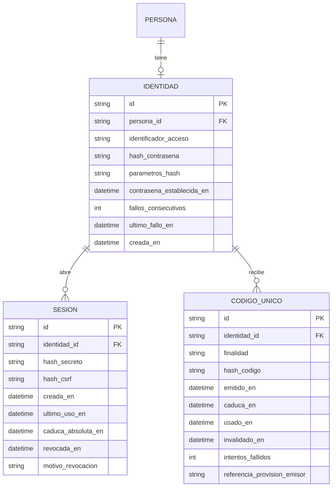

# ADR-002 — Autenticación y acceso de SMARTWORK

| | |
|---|---|
| **Estado** | **PROPUESTO** hasta resolver el mecanismo operativo de la provisión. La **arquitectura técnica de referencia** (sección 2) está aprobada por la persona responsable |
| **Versión** | 0.19 |
| **Fecha** | 2026-11-17 |
| **Relacionado con** | PA-12, RN-33 a RN-35, RN-38, RN-61, RN-64, RN-96 a RN-99, RN-102, RNF-08, IR-34, IR-37, IR-38, DM-07, DD-04, DD-05; ADR-001 |
| **Documentos complementarios** | `docs/modelo-datos/modelo-datos.md`, `docs/api/indice.md`, `docs/api/m1-m5-dependencias.md` |

Este ADR desarrolla la propuesta de autenticación. La persona responsable aprobó como arquitectura técnica de referencia los ocho puntos de la sección 2; lo que sigue **sin aprobar** es el mecanismo operativo de la provisión (secciones 7 a 11) y los valores de los parámetros. No decide el despliegue (DT-07) y no toca el alcance, el PRD, las historias ni el modelo de datos: su impacto estructural se presenta aparte (sección 10) para aprobación. No contiene credenciales, claves ni valores secretos.

## 1. Contexto y requisitos

| Requisito | Qué exige a la autenticación |
|---|---|
| RN-61 | Solo las personas identificadas acceden |
| RN-64, RNF-08 | Las credenciales nunca se muestran ni se registran en claro |
| RN-33 a RN-35 | Provisión administrativa controlada, sin tercer rol funcional ni panel avanzado; primer acceso seguro, individual y de un solo uso |
| RN-96, RN-97, IR-37, IR-38, DM-07 | La desactivación de acceso es inmediata y se comprueba en cada operación; una persona sin pertenencia vigente no opera |
| DD-05 | Recuperar una credencial no reactiva un acceso desactivado |
| RN-98 | Un supervisor con acceso desactivado no ejerce funciones |
| RN-102, IR-34 | Toda operación de provisión tiene autor identificable y trazabilidad, sin credenciales |
| ADR-001 | Flutter Web, FastAPI y PostgreSQL; autorización centralizada en el backend |

Quedan abiertos en PA-12: caducidad del acceso inicial, credencial propia en el primer ingreso, medio de entrega, verificación de identidad al recuperar y reactivación administrativa.

## 2. Arquitectura técnica de referencia (aprobada)

1. Identificación mediante credenciales propias (identificador y contraseña). El identificador lo asigna la provisión; no se exige correo electrónico.
2. Contraseñas protegidas con Argon2id.
3. Sesiones revocables en servidor, gestionadas por FastAPI y guardadas en PostgreSQL. Un identificador opaco viaja en una cookie con `HttpOnly`, `Secure` y `SameSite`.
4. Protección CSRF y HTTPS.
5. Código temporal de un solo uso para el primer acceso y la recuperación. La persona fija su propia contraseña al canjearlo.
6. Desactivación inmediata del acceso y revocación de sesiones en la misma transacción.
7. Provisión administrativa controlada, sin tercer rol funcional ni panel avanzado.

Fuera del MVP, por no tener respaldo en ningún requisito confirmado: autenticación multifactor, inicio único (SSO) con un proveedor de identidad externo, recuperación por autoservicio y envío de correo.

**Lo que este ADR propone y sigue sin aprobar:** el medio de entrega del código, la verificación de identidad al recuperar, la identificación y autorización de la persona operadora, la reactivación del acceso y los valores de los parámetros.

## 3. Alternativas consideradas

| Alternativa | A favor | En contra | Resultado |
|---|---|---|---|
| **A. Sesión en servidor con cookie** (propuesta) | Revocación inmediata; sin secretos en el cliente; el navegador gestiona la cookie; sin infraestructura nueva | Exige CSRF y un solo origen; estado en base de datos | Propuesta |
| B. Tokens (JWT) en el cliente | Sin estado en el servidor | Revocar es difícil y por eso habría que consultar el estado en cada petición de todos modos; guardarlos en el navegador los expone a XSS | No propuesta |
| C. Proveedor de identidad externo (OIDC) | Delega credenciales y MFA | Dependencia externa y coste; la organización quizá no tiene proveedor; más superficie de integración | Descartada para el MVP; reevaluar si la organización ya lo tiene |
| D. Enlace por correo («passwordless») | Sin contraseñas | Exige infraestructura de correo y que el correo sea el canal de confianza | Descartada para el MVP |

## 4. Modelo de identidad, sesiones y códigos temporales

Son estructuras **técnicas fuera de las nueve entidades de dominio**. Se necesitan porque RN-64 impide guardar credenciales en `PERSONA` y porque el modelo (principio P8) ya reservaba la identidad para esta decisión.

| Estructura | Reglas |
|---|---|
| `IDENTIDAD` | Una por persona (relación 1 a 0..1). `identificador_acceso` único y normalizado; no es un dato de contacto. `hash_contrasena` vacío hasta completar el primer acceso. `parametros_hash` permite volver a calcular el hash al subir los parámetros. No contiene la contraseña ni nada reversible |
| `SESION` | Solo se guarda el hash del secreto de la sesión y del token CSRF, de modo que una fuga de la base de datos no entrega sesiones vivas. El secreto se genera con un generador criptográfico. Nunca se reutiliza un identificador de sesión |
| `CODIGO_UNICO` | Se guarda solo el hash. Finalidad: primer acceso, recuperación o reactivación. Un solo uso, con caducidad y contador de intentos. La referencia del emisor es no secreta y coincide con `referencia_provision` de la auditoría |
| Dominio | `PERSONA.acceso_desactivado_en` (aprobado) sigue siendo la fuente de verdad de la desactivación. La política de autorización lo consulta en cada operación (DM-07) |
| Auditoría | Se usa `AUDITORIA` con `tipo_autor` igual a provisión (IR-34). Nunca contiene contraseñas, códigos, hashes ni secretos de sesión |

## 5. Ciclo de vida de las sesiones

1. **Creación.** Tras verificar la contraseña se genera un identificador nuevo (se descarta cualquier identificador previo, contra la fijación de sesión) y un token CSRF asociado.
2. **Uso.** En cada petición, la política comprueba por orden: la sesión existe, no está revocada ni caducada → la identidad existe → `acceso_desactivado_en` vacío (IR-37) → pertenencia vigente (IR-38) → para métodos que modifican, el token CSRF. Solo entonces se evalúa la autorización del recurso (convenciones de la API, 3.2). La actualización de `ultimo_uso_en` se limita en frecuencia para no escribir en cada petición.
3. **Caducidad.** Dos límites impuestos en el servidor: inactividad máxima y duración absoluta. Los valores son parámetros de configuración (sección 14, decisión A9). Borrar la cookie no invalida la sesión: la caducidad y la revocación viven en el servidor.
4. **Revocación inmediata** al: cerrar sesión; cambiar la contraseña o completar una recuperación (todas las sesiones de la persona); desactivar el acceso (misma transacción que fija `acceso_desactivado_en`); reactivar el acceso (se parte sin sesiones). La finalización de la pertenencia no necesita revocar: IR-38 deja de permitir operar en la fecha efectiva.
5. **Sesiones simultáneas.** Se permiten varias por persona (varios navegadores). Un límite de sesiones no está requerido.
6. **Mantenimiento.** Una purga periódica de sesiones caducadas y de códigos usados o caducados limita el tamaño de la tabla. Es mantenimiento del propio mecanismo, no una funcionalidad.

## 6. Primer acceso y recuperación

**Primer acceso** (RN-35)

1. La provisión crea la persona y su identidad (sin contraseña) y emite un código de un solo uso. La orden lo muestra **una sola vez** a quien opera; no se guarda en claro.
2. La persona recibe el código por el medio de la sección 8.
3. En el canje, la persona presenta el identificador de acceso, el código y una contraseña nueva. En una sola operación atómica: se comprueba que el código es válido, no está usado ni caducado, y que el acceso no está desactivado; se establece el hash de la contraseña; se marca el código como usado; se revocan sus sesiones.
4. La persona inicia sesión de forma normal. No se abre sesión automática, para que haya un único camino de creación de sesiones.

**Recuperación** (RN-34)

1. La persona avisa a la organización de que perdió el acceso. La provisión verifica su identidad **fuera de banda** según el procedimiento de la organización (decisión A5).
2. La provisión emite un código de recuperación. El canje es igual al del primer acceso: fija una contraseña nueva y revoca todas las sesiones.
3. **Si el acceso está desactivado, el canje se rechaza** (DD-05): recuperar una credencial no reactiva el acceso.

**Respuestas uniformes.** Un código desconocido, usado, caducado o de un acceso desactivado produce la misma respuesta, para no revelar cuál es el caso. Un identificador de acceso inexistente y una contraseña incorrecta también producen la misma respuesta (sin enumeración de identificadores).

## 7. Parámetros de duración, caducidad e intentos, con fuentes

**Cómo leer las fuentes.**

- **NIST SP 800-63B-4** es una guía de identidad digital pensada para los servicios de las agencias federales de EE. UU. No es una obligación legal para SMARTWORK: se usa como **referencia técnica**. Sus requisitos dependen del nivel de garantía de autenticación (AAL1, AAL2 o AAL3) y del tipo de autenticador. Dentro de la guía, «obligatorio» (SHALL) es lo que exige a quien la aplica, «recomendado» (SHOULD) admite excepciones justificadas y «opcional» (MAY) deja libertad. Aquí se indica la fuerza de cada cifra tal como figura en el texto leído el 2026-11-06.
- **OWASP Cheat Sheet Series** reúne **buenas prácticas** de la comunidad; no son normas ni requisitos.
- SMARTWORK no declara conformidad con ninguna de estas guías. Cada valor se propone y la persona responsable lo aprueba.
- Las cifras de OWASP sobre tiempos de sesión y limitación de intentos no se pudieron verificar y no se usan.

| Parámetro | Fuente y fuerza | Alcance y condiciones | Propuesta (no aprobada) |
|---|---|---|---|
| **Duración total de la sesión** | NIST §2.1.3 (AAL1): hay que establecer un plazo total, recomendado de no más de 30 días. §2.2.3 (AAL2): recomendado no más de 24 horas. §2.3.3 (AAL3): obligatorio no más de 12 horas | Los niveles dependen del tipo y número de factores. SMARTWORK usa solo contraseña (nivel comparable a AAL1), así que NIST admitiría más tiempo del propuesto | **24 horas**: se toma la referencia de AAL2 por prudencia, ya que hay información laboral de personas y posibles equipos compartidos. Es una decisión de riesgo, no una exigencia de NIST. **Aprobado el 2026-11-17** (parámetro `SESSION_ABSOLUTE_MINUTES`, 1440) |
| **Inactividad de la sesión** | NIST: opcional en AAL1; recomendado no más de 1 hora en AAL2 y no más de 15 minutos en AAL3 | Ídem | **1 hora** (referencia de AAL2). La actividad reinicia el contador. **Aprobado el 2026-11-17** (parámetro `SESSION_IDLE_MINUTES`, 60) |
| **Intentos fallidos de inicio de sesión** | NIST §3.2.2: obligatorio limitar los intentos fallidos consecutivos de un autenticador de una cuenta a no más de 100, deshabilitándolo; es un tope y se pueden fijar límites menores. Opcional: esperas crecientes, «por ejemplo, de 30 segundos hasta una hora». Recomendado reiniciar el contador tras un acierto | Se aplica a la verificación de autenticadores como la contraseña | Espera creciente de 30 segundos a una hora y deshabilitar la contraseña a los 100 fallos consecutivos (recuperable con M1-09a). Los extremos de la espera son el ejemplo de NIST, no un valor exigido. **Aprobado e implementado el 2026-11-17 (M1-T7), salvo el tope de 100:** cinco intentos libres; esperas de 30 s, 1, 2, 4, 8, 16 y 32 min y 1 hora de máximo, por identificador normalizado y origen; olvido a las 24 horas; reinicio tras un acierto; límites por origen de 30 en 5 minutos y 200 en 1 hora. **El tope agregado de 100 y la deshabilitación automática NO se implementan todavía** (desviación temporal de NIST §3.2.2, obligatorio como tope; a revisar con la recuperación segura de M1-T8) |
| **Código de un solo uso: entropía** | NIST §4.2.1.1: obligatorio al menos 64 bits en un código de recuperación guardado. §4.2.1.2: obligatorio al menos seis dígitos decimales en uno emitido, con limitación de intentos | Cada sección describe un caso de recuperación de cuenta concreto; el código de SMARTWORK se asimila por analogía | **128 bits**, con 64 como mínimo si la usabilidad lo desaconsejara |
| **Código: validez** | NIST §3.1.3.2: obligatorio como máximo 10 minutos para un secreto fuera de banda, de un solo uso. §4.1.2: 10 minutos y un solo uso para un código de vinculación. §4.2.1.2: máximos de 10 minutos por texto o voz, 24 horas por correo y 21 o 30 días por correo postal | Cada máximo corresponde a un canal; no se aplican en bloque | **10 minutos** con la entrega directa de la sección 8. Si se adoptara un canal asíncrono, el máximo de referencia es 24 horas |
| **Código: intentos de canje** | NIST §4.2.1.2: la verificación de un código emitido queda sujeta a la limitación de §3.2.2. §3.2.10 fija 10 intentos para secretos de activación | §3.2.10 es una referencia indirecta, no un requisito para este código | Invalidar el código tras **10** canjes fallidos |
| **Contraseña** | NIST §3.1.1.2: obligatorio un mínimo de 15 caracteres si es el único factor; recomendado admitir al menos 64; obligatorio **no** imponer reglas de composición y **no** exigir cambios periódicos (salvo evidencia de compromiso); obligatorio compararla con una lista de contraseñas conocidas o comprometidas | Las cifras de longitud cambian si la contraseña es un factor entre varios | **10 caracteres** como mínimo, hasta 64 o más, sin composición ni caducidad. **Decisión de la persona responsable (versión 0.4):** se aparta a propósito de los 15 de NIST para simplificar la política. NIST es una referencia y no una obligación de SMARTWORK (ver arriba). El riesgo asumido es que una contraseña corta es más fácil de adivinar si es el único factor; lo mitigan Argon2id, el almacenamiento solo del hash y la ausencia de reglas de composición, pero la limitación de intentos fallidos (NIST §3.2.2) **solo está implementada parcialmente (M1-T7): esperas crecientes y límites por origen, sin el tope agregado de 100**, y su importancia crece con una contraseña más corta. El mínimo es el parámetro `PASSWORD_MIN_LENGTH`. La lista de contraseñas comprometidas sigue siendo una dependencia por decidir (A8) |
| **Hash** | OWASP Password Storage Cheat Sheet: Argon2id con un mínimo de 19 MiB de memoria, 2 iteraciones y paralelismo 1 (recomendación) | Buena práctica, a calibrar en el entorno real | Parámetros no inferiores a ese mínimo |
| **Identificador de sesión** | OWASP Session Management Cheat Sheet: al menos 64 bits de entropía (recomendación) | Buena práctica | **128 bits** |

## 8. Entrega segura del código inicial y verificación de la identidad al recuperar

### 8.1 Entrega del código

| Opción | Evaluación |
|---|---|
| **a. Entrega directa, en el momento de emitirlo** (recomendada) | Una persona operadora lo emite y se lo comunica a la persona, presencialmente o por una llamada en directo tras verificar su identidad. Encaja con la validez de 10 minutos. No necesita infraestructura nueva |
| b. Enlace por correo corporativo | NIST admite hasta 24 horas con este canal, pero el código queda en una bandeja de entrada y exige que ese correo sea de confianza |
| c. Mensajería corporativa | El código queda en un historial fuera de nuestro control |
| d. Correo postal | NIST admite hasta 21 días; inviable para el uso previsto |

**Procedimiento propuesto (opción a):** (1) la persona operadora verifica la identidad de quien recibe el código (8.2); (2) emite el código, que se muestra una sola vez en su terminal; (3) se lo comunica en directo; (4) la persona lo canjea de inmediato y fija su contraseña (M1-03b); (5) si pasan 10 minutos, se emite otro; (6) el código nunca se escribe en tickets, chats, correos ni documentos; (7) quien opera no conoce la contraseña.

### 8.2 Verificación de la identidad durante la recuperación

| Opción | Evaluación |
|---|---|
| **a. Verificación fuera de banda por la persona operadora** (recomendada) | La persona operadora comprueba la identidad por un canal independiente de la cuenta perdida: presencialmente o por una llamada o videollamada en directo con alguien que conoce a la persona. Lo que declara haber hecho se registra en la emisión (`verificacion`) |
| b. Preguntas de conocimiento | Descartada: NIST prohíbe pedir autenticación basada en conocimiento (§3.1.1.2) |
| c. Aval del supervisor | No es posible: el supervisor no tiene funciones de provisión (RN-33, CA-28). Podría actuar como fuente de confirmación, no como quien emite |
| d. Control de dos personas operadoras | Añade seguridad frente a la suplantación por la propia persona operadora; solo es posible con dos o más |

**Recomendación mínima viable:** a. Con dos o más personas operadoras, aplicar también d a la recuperación de cuentas de supervisores y de personas operadoras. Con una sola, la confianza recae en ella; es un riesgo residual reconocido (sección 13).

## 9. Persona operadora de provisión: identificación y autorización

**Principio: tener acceso al servidor no equivale a tener autorización administrativa.** El acceso al servidor lo da la infraestructura (DT-07); la autorización para provisionar es una concesión explícita de la aplicación, separada de ella.

| Alternativa | Evaluación |
|---|---|
| A. La cuenta del sistema operativo es la persona operadora | Descartada: confunde acceso al servidor con autorización. Quien puede abrir una terminal quedaría autorizada |
| B. Lista de operadores en un fichero de configuración | Descartada como única barrera: quien tiene acceso al servidor puede editarlo, así que es circular |
| **C. Registro de personas operadoras con credencial propia** (recomendada) | La aplicación guarda un registro `OPERADOR` (identificador, hash de credencial con Argon2id, estado). Cada orden exige identificarse como persona operadora con esa credencial, aunque se tenga acceso al servidor. La concesión y revocación quedan auditadas |
| D. Interfaz interna con sesiones de operador | Mismo registro que C, con más superficie de ataque. Compatible si el despliegue lo aconsejara |

**Propuesta mínima viable: C.**

- **Identificación:** el identificador nominal y la credencial de la persona operadora, verificada por la aplicación en cada invocación (sin sesión persistente). Las mismas reglas de contraseña y de limitación de intentos que para las personas. Se recomienda además proteger el acceso al servidor con una clave por persona, como defensa en profundidad.
- **Autorización:** una persona operadora activa puede ejecutar las órdenes de provisión. No tiene permisos de colaboración ni de supervisión, ni es un rol del producto (RN-33).
- **Alta de la primera persona operadora:** un procedimiento de instalación, documentado, genera un código de un solo uso para la primera, que se desactiva al usarse. Las siguientes las concede una persona operadora existente; con dos o más, el alta y la revocación exigen el control de dos personas.
- **Auditoría:** cada orden deja una entrada con `tipo_autor` igual a provisión y `referencia_provision` con el identificador de la persona operadora y el de la invocación (IR-34). También se auditan el alta, la revocación y los intentos fallidos de identificación de personas operadoras. Nunca se registran credenciales.
- **Separación de privilegios:** la aplicación usa un rol de base de datos con los privilegios mínimos. Ninguna persona con acceso al servidor debe tener acceso de administración a la base de datos por el mero hecho de tenerlo al servidor (DT-07).
- **Limitación honesta:** con una sola persona que administra todo, la separación es nominal: quien administra la base de datos puede escribir en ella directamente. Se mitiga con la auditoría de solo anexado y con enviar copias de los registros a un destino que esa persona no pueda modificar, si el despliegue lo permite.
- **Órdenes previstas:** crear persona y equipo; registrar, cancelar y sustituir pertenencias; finalizar pertenencia; emitir códigos; desactivar y reactivar el acceso; gestionar personas operadoras; listar los equipos pendientes de supervisión efectiva (DM-09).

## 10. Impacto estructural en el modelo de datos (presentado, no aplicado)

| Cambio | Detalle |
|---|---|
| Cuatro estructuras técnicas nuevas | `IDENTIDAD`, `SESION` y `CODIGO_UNICO` (sección 4) y `OPERADOR` (sección 9: identificador, hash de credencial, estado, concedida por, revocada en) |
| Sin cambios en las nueve entidades | `PERSONA.acceso_desactivado_en` ya existe; `AUDITORIA` ya distingue el tipo de autor |
| Nueva operación de auditoría | Emisión de código, canje, reactivación de acceso. Entran como tipos de operación de `AUDITORIA` |
| Relación | `PERSONA` 1 a 0..1 `IDENTIDAD`. La persona sin identidad es válida mientras no se complete el primer acceso |
| Reglas nuevas | Unicidad del identificador de acceso; un código solo se canjea una vez, de forma atómica; una sesión solo es válida si la identidad no está desactivada |
| Pendiente de definir en el alcance | La reactivación administrativa del acceso (OP-12, PA-12) no tiene regla ni historia; hay que especificarla antes de contratarla |

## 11. Reactivación controlada de un acceso desactivado

Orden de provisión propuesta. **No existe regla ni historia que la respalde**; necesita una RN antes de especificarse como contrato (M1-10).

**Condiciones y efectos propuestos**

1. La ejecuta una persona operadora autorizada (sección 9). Con dos o más personas operadoras, la aprueba una segunda.
2. Exige un **motivo**, que se registra en la auditoría con autor de provisión. La organización es quien confirma que la causa de la desactivación está resuelta; la aplicación no lo comprueba.
3. Pone `acceso_desactivado_en` a vacío.
4. **Invalida las credenciales anteriores**, vaciando el hash de la contraseña e invalidando los códigos pendientes: la desactivación puede deberse a un compromiso, así que se parte de un primer acceso nuevo, con un código nuevo (M1-03a).
5. No restablece sesiones: ya estaban revocadas.
6. No toca la pertenencia: la persona solo opera si tiene una pertenencia vigente (IR-38).
7. No restaura ni transfiere permisos de supervisión: los da el intervalo de supervisor vigente (RA-12). Si el equipo estaba pendiente de supervisión efectiva, deja de estarlo cuando su supervisor asignado vuelve a tener acceso efectivo.

**Borrador de regla para el alcance (no aplicado):** «La reactivación administrativa de un acceso desactivado requiere una operación de provisión con motivo, invalida las credenciales anteriores y exige un nuevo primer acceso. No restablece sesiones ni modifica pertenencias.»

## 12. CSRF, cookies, HTTPS y condiciones de despliegue

| Aspecto | Propuesta |
|---|---|
| Origen de la petición (M1-T7, DT-07) | El control de intentos usa la dirección de la conexión. `X-Forwarded-For` se acepta **únicamente** si la conexión viene de un proxy expresamente configurado como de confianza (`TRUSTED_PROXIES`: direcciones o redes CIDR) y se recorre de derecha a izquierda saltando los proxies de confianza, de modo que lo que escribe el cliente nunca se acepta mientras haya una dirección anterior añadida por un proxy propio. Vacío (por defecto) = ninguna. **Antes de desplegar en AWS ECS** hay que configurar las redes del balanceador en `TRUSTED_PROXIES` (con uvicorn en `--no-proxy-headers`) o, de forma equivalente, `--proxy-headers` con `--forwarded-allow-ips` limitado a esas redes (nunca `*`): sin ello todas las personas comparten origen. No está comprobado en ECS |
| Cookie de sesión | Con prefijo `__Host-`, `Secure`, `HttpOnly`, `SameSite=Strict`, `Path=/` y sin atributo `Domain`. Evita la falsificación desde subdominios y la degradación a HTTP (OWASP) |
| CSRF | Token de sincronización asociado a la sesión, enviado en una cabecera propia en todo método que modifica, más verificación del origen (`Origin`, o `Referer` si falta). `SameSite` se trata como defensa adicional, no como sustituto (OWASP) |
| CORS | Deshabilitado: la aplicación y la API comparten origen |
| HTTPS | Solo HTTPS, con HSTS. La cookie nunca viaja por HTTP |
| Respuestas autenticadas | `Cache-Control: no-store`, para equipos compartidos |
| Origen único | Flutter Web servido desde el mismo origen que `/api/v1`, mediante un proxy inverso que enruta por ruta. **Condición de despliegue (DT-07)** |
| Cabeceras de seguridad | Política de seguridad de contenido adecuada a Flutter Web. Sus requisitos (por ejemplo, WebAssembly) deben verificarse; no se asumen |
| Reloj | La caducidad depende del reloj del servidor: debe estar sincronizado |
| Secretos y copias | Los secretos de configuración no van en el repositorio. Las copias de seguridad contienen hashes y sesiones: cifradas y con la misma purga |

## 13. Riesgos y pruebas de seguridad

| Riesgo | Mitigación | Prueba prevista |
|---|---|---|
| Relleno de credenciales y adivinación | Retraso progresivo, límite por origen, lista de contraseñas filtradas | Intentos repetidos: el retraso crece y no se bloquean cuentas ajenas de forma permanente |
| Enumeración de identificadores | Respuestas y tiempos uniformes en inicio de sesión y canje | Comparar respuestas de identificadores existentes e inexistentes |
| Fijación de sesión | Identificador nuevo al iniciar sesión | El identificador anterior al inicio no sirve después |
| CSRF | Token, cabecera propia, `Origin`, `SameSite=Strict` | Petición modificadora desde otro origen y sin token: rechazada |
| XSS que exponga la sesión | `HttpOnly`; política de contenido; sin secretos en el almacenamiento del navegador | Revisión de que ningún dato de sesión es accesible por script |
| Reutilización de un código | Canje atómico; un solo uso | Dos canjes simultáneos del mismo código: solo uno tiene éxito |
| Persona desactivada que sigue operando | Comprobación en cada petición (DM-07); revocación en la misma transacción | **Criterio de aceptación:** tras desactivar, la siguiente petición con una sesión previa se rechaza |
| Recuperación que reactiva (DD-05) | El canje rechaza accesos desactivados | Recuperar a una persona desactivada: sigue desactivada (CA-254) |
| Operador malintencionado | Cuentas nominales, auditoría, control de dos personas opcional | Revisar que toda orden deja su entrada |
| Secretos en registros | Los registros de la aplicación excluyen contraseñas, códigos y cabeceras de sesión | Búsqueda en registros tras flujos completos |
| Fuga de la base de datos | Hash de contraseñas, de sesiones y de códigos | Comprobar que ninguna tabla contiene valores utilizables |
| Fallo del control de acceso | Orden de evaluación fijo; respuestas indistinguibles (T-01) | Matriz de permisos por rol y equipo (RNF-01) |

Se propone además un registro técnico de eventos de autenticación (éxito, fallo, revocación), sin secretos, separado de la auditoría de dominio, para detectar abusos. Su retención depende de PA-06 y no se asume.

**Implementado en M1-T7 (2026-11-17):** el retraso progresivo por (cuenta, origen) con reserva atómica, los límites por origen, las respuestas uniformes y el registro técnico de eventos (A11) con retención técnica inicial de 30 días y purga por la CLI. **Sigue sin implementar** el tope agregado de 100 con deshabilitación de la contraseña y, por tanto, **no se declara resuelto el riesgo de adivinación distribuida**: el contador por cuenta y origen no la frena. La prueba prevista (el retraso crece y no se bloquean cuentas ajenas de forma permanente) está cubierta con pruebas deterministas, de concurrencia y de extremo a extremo.

## 14. Decisiones

**Aprobadas como arquitectura técnica de referencia:** las de la sección 2.

**Pendientes de aprobación**

| Id | Decisión | Recomendación |
|---|---|---|
| A2 | Mecanismo operativo de la provisión: órdenes en el servidor, sin superficie HTTP | Sí |
| A3 | La persona fija su propia contraseña al canjear el código | Sí (implícita en la arquitectura aprobada). **Aprobada el 2026-11-17**; el canje llega en T8.3 |
| A4 | Caducidad, entropía e intentos de los códigos (sección 7) | 10 minutos, 128 bits, 10 intentos. **Aprobada el 2026-11-17**; generación, vigencia, uso único e invalidación a los 10 intentos **implementados en el modelo (M1-T8.1)**; la integración con los límites de M1-T7 llega con el canje |
| A5 | Verificación de identidad al recuperar (sección 8.2) | Fuera de banda por la persona operadora; dos personas cuando haya dos o más. **Aprobada el 2026-11-17 (sin el control de dos personas, que exige una segunda persona operadora que hoy no puede existir)** con registro estructurado de operadora, fecha, procedimiento y evidencia administrativa; se implementa en T8.2 |
| A6 | Medio de entrega (sección 8.1) | Entrega directa en el momento de emitir. **Aprobada el 2026-11-17**: sin correo electrónico ni SMS por ahora; se muestra una sola vez y solo en una terminal interactiva (T8.2) |
| A7 | Quién es la primera persona operadora y cómo se identifica | Registro `OPERADOR` con credencial propia (sección 9, opción C) |
| A8 | Política de contraseñas y lista de contraseñas comprometidas | **10 caracteres** como mínimo (decidido por la persona responsable en la versión 0.4), sin composición; lista a incorporar |
| A9 | Duración e inactividad de la sesión, y espera e intentos del inicio de sesión | 24 horas, 1 hora, espera de 30 segundos a 1 hora y tope de 100. **Aprobada el 2026-11-17 salvo el tope de 100** (ver abajo) |
| A10 | Regla (RN) de la reactivación administrativa | Sí, con las condiciones de la sección 11. **Fuera de alcance de M1-T8 (decisión del 2026-11-17)** |
| A11 | Registro técnico de eventos de autenticación, sin secretos | Sí. **Aprobada el 2026-11-17** con retención técnica inicial de 30 días (PA-06 general pendiente) |
| A12 | Aprobar las cuatro estructuras técnicas de la sección 10 | Sí |

**Aprobadas el 2026-11-11 por la persona responsable:** **A2** (la provisión se realiza con órdenes de línea de comandos en el servidor, sin endpoints HTTP administrativos) y **A7** (opción C: entidad `OPERADOR` con credencial propia). Además: rol de base de datos de provisión separado del propietario y con privilegios mínimos; IR-32 validada en el servicio y, cuando se compruebe con pruebas que admite las operaciones temporales válidas, con una protección diferida en la base de datos; nombre de equipo único por organización y motivo obligatorio para desactivar un acceso; y reloj inyectable en las operaciones de provisión. **Siguen pendientes de aprobación específica, con sus parámetros completos, A4, A5, A6, A8 (la longitud mínima de 10 caracteres ya está decidida), A9 y A10**, y no se implementan hasta entonces. El detalle y el orden de implementación están en [m1-plan-implementacion.md](../../backlog/tickets/m1-plan-implementacion.md).

**Aprobado el 2026-11-17 (M1-T7):** cinco intentos fallidos iniciales sin espera; a partir del siguiente intento restringido, la espera es de 30 s y se duplica (30 s, 1, 2, 4, 8, 16 y 32 min) hasta un máximo de 1 hora (tras 32 min, 1 hora); contador por identificador normalizado y origen; el contador se olvida tras 24 horas sin nuevos fallos y un inicio correcto lo reinicia; límites por origen de 30 intentos en 5 minutos y de 200 en 1 hora (configurables y sin bloqueos permanentes); identificadores de control solo como HMAC con `AUTH_PEPPER` (secreto nuevo, independiente y no versionado); sesión de 24 horas como máximo y 1 hora de inactividad; origen de la petición según la dirección de la conexión, con las cabeceras de un proxy solo si está expresamente configurado como de confianza (DT-07); eventos técnicos de A11 (inicio correcto, inicio fallido, espera aplicada, cierre de sesión, acceso desactivado durante la autenticación y revocación por desactivación) con retención técnica inicial de 30 días y procedimiento de purga; la persona operadora con la misma curva y un contador separado, sin deshabilitarla nunca. **No se implementa todavía** el tope agregado de 100 fallos con deshabilitación automática de la contraseña (desviación temporal registrada).

**Interpretaciones adoptadas por la implementación, CONFIRMADAS el 2026-11-17 (la 5 y la 6 con las precisiones indicadas):** (1) «cinco fallos iniciales sin espera» significa cinco intentos inmediatos: el sexto intento es el primero restringido y espera 30 s desde el quinto fallo, el séptimo 1 min, y así hasta la hora; (2) «hasta un máximo de 1 hora» sigue a los 32 min: el intento siguiente espera 1 hora y se mantiene; (3) en los límites por origen cuentan los intentos FALLIDOS (cada inicio correcto devuelve su reserva), para no penalizar a una red compartida por sus aciertos; (4) las peticiones denegadas por espera o por límite no cambian ningún contador (no prolongan la espera); (5) **CORREGIDA el 2026-11-17:** solo una autenticación COMPLETA (contraseña correcta, acceso habilitado y pertenencia vigente) reinicia el contador y devuelve la reserva de origen, en la misma transacción que crea la sesión; con el acceso desactivado o sin pertenencia vigente se rechaza (403) sin reiniciar nada y el intento sigue contando, de modo que no se pueden sondear sin límite contraseñas de una cuenta que no puede operar; (6) la auditoría funcional de la desactivación registra SIEMPRE la operación efectiva; el evento técnico de revocación se genera solo si realmente había sesiones que revocar (no se cuentan sesiones ya revocadas ni inexistentes) y no guarda identificadores de sesión, tokens ni secretos (solo el número de sesiones y la invocación); (7) las direcciones IPv6 se tratan completas, sin agrupar por prefijo (riesgo de rotación de direcciones documentado).

**Riesgos pendientes (no resueltos por M1-T7):** (a) sin el tope agregado de 100 fallos por cuenta, un ataque DISTRIBUIDO desde muchos orígenes no lo frena el contador por cuenta y origen (solo los límites por origen); la decisión se revisará con la recuperación segura (M1-T8, M1-09a), porque deshabilitar la contraseña es en sí un vector de bloqueo ajeno; (b) quien comparte origen con la víctima puede retrasarla hasta 1 hora por espera (riesgo residual aceptado: nunca es permanente); (c) un origen IPv6 puede rotar entre direcciones de su prefijo y esquivar los límites por origen; (d) DT-07: detrás de un balanceador (AWS ECS) hay que configurar `TRUSTED_PROXIES` (o `--forwarded-allow-ips` en uvicorn) con las redes del balanceador; sin ello todas las personas comparten origen y la protección degenera en la de solo cuenta; (e) la purga de eventos es una orden de la CLI y NO hay planificador: hasta que el despliegue la programe, los eventos crecen; PA-06 (retención general de auditoría) sigue pendiente; (f) el contador de la persona operadora no tiene origen (es una orden local del servidor) y la persona operadora nunca se deshabilita: un ataque con acceso al servidor puede retrasarla hasta 1 hora por espera.

**Aprobado el 2026-11-17 para M1-T8 (con revisión y autorización individual de cada subpaso T8.1 a T8.6):** **A3** la persona establece su propia contraseña al canjear el código; **A4** código aleatorio criptográfico de 128 bits, vigencia de 10 minutos con entrega directa, máximo de 10 intentos de canje fallidos por código e integración posterior con los límites de M1-T7; **A5** verificación de identidad fuera de banda, con registro de la persona operadora, la fecha, el procedimiento y la evidencia administrativa sin datos sensibles innecesarios, y una emisión de recuperación que no dependa solo de un texto libre sin trazabilidad; **A6** entrega directa, sin correo electrónico ni SMS por ahora; **A8** mínimo de 10 caracteres, sin reglas de composición ni caducidad periódica y comprobación de contraseñas comprometidas con una lista LOCAL, mantenida y de procedencia documentada, cuya selección y cobertura se revisan en T8.6; **A10** la reactivación del acceso queda fuera de alcance. **Técnicas:** D1 HMAC para guardar los códigos con un secreto independiente de `AUTH_PEPPER` (`CODE_PEPPER`) y no versionado; D2 estrategia `SECURITY DEFINER` para el canje, aprobada condicionalmente (hay que demostrar que no permite escalada de privilegios; no se implementa hasta T8.3); D3 revisar los tipos de auditoría existentes antes de crear otros; D4 la emisión mostrará el código una sola vez y solo en una terminal interactiva; D5 reservar `CODIGO_NO_VALIDO` y `CONTRASENA_NO_VALIDA` sin revelar datos de cuentas; D6 retención técnica de 30 días para códigos terminados con purga controlada, sin tocar la retención de la auditoría funcional; D7 una contraseña que incumple la política no consume el código y los intentos de canje se limitan y cuentan de forma segura; D8 `contrasena_establecida_en`; D9 separación de dominios para reutilizar el control de intentos de M1-T7; D10 la solicitud de recuperación es administrativa y fuera de banda, sin endpoint público.

**Implementado en M1-T8.1 (2026-11-17): solo el modelo, la generación segura y la política de contraseñas. El primer acceso y la recuperación NO son funcionales:** no existe ninguna orden de emisión, ninguna ruta de canje ni ninguna función de canje (T8.2 a T8.6). Migración 0014: `identidad.contrasena_establecida_en` (la mantiene un disparador; hay hash exactamente cuando hay fecha) y la tabla `codigo_unico` (solo el HMAC del código, finalidad, vigencia, uso, invalidación, intentos fallidos y referencia no secreta de quien emite). Invariantes en la base, con el reloj de PostgreSQL y sin depender de quien la llame: un solo código pendiente por identidad y finalidad; la finalidad corresponde al estado de la contraseña y nunca se emite a un acceso desactivado (DD-05); `emitido_en` lo fija la base y la vigencia no pasa de 24 horas; uso único y solo antes de caducar; un código usado o invalidado no vuelve a cambiar; los intentos fallidos solo crecen de uno en uno y al llegar a 10 el código se invalida; el hash, la identidad, la finalidad, la emisión y la vigencia no se modifican; solo se borra pasados 30 días desde que terminó. Permisos: la aplicación no tiene ninguno sobre `codigo_unico`; la provisión inserta las columnas de emisión, lee todo menos el hash y solo puede poner `invalidado_en`; nadie salvo el propietario lee un hash. La provisión además pierde la posibilidad de insertar una identidad con contraseña. Código: `app/seguridad/codigos.py` (128 bits con `secrets`, representación Crockford Base32 de 26 caracteres, normalización estricta y HMAC-SHA256 con `CODE_PEPPER`), `app/seguridad/politica_contrasenas.py` (A8, con el punto de enganche de la lista local), `app/provision/codigos.py` (registro interno: invalida el pendiente anterior y registra el nuevo bajo los bloqueos de persona y de (identidad, finalidad), con la vigencia calculada por PostgreSQL), los códigos `CODIGO_NO_VALIDO` y `CONTRASENA_NO_VALIDA` reservados en el catálogo de errores y la clave de control de intentos del canje con dominio propio (`clave_de_canje`). Verificado: 48 pruebas nuevas de T8.1 (generación y entropía, entrada canónica, HMAC e independencia del secreto, política de contraseñas, invariantes y permisos en PostgreSQL con cada rol, uso único con 8 canjes simultáneos, emisiones simultáneas, migración con datos y reversión) y 429 pruebas focalizadas superadas (login, intentos, desactivación, provisión, semilla, cuentas y las nuevas), sobre una base desechable; se ajustaron 3 pruebas existentes de migraciones (versión del esquema y lista explícita de columnas de identidad). No se ejecutaron mutaciones ni la suite completa (metodología ligera del 2026-11-17). Sin Flutter.

**Cierre técnico de M1 (M1-T9, 2026-11-17).** Matriz completa en `docs/evidencia/matriz-trazabilidad-m1.md`: 65 criterios: 48 implementados y probados, 15 parciales, 2 bloqueados por otro módulo (M4 o M5), 0 pendientes y 0 fuera de alcance; 13 contratos implementados y probados y M1-10 fuera de alcance aprobado. Los criterios parciales o bloqueados lo son por la ausencia de M4 (consulta ajena, vista consolidada, supervisión) o de M5 (informes): la política de visibilidad histórica que M4 necesita está implementada y probada, pero ninguna ruta la usa todavía. **Regresión:** backend 2804 superadas y 1 omitida a propósito, Flutter 654 superadas y `flutter analyze` sin incidencias; migraciones 0001 a 0017 verificadas sobre una base desechable (orden, reversibilidad, permisos, funciones `SECURITY DEFINER`, restricciones y disparadores); recorrido integral real con FastAPI, Flutter Web compilado y PostgreSQL desechable (provisión por la CLI, primer acceso y recuperación en Chrome, M2 y M3 por HTTP, traslados programados, cancelación, sustitución, finalización, desactivación y conservación del historial). **No se declara activa la comprobación de contraseñas comprometidas** mientras el conjunto de Pwned Passwords no esté instalado. **Pendientes para producción:** instalar Pwned Passwords; tope agregado y ataques distribuidos; proxies de confianza; programar las purgas; control de dos personas; reactivación (M1-10, sin contrato); verificación de roles y permisos, y secretos en el despliegue; identificadores explícitos para los enlaces de auditoría históricos. Decisión de la persona responsable el 2026-11-17: la integración con Pwned Passwords queda aprobada como implementación; **no se descargan los ≈ 81 GB en el entorno de desarrollo**; la instalación completa, la verificación de integridad y las mediciones de funcionamiento son tareas de preparación del despliegue; **frecuencia de actualización propuesta: trimestral, pendiente de validación operativa** `[PROPUESTO]`.

**Implementado en M1-T8.6 (2026-11-17): endurecimiento y cierre del flujo de primer acceso y recuperación; cobertura de contraseñas comprometidas con Pwned Passwords (versión 0.18).** Sin reimplementar T8.1 a T8.5. **(1) Contraseñas comprometidas: Pwned Passwords de Have I Been Pwned, instalado en local (fuente elegida por la persona responsable el 2026-11-17). Mecanismo implementado y probado; la COBERTURA REAL exige instalar el conjunto (unos 81 GB) en cada despliegue y NO está instalado en el entorno de desarrollo.** **Términos** (<https://haveibeenpwned.com/termsofuse>, última actualización indicada: 27 de octubre de 2026; consultados el 2026-11-17): Pwned Passwords, incluidos sus conjuntos de hashes descargables, puede usarse para cualquier fin lícito, también en productos comerciales; no exige atribución; no se puede revender ni usar para construir un servicio sustancialmente similar. Por eso el conjunto no se versiona ni se redistribuye (`backend/data/` está en `.gitignore`): cada despliegue lo obtiene de la fuente. **Formato oficial verificado** con la documentación de la API, el README y el código de la herramienta oficial `haveibeenpwned-downloader` y 10 rangos reales: un archivo `<PREFIJO>.txt` por cada uno de los 1.048.576 prefijos de 5 caracteres hexadecimales del SHA-1, con líneas `SUFIJO(35 hex):CUENTA` ordenadas y en CRLF (modo directorio, el predeterminado), más un `sha1.index` opcional (prefijo y ETag). **Diseño (cambio justificado respecto a la primera versión de T8.6, un listado de texto cargado en memoria, que no sirve para ~2.060 millones de hashes):** consulta por rango; se calcula el SHA-1 de la contraseña (UTF-8 tal como llega), se abre el archivo de su prefijo (~77 KB; ~0,09 ms con caché caliente, medido) y se busca el sufijo con cuenta mayor que cero (una cuenta 0, relleno, no cuenta). No se carga el conjunto en memoria ni se añade ninguna dependencia nueva (solo biblioteca estándar; una prueba comprueba que el módulo no importa nada de red). **Durante un canje no se envía nada a ningún servicio externo**: la API de Pwned Passwords solo se usa al instalar o actualizar. `COMPROMISED_PASSWORDS_DIR` reemplaza al ajuste provisional de la primera versión. **Controles:** con directorio configurado la API **solo arranca con una instalación COMPLETA y válida** (los 1.048.576 archivos de rango presentes, `procedencia.json` completa con fuente, URL, términos, herramienta, fecha, formato y rangos, y, si existe `sha1.index`, con la huella declarada); **un subconjunto no se acepta, tampoco regenerando la procedencia** (la completitud se comprueba por los archivos, no por el índice, porque la herramienta no indexa los rangos que el servicio devuelve sin ETag); si desaparece un rango ya en uso la comprobación falla cerrada (error interno) y nunca da por buena una contraseña no comprobada; sin directorio la comprobación está INACTIVA (solo rige la longitud mínima) y se avisa al arrancar. Se aplica en el primer acceso y en la recuperación, antes del código, con `CONTRASENA_NO_VALIDA` y motivo `comprometida` (mensajes existentes sin cambios): igual con un código válido que con uno inventado (sin oráculo), no consume el código ni revoca sesiones. `python -m scripts.lista_contrasenas procedencia|verificar` escribe la procedencia (fuente y términos fijos, número REAL de rangos, huella del índice) y verifica la instalación y el formato de una muestra. **Integridad:** la herramienta oficial valida cada rango contra `Content-MD5` y lo reemplaza de forma atómica; SMARTWORK comprueba la presencia de todos los rangos, la huella del índice y, con `verificar`, una muestra; no hay verificación criptográfica de todo el contenido (en la documentación consultada no se encontró una huella publicada del conjunto completo). **Tamaño y requisitos (medidos con 10 rangos reales al azar: 77.261 B de media por rango):** ≈ 81 GB y ≈ 2.060 millones de hashes en 1.048.576 archivos (≥ 90 GB libres recomendados), 1.048.576 peticiones HTTPS al instalar, SDK de .NET 11 o posterior para la herramienta; el tiempo de instalación y el de arranque con el conjunto completo no se midieron. **No se instaló aquí** (el entorno tenía ~77 GB libres, menos que el conjunto, y no tenía .NET): se verificó con instalaciones sintéticas completas de 16 rangos y con un rango real descargado (formato auténtico, una contraseña pública común detectada y una sintética del mismo rango no). La instalación reproducible para el despliegue está en `docs/operacion/pwned-passwords.md`. **Actualización:** volver a ejecutar la herramienta sobre el mismo directorio (descarga incremental por ETag), regenerar la procedencia, verificar y reiniciar; la frecuencia propuesta es trimestral `[PROPUESTO]`, pendiente de validación operativa. **Cobertura y limitaciones:** la del conjunto a la fecha de obtención (sin filtraciones posteriores hasta actualizar); búsqueda exacta sobre el SHA-1 (sin variantes ni parecidos, distingue mayúsculas); solo se comprueban contraseñas nuevas en el primer acceso y la recuperación; una cadena que no es UTF-8 no se rechaza por esta vía; un rango dañado pero presente solo se detecta con `verificar` o al consultarlo. **(2) Purga de códigos terminados:** orden `purgar-codigos` de la CLI de provisión (identifica a la persona operadora, igual que `purgar-eventos-autenticacion`), que borra los códigos usados, invalidados o caducados que terminaron hace 30 días o más (`coalesce(usado_en, invalidado_en, caduca_en)`, el mismo criterio del disparador de la migración 0014), con el reloj de PostgreSQL (un reloj de Python adelantado no adelanta la retención), nunca un pendiente vigente ni uno más reciente, repetible, sin tocar la auditoría funcional y devolviendo solo cuántos borró (sin códigos, hashes ni personas). No hay planificador: nada la ejecuta sola y hay que lanzarla periódicamente (DT-07). **Migración 0017** (la única posterior a la 0016): concede `DELETE` sobre `codigo_unico` al rol de provisión, y nada más; sigue sin poder leer `hash_codigo`, sin `TRUNCATE` ni cambios de estado, y la aplicación sigue sin ningún permiso sobre la tabla. La base impone además la retención por su cuenta (el disparador impide borrar un código pendiente o de menos de 30 días a cualquier rol, también a la provisión), de modo que no basta un fallo de una sola capa. **(3) Revisión de seguridad focalizada** (sin ser una auditoría general): generación (128 bits con `secrets`), almacenamiento (solo HMAC-SHA256 con separación de dominio) y consumo de códigos; `AUTH_PEPPER` y `CODE_PEPPER` independientes (la configuración rechaza que coincidan y cada módulo usa solo el suyo); permisos de emisión (provisión, sin leer hashes) y de canje (solo la aplicación, solo por función); las dos funciones `SECURITY DEFINER` (propietario no superusuario ni con otros atributos de administración, `search_path` fijo a `pg_catalog, pg_temp`, `EXECUTE` revocado a PUBLIC y solo para la aplicación, comprobado en la base); revocación de sesiones en la misma transacción; control de intentos; acceso desactivado; auditoría sin secretos; configuración del entorno (`CODE_PEPPER` obligatorio, sin configuración de producción); y Flutter (revisado: no usa ningún almacenamiento persistente: ni preferencias, ni almacenamiento del navegador, ni cookies propias; el código y las contraseñas viven solo en los campos de la pantalla). **Defecto real encontrado y corregido:** ante un error de la base durante el canje, SQLAlchemy incluye por defecto los parámetros de la sentencia en el texto de su excepción y el manejador de errores internos la registra, de modo que el registro habría contenido el hash Argon2 de la contraseña nueva, el HMAC del código y el identificador de acceso (no el código ni la contraseña en claro). Se corrigió con `hide_parameters=True` en los tres motores (`app/db.py`; es una configuración del acceso a datos que afecta también a otros módulos solo en que sus errores ya no muestran parámetros) y una prueba que falla sin el cambio. **Aceptado, no es un defecto:** la comparación del HMAC del código dentro de la función de la base no es de tiempo constante, pero el HMAC lleva un secreto que el atacante no conoce, así que no puede construir entradas para sondearlo. **(4) Verificado** con pruebas focalizadas (sin mutaciones ni suite completa): 45 pruebas nuevas (purga y privilegios; formato oficial por rangos, verificación de la instalación y de la procedencia, subconjunto rechazado, rechazo en primer acceso y en recuperación sin consumir el código, contraseña no incluida aceptada, mismo control en ambos flujos, registros y auditoría sin contraseñas, hashes ni códigos, sin comunicación externa) y 295 de regresión superadas (1 omitida que ya existía) sobre el canje, los códigos, la CLI, los errores y el inicio de sesión. **Pendiente para M1-T9 y producción:** instalar Pwned Passwords en cada despliegue (hasta entonces la comprobación está inactiva allí) y decidir la frecuencia de actualización `[ABIERTO]`; programar las purgas (DT-07); la reactivación del acceso (M1-10, fuera de alcance); el control de dos personas en la verificación de identidad (A5); la matriz de trazabilidad completa de M1; la evaluación de seguridad del despliegue.

**Implementado en M1-T8.5 (2026-11-17): las pantallas Flutter de primer acceso (M1-03b) y de recuperación (M1-09b), sin cambios en el backend.** Se abren desde dos enlaces del inicio de sesión; piden usuario, código, contraseña nueva y confirmación (con mostrar u ocultar, validaciones básicas, carga y prevención de envíos duplicados) y usan `POST /api/v1/acceso/primer-acceso` y `POST /api/v1/acceso/recuperacion` tal como están. Decisiones de diseño: (1) **no crean sesión ni guardan nada**: el código y las contraseñas viven solo en los campos de la pantalla y se vacían al terminar; al canjear con éxito se vuelve al inicio de sesión con un aviso y la persona entra por el único camino de siempre; (2) el rechazo de un código tiene un único mensaje en el cliente, que no distingue usuario inexistente, código usado, caducado ni ajeno; (3) `CONTRASENA_NO_VALIDA` se explica por su motivo; tras un error se vacían las contraseñas y se conservan usuario y código; (4) un 429 muestra una cuenta atrás con el tiempo comunicado, deshabilita el botón y no envía nada hasta que termina; (5) **la pantalla no ofrece pedir un código**: la recuperación sigue siendo administrativa y fuera de banda (D10), sin correo ni SMS. Verificado con pruebas focalizadas de widget y de datos, `flutter analyze` y un recorrido real en Chrome (escritorio y móvil) contra el servidor real y PostgreSQL desechable; detalle en `docs/backlog/tickets/m1-plan-implementacion.md`. **Pendiente tras T8.5:** la lista local de contraseñas comprometidas, la purga de códigos terminados y la evaluación integral de seguridad (T8.6: resueltas salvo la cobertura del listado, ver arriba); la reactivación (M1-10) sigue fuera de alcance.

**Implementado en M1-T8.4 (2026-11-17): el canje del código de recuperación (M1-09b) por API, `POST /api/v1/acceso/recuperacion`. Con M1-T8.3, el primer acceso y la recuperación funcionan por API (las pantallas llegaron en T8.5).** Mismo esquema y mismo orden que el primer acceso: origen y forma; control de intentos de M1-T7 con el dominio de canje; política de contraseña ANTES de mirar el código (`CONTRASENA_NO_VALIDA` igual con un código válido que con uno inventado; no consume el código ni su contador específico, y sigue protegida por los controles generales contra abuso); hash Argon2id fuera de toda transacción; una transacción con la función `canjear_codigo_recuperacion` (migración 0016), segunda función `SECURITY DEFINER` con el MISMO blindaje que la de primer acceso (sin SQL dinámico, `search_path` fijo, `EXECUTE` revocado a PUBLIC y solo para la aplicación, parámetros validados, alcance limitado a la identidad y al código vinculados; la aplicación sigue sin permisos de escritura sobre `identidad`, `codigo_unico` ni `sesion`). La función, bajo el bloqueo por persona: rechaza un acceso DESACTIVADO (recuperar una credencial no lo reactiva: nunca toca `acceso_desactivado_en`, CA-254) y una identidad SIN contraseña (eso es un primer acceso); consume el código de finalidad recuperación (uso único, no caducado ni invalidado, con el reloj de PostgreSQL); cambia el hash Argon2id (el disparador renueva `contrasena_establecida_en`); REVOCA TODAS las sesiones de la persona en la misma transacción; y audita `recuperacion_acceso` en fase `canje`, con la persona como autora y sin código, hash ni contraseña. Atómica: si falla la auditoría o cualquier parte, no se consume el código, no se cambia la contraseña y no se revoca ninguna sesión. No crea ninguna sesión. Un código desconocido, usado, caducado, invalidado, ajeno, de otra finalidad, de una identidad sin contraseña o de un acceso desactivado da el MISMO `CODIGO_NO_VALIDO`. A los 10 canjes fallidos el código se invalida; dos canjes simultáneos dejan exactamente uno efectivo. No hay solicitud de recuperación autoservicio, correo ni SMS (D10). Verificado: 13 pruebas nuevas del canje de recuperación (recuperación correcta con revocación de todas las sesiones y cambio efectivo de contraseña, auditoría, uso único, respuestas uniformes también entre finalidades, acceso desactivado no reactivado, política antes del código sin consumir nada, límites e invalidación a los 10, 8 canjes simultáneos, atomicidad ante un fallo de auditoría, carrera con la desactivación y blindaje de las dos funciones) con 160 pruebas de regresión focalizadas superadas (login, desactivación, migraciones y códigos) tras otras 131 del canje, la emisión y la base, y evidencia real con uvicorn y PostgreSQL desechable (16 comprobaciones correctas: dos sesiones reales revocadas, contraseña anterior rechazada, nueva aceptada, 12 canjes simultáneos con uno efectivo, ausencia de secretos y privilegios). Sin mutaciones ni suite completa (metodología ligera). Sin Flutter.

**Pendiente tras T8.4:** (1) las pantallas de primer acceso y de recuperación (hecho en T8.5); (2) la lista local de contraseñas comprometidas, la purga de códigos terminados y la evaluación integral de seguridad (T8.6); (3) la reactivación del acceso (M1-10), fuera de alcance; (4) quien conozca un identificador puede gastar los 10 intentos del código de recuperación de esa persona (como en el primer acceso, A4): los límites de M1-T7 lo frenan y la operadora emite otro; (5) los canjes de primer acceso y de recuperación comparten el contador de intentos de canje por identificador y origen; (6) el canje de recuperación no registra evento técnico de autenticación (A11 no lo prevé); (7) con una sola persona operadora la verificación de identidad de la emisión descansa en lo que ella declara (A5).

**Implementado en M1-T8.3 (2026-11-17): el canje del código de primer acceso (M1-03b) por API. Funciona sin pantalla: NO hay interfaz Flutter (T8.5) y la recuperación sigue sin ser funcional (T8.4).** `POST /api/v1/acceso/primer-acceso`, pública, con verificación del origen (sin CSRF), cuerpo `identificador_acceso`, `codigo` y `contrasena_nueva`, respuesta 204 sin cuerpo y SIN crear ninguna sesión. Orden: (1) origen y forma (400, sin contar intentos); (2) control de intentos de M1-T7 con un dominio de clave de canje propio (reserva atómica, curva de esperas, límites por origen, 429 con `Retry-After`); (3) política de contraseña (A8) ANTES de mirar el código: una contraseña débil da `CONTRASENA_NO_VALIDA` (422) igual con un código válido que con uno inventado, no consume el código y no es un oráculo de códigos (esta rama no prueba ninguno y devuelve su reserva); (4) hash Argon2id fuera de toda transacción y siempre el mismo trabajo; (5) una transacción con la función `canjear_codigo_primer_acceso` (migración 0015) y, solo si el canje es efectivo, el reinicio del contador. La función `SECURITY DEFINER` es lo único que la aplicación puede ejecutar para tocar `identidad` y `codigo_unico` (la aplicación no tiene permisos sobre ellas): toma el bloqueo por persona, rechaza un acceso desactivado o una contraseña ya establecida, localiza el código pendiente de ESA identidad con el reloj de PostgreSQL, suma un intento fallido si el HMAC no coincide (a los 10 el código se invalida), y si coincide lo consume, fija el hash Argon2id (un disparador fija `contrasena_establecida_en`), revoca las sesiones y audita (`entrega_acceso`, fase `canje`, la persona como autora, sin código, hash ni contraseña). Todo es atómico: si falla cualquier parte, incluida la auditoría, el código no se consume ni se toca la identidad. Un código desconocido, usado, caducado, invalidado, de otra persona, de una identidad que ya tiene contraseña o de un acceso desactivado da el MISMO `CODIGO_NO_VALIDO` (400). Dos canjes simultáneos del mismo código dejan exactamente uno efectivo. **Blindaje de la función (D2):** sin SQL dinámico, `search_path` fijo a `pg_catalog, pg_temp` con objetos calificados, `EXECUTE` revocado a PUBLIC y concedido solo al rol de la aplicación (no al de provisión), propietario sin privilegios de superusuario, creación de roles ni de bases (el de la migración; un rol propio exigiría un administrador del servidor), parámetros validados (HMAC hexadecimal, hash Argon2id acotado) y alcance limitado a la identidad y el código vinculados. **`CODE_PEPPER` pasa a ser obligatorio para arrancar la API** (emisión y canje). Verificado: 24 pruebas nuevas del canje (flujo válido con inicio de sesión posterior, respuestas uniformes para ocho causas de código no válido, política de contraseña sin consumir el código ni oráculo, límites de M1-T7 e invalidación a los 10 intentos, 8 canjes simultáneos, atomicidad ante un fallo de auditoría, carrera con la desactivación, permisos y blindaje de la función, secretos y configuración) con 309 pruebas focalizadas superadas, y evidencia real con uvicorn y PostgreSQL desechable (22 comprobaciones correctas: 204 sin sesión, inicio de sesión posterior, uniformidad, 429 y espera real de 30 s, 12 canjes simultáneos con exactamente uno efectivo, ausencia de secretos y privilegios). Sin mutaciones ni suite completa (metodología ligera). Sin Flutter.

**Pendiente tras T8.3:** (1) la pantalla de primer acceso (T8.5): hasta entonces solo se puede usar por API; (2) la recuperación (T8.4: canje de recuperación) y la lista de contraseñas comprometidas, la purga de códigos y el cierre (T8.6); (3) decisión de orden: la política de contraseña se evalúa ANTES que el código (distinto de lo que se dibujó en el diseño de T8, que la ponía después): es lo que impide que `CONTRASENA_NO_VALIDA` revele que un código es válido; el coste es que quien no tiene código conoce la política (que es pública); (4) un identificador es público y 10 intentos fallidos invalidan el código (A4): quien conozca un identificador puede quemar el código pendiente de esa persona, aunque los límites de M1-T7 (cinco libres y esperas crecientes) lo frenan; la persona operadora emite otro; (5) ráfagas de canjes simultáneos de la misma cuenta y origen pueden recibir 429 aunque uno sea válido (la reserva cuenta el intento como fallido hasta que se confirma); (6) la función no registra evento técnico de autenticación (A11 no lo prevé para el canje); (7) la función queda como propiedad del rol propietario del esquema, no de un rol propio de solo este canje; (8) con el acceso ya desactivado o la contraseña ya establecida no se suma ningún intento al código (no hay nada que sondear).

**Decididas el 2026-11-17 para T8.2:** formato del código (Crockford Base32, 128 bits, 26 caracteres con separadores y las normalizaciones seguras de T8.1); verificación de identidad A5 con procedimientos `PRESENCIAL`, `VIDEOLLAMADA` y `PROCEDIMIENTO_INTERNO` (protocolo documentado por la organización), referencia administrativa obligatoria y registro de persona operadora, fecha, procedimiento y referencia sin documentos, imágenes ni descripciones, entendido como lo DECLARADO por la persona operadora; D3: se reutilizan `entrega_acceso` y `recuperacion_acceso`, con la fase `emision` (la futura fase `canje` las diferenciará), la finalidad, la persona operadora y la persona afectada, y sin el código ni su hash; D4: el código se muestra una sola vez y solo en una terminal interactiva, sin JSON, registros, tuberías ni archivos.

**Implementada en M1-T8.2 (2026-11-17): SOLO la emisión administrativa.** Órdenes CLI `emitir-codigo-primer-acceso` y `emitir-codigo-recuperacion` (credencial de la persona operadora por el canal habitual, sin códigos ni credenciales como argumentos). En una transacción y sin efectos parciales: autoriza a la persona operadora; toma el bloqueo por persona (el del inicio de sesión y la desactivación) y SOLO después lee el estado; exige acceso NO desactivado (DD-05) y finalidad coherente con la contraseña (primer acceso si no está establecida, recuperación si lo está); genera el código (128 bits), invalida el pendiente anterior de la misma finalidad, guarda solo el HMAC, audita la emisión reutilizando `entrega_acceso` y `recuperacion_acceso` con la fase `emision` (nunca el código ni su hash) y lo presenta como último paso: el código se muestra UNA sola vez y SOLO en una terminal interactiva (entrada y salida); con una tubería, un archivo o sin terminal la orden se rechaza antes de tocar nada. No va en el JSON de resultado, en la auditoría, en los argumentos ni en archivos, y no puede volver a mostrarse: si no se puede presentar, la transacción se deshace; si el registro no llega a confirmarse después de mostrarlo, se avisa de que el código mostrado no es válido; en ambos casos se emite uno nuevo. La recuperación exige la verificación de identidad ESTRUCTURADA (A5): procedimiento `PRESENCIAL`, `VIDEOLLAMADA` o `PROCEDIMIENTO_INTERNO` (este último debe corresponder a un protocolo documentado por la organización), una referencia administrativa de la evidencia (3 a 64 caracteres, sin espacios: una referencia, no una descripción) y la declaración expresa de la persona operadora (escribe `CONFIRMO`); la auditoría registra persona operadora, fecha, procedimiento y referencia como lo DECLARADO, con `verificada_por_el_sistema` falso: elegir una opción no equivale a haber verificado la identidad, y no se almacenan documentos, imágenes ni descripciones. La desactivación del acceso (M1-08) pasa a invalidar los códigos pendientes de la persona en su misma transacción (se serializa con la emisión por el bloqueo de la persona). La API no puede emitir códigos (no tiene permisos ni rutas) y el rol de provisión sigue sin poder leer el hash. **Sigue sin existir ningún canje (T8.3 a T8.6): el primer acceso y la recuperación NO son funcionales.** Verificado: 29 pruebas nuevas de la emisión (flujo principal de cada orden con PostgreSQL real, elegibilidad y rechazos sin efectos parciales, código solo en terminal interactiva y ausente del JSON, la auditoría y la base, verificación estructurada y declarada, invalidación del anterior, fallo al presentar y al confirmar, y la carrera con la desactivación en los dos órdenes) y 207 pruebas focalizadas superadas (desactivación, provisión, códigos, operadora y las nuevas) sobre una base desechable. Sin mutaciones ni suite completa (metodología ligera). Sin Flutter.

**Pendiente tras T8.2:** (1) el primer acceso no lleva verificación de identidad en el contrato M1-03a (solo la recuperación, A5): si la organización quiere registrarla también en el primer acceso, es una decisión nueva; (2) la emisión no exige pertenencia vigente (una persona puede recibir su primer acceso antes de que empiece la suya); (3) la persona operadora identificada puede emitir a cualquier persona: con una sola operadora, la confianza recae en ella y el control de dos personas (A5) no existe mientras no haya una segunda (no hay alta de operadoras); (4) el protocolo de `PROCEDIMIENTO_INTERNO` y el significado de la referencia administrativa los documenta la organización, no el sistema; (5) el canje, la lista de contraseñas comprometidas, la purga y Flutter siguen en T8.3 a T8.6.

**Pendiente y dependencias que T8.1 deja documentadas (no se amplió el alcance):** (1) el formato de presentación del código (alfabeto y agrupación) es una decisión `[PROPUESTO]` que se confirma al mostrarlo (T8.2); (2) la emisión (T8.2) debe tomar el bloqueo por persona y registrar la auditoría y el código en la misma transacción, y la base ya rechaza emitir a un acceso desactivado aunque falle ese bloqueo; (3) la verificación de identidad de la recuperación (A5) debe quedar ESTRUCTURADA en la auditoría de la emisión (operadora, fecha, procedimiento de una lista cerrada y referencia de la evidencia administrativa, sin datos sensibles) y no solo como texto libre: la lista de procedimientos y el formato de la referencia se aprobarán en T8.2; (4) el canje (T8.3) tendrá que comprobar el acceso dentro del bloqueo de la persona y usar la función con `SECURITY DEFINER` bajo las condiciones de D2: propietario sin privilegios de administración, `search_path` fijado y con nombres calificados, `REVOKE` a PUBLIC y `EXECUTE` solo para la aplicación, sin SQL dinámico, que solo pueda marcar el código usado, fijar la contraseña si y solo si el código era válido, revocar las sesiones y auditar, y con pruebas de intentos de escalada (otro identificador, un código ajeno o inventado, reactivar un acceso, `search_path` manipulado); (5) los tipos de auditoría ya existentes son `entrega_acceso` y `recuperacion_acceso` (migración 0004; `reactivacion` es la de actividades de M3 y `desactivacion_acceso` ya la usa M1-T6): se recomienda reutilizarlos, distinguiendo en `valor_nuevo` la fase (emisión o canje), sin migración, y se decide en T8.2; (6) la purga de códigos terminados (30 días) es de T8.6: la base ya impide borrar antes, pero ningún rol tiene todavía permiso de borrado; (7) la lista de contraseñas comprometidas no se aplica hasta T8.6; (8) `CODE_PEPPER` es obligatorio solo cuando se use (T8.2 en adelante) y debe generarse y custodiarse como `AUTH_PEPPER`.

**Implementado en M1-T2 (2026-11-11):** la entidad `OPERADOR` con credencial propia (solo el hash Argon2id), el rol de PostgreSQL de provisión separado del propietario con privilegios mínimos, y las órdenes de provisión M1-02a y M1-02b mediante la CLI del servidor. **Sin resolver, porque dependen de decisiones pendientes y no se han inventado valores:** ~~la limitación de intentos fallidos de la credencial de la persona operadora y el registro de los intentos fallidos~~ (resueltos en M1-T7, 2026-11-17); el alta de la primera persona operadora mediante un código de un solo uso (A4: se usa en su lugar un procedimiento de instalación con el rol propietario, que se niega si ya existe alguna); y el alta de las siguientes personas operadoras y el control de dos personas.

### 14.1 Riesgos, parámetros y dependencias para la implementación

Nada de esto se implementa en la fase de documentación: no se genera ningún código real, no se crea ninguna cuenta ni se prueba ningún flujo.

| Tipo | Elemento | Cuándo se resuelve |
|---|---|---|
| Riesgo | La persona operadora puede suplantar a otra al emitir y canjear un código (sección 8) | Con la forma operativa de la provisión y el control de dos personas |
| Riesgo | Con una sola persona que administra todo, la separación de privilegios es nominal (sección 9) | Con el despliegue (DT-07) |
| Riesgo | Bloqueo de cuentas ajenas por fallos repetidos (sección 7) | **Mitigado en M1-T7:** contador por (cuenta, origen), las peticiones denegadas no cambian el estado, nada es permanente y todo caduca; riesgo residual: quien comparte origen con la víctima. El tope agregado de 100 (que sí sería un vector de bloqueo ajeno) no se implementa |
| Riesgo | Ataques de adivinación distribuidos desde muchos orígenes | Sin resolver: requiere el tope agregado, a revisar con la recuperación segura (M1-T8) |
| Riesgo | Diferencias de tiempo de respuesta que revelen la existencia de cuentas | Pruebas de seguridad de la implementación |
| Parámetro | Duración e inactividad de sesión, esperas e intentos (**aprobados el 2026-11-17**), validez e intentos de los códigos, longitud mínima de contraseña, parámetros de Argon2id | Aprobación (A4, A8) y calibración en el entorno |
| Dependencia | Origen único, proxy inverso y HTTPS (sección 12); redes del balanceador en `TRUSTED_PROXIES` para el control de intentos | DT-07 |
| Dependencia | Lista de contraseñas comprometidas | A8 |
| Dependencia | Registro de personas operadoras y procedimiento de instalación de la primera | A7 |
| Dependencia | Estrategia de pruebas de seguridad (sección 13) | DT-08 |
| Dependencia | Regla de reactivación del acceso | A10 |

## 15. Consecuencias

- Los contratos preliminares de M1 están en `docs/api/m1-acceso-usuarios-equipos.md`: cuatro operaciones HTTP (iniciar y cerrar sesión, completar el primer acceso y completar la recuperación), una consulta de la sesión pendiente de aprobar y las órdenes de provisión, cuyo contrato funcional es independiente de cómo se invoquen.
- Los contratos de M2 a M4 no cambian de forma: suponen una persona identificada.
- Hay que fijar el origen único y el proxy inverso en DT-07.

## 16. Lo que este ADR no decide

El despliegue, la infraestructura de correo, el proveedor de identidad externo, la autenticación multifactor, la aprobación de los valores de las secciones 7 y 12, ni la retención de los registros de seguridad (PA-06).

## 17. Condiciones que obligarían a revisarlo

La organización dispone de un proveedor de identidad; se exige autenticación multifactor; el despliegue no permite un origen único; se pide recuperación por autoservicio; aparece más de una persona operadora con permisos distintos.

## 18. Fuentes

- NIST SP 800-63B-4, Digital Identity Guidelines: <https://pages.nist.gov/800-63-4/sp800-63b.html> (secciones leídas: 2.1.3, 2.2.3, 2.3.3, 3.1.1.2, 3.1.3.2, 3.2.2, 3.2.10, 4.1.2, 4.2.1.1, 4.2.1.2 y 5.2, en las páginas `/authenticators/`, `/session/` y `/events/`)
- OWASP Password Storage Cheat Sheet: <https://cheatsheetseries.owasp.org/cheatsheets/Password_Storage_Cheat_Sheet.html>
- OWASP Session Management Cheat Sheet: <https://cheatsheetseries.owasp.org/cheatsheets/Session_Management_Cheat_Sheet.html>
- OWASP Cross-Site Request Forgery Prevention Cheat Sheet: <https://cheatsheetseries.owasp.org/cheatsheets/Cross-Site_Request_Forgery_Prevention_Cheat_Sheet.html>

Valores confirmados en esas fuentes: 15 caracteres mínimos (SMARTWORK adopta 10, sección 7) y aceptar al menos 64 (NIST); Argon2id con 19 MiB, 2 iteraciones y paralelismo 1 como mínimo (OWASP); al menos 64 bits de entropía en el identificador de sesión, `SameSite=Strict` preferido y prefijo `__Host-` (OWASP). Los tiempos de sesión proceden de NIST. Las cifras de OWASP sobre tiempos de sesión y limitación de intentos no se pudieron verificar y no se usan.

## 19. Historial

| Versión | Cambios |
|---|---|
| 0.19 | Cierre técnico de M1 (M1-T9): matriz completa de trazabilidad de M1 (`docs/evidencia/matriz-trazabilidad-m1.md`), regresión del backend y de Flutter, comprobación de las migraciones 0001 a 0017 y recorrido integral real; se registran los pendientes de seguridad y despliegue y la actualización de Pwned Passwords se propone trimestral `[PROPUESTO]`. Sin cambios de diseño. |
| 0.18 | Se completa la cobertura de contraseñas comprometidas de M1-T8.6 con Pwned Passwords de Have I Been Pwned (fuente elegida por la persona responsable el 2026-11-17): consulta local por rangos SHA-1 en el formato oficial, instalación completa obligatoria con procedencia verificada, sin envío de contraseñas a servicios externos durante un canje, sin cargar el conjunto en memoria y sin dependencias nuevas; el conjunto (~81 GB) no se versiona ni se instaló en el entorno de desarrollo, donde la comprobación sigue inactiva; guía de instalación en `docs/operacion/pwned-passwords.md`. |
| 0.17 | Se implementa M1-T8.6: mecanismo de comprobación de contraseñas comprometidas con un listado local de procedencia verificada (sin listado incluido: no se pudo verificar la licencia de ningún candidato, así que la comprobación está inactiva hasta que se apruebe uno), orden `purgar-codigos` con la migración 0017 (solo `DELETE` para la provisión), revisión de seguridad focalizada y corrección de un defecto real (parámetros de las sentencias en los errores registrados). |
| 0.16 | Se implementa M1-T8.5: las pantallas Flutter de primer acceso y de recuperación, enlazadas desde el inicio de sesión, sin cambios en el backend; no crean sesión ni guardan el código ni las contraseñas, usan un único mensaje para el código rechazado, muestran la espera del 429 y no ofrecen pedir un código (la recuperación sigue siendo administrativa). Quedan para T8.6 la lista de contraseñas comprometidas, la purga de códigos y la evaluación integral. |
| 0.15 | Se implementa M1-T8.4: el canje del código de recuperación (M1-09b) por API mediante una segunda función `SECURITY DEFINER` (migración 0016) con el mismo blindaje; cambia la contraseña, revoca todas las sesiones en la misma transacción, no reactiva accesos desactivados y mantiene la política de contraseña antes del código. Confirmada la decisión de T8.3 de evaluar la política antes que el código. Primer acceso y recuperación funcionan por API; faltan las pantallas (T8.5) |
| 0.14 | Se implementa M1-T8.3: el canje del código de primer acceso (M1-03b) por API, mediante la función `SECURITY DEFINER` `canjear_codigo_primer_acceso` (migración 0015) con permisos mínimos; política de contraseña antes del código para no crear un oráculo; control de intentos de M1-T7 con dominio de canje propio; `CODE_PEPPER` obligatorio para arrancar. Sin pantalla Flutter; la recuperación sigue sin ser funcional |
| 0.13 | Se implementa M1-T8.2: las órdenes de emisión de códigos de primer acceso y de recuperación (solo la emisión), con verificación de identidad estructurada y declarada, auditoría con `entrega_acceso` y `recuperacion_acceso` en fase `emision`, presentación solo en terminal interactiva y desactivación que invalida los códigos pendientes. El canje sigue sin existir: el primer acceso y la recuperación no son funcionales |
| 0.12 | Se aprueba el diseño de M1-T8 por subpasos y se implementa M1-T8.1 (modelo de códigos, generación segura y política de contraseñas; migración 0014). A3, A4, A5, A6, A8 y A10 quedan decididas en lo indicado y D1 a D10 aprobadas; el primer acceso y la recuperación siguen sin ser funcionales hasta T8.2 a T8.6 |
| 0.11 | Cierre funcional de M1-T7. La persona responsable confirma las interpretaciones 1 a 7 de la implementación: la 5 se corrige (solo una autenticación completa reinicia el contador; con el acceso desactivado o sin pertenencia no se reinicia) y la 6 se precisa (la auditoría funcional siempre registra la desactivación; el evento técnico solo si había sesiones que revocar, sin identificadores de sesión ni secretos). El riesgo de rotación de direcciones IPv6 queda documentado |
| 0.10 | Se implementa M1-T7 (A9 y A11, aprobados el 2026-11-17 salvo el tope agregado de 100). Migración 0013: tablas separadas para los contadores de las personas, las reservas por origen, los contadores de la persona operadora y los eventos técnicos de autenticación (solo anexado, borrado solo pasados 30 días), con permisos mínimos por rol y sin cambios sobre `identidad`, `persona` ni `sesion`. El inicio de sesión reserva el intento antes de calcular Argon2 y responde 429 con `Retry-After`; la CLI aplica la misma curva a la persona operadora sin deshabilitarla; nueva orden de purga. Sesión de 24 horas y 1 hora de inactividad. Se documentan las interpretaciones adoptadas, la desviación temporal del tope de 100 y las condiciones de DT-07 |
| 0.9 | Se implementa M1-08 (M1-T6). El rol de provisión recibe permisos por columna para desactivar el acceso y revocar sesiones (`persona.acceso_desactivado_en`, `sesion.revocada_en`) con disparadores que impiden reactivar o resucitar, y pierde la lectura del hash de contraseña de `identidad`. El inicio de sesión se serializa con la desactivación (bloqueo consultivo de la persona) y el acceso se comprueba con el instante real: no queda ninguna sesión válida por una carrera. La condición de equipo pendiente de supervisión efectiva (DM-09) se comunica con una advertencia en el resultado de la orden y en la auditoría |
| 0.8 | Se implementan M1-06 y M1-07 (M1-T4). El rol de provisión recibe `DELETE` sobre `pertenencia`, acotado en la base de datos a los intervalos programados (que todavía no han empezado) y con el cambio de fin limitado a fines posteriores a hoy; el disparador diferido de IR-32 vigila también los borrados. No se concede ningún otro privilegio de escritura |
| 0.7 | Se implementa M1-05 (M1-T3). La protección diferida de IR-32 en la base queda implementada **solo para el rol de provisión**, tras comprobar con pruebas que admite traslados, cambios de rol y relevos de supervisor en una sola transacción. El rol de provisión recibe un único permiso nuevo, `UPDATE (hasta_exclusivo)` sobre `pertenencia`. El script del rol de provisión pasa a pedir la contraseña sin eco, sin argumentos, y solo prepara la base de pruebas local |
| 0.6 | Se implementan `OPERADOR`, el rol de provisión y las órdenes M1-02a y M1-02b (M1-T2). Quedan por aprobar los parámetros de la credencial de la persona operadora que dependen de A9 y A11 y el alta de operadoras posteriores |
| 0.5 | La persona responsable aprueba A2 (órdenes CLI en el servidor) y A7 (opción C, `OPERADOR` con credencial propia), el rol de provisión separado del propietario, la protección diferida de IR-32 condicionada a pruebas, el nombre de equipo único y el motivo obligatorio de desactivación, y el reloj inyectable. A4, A5, A6, A8, A9 y A10 siguen pendientes de aprobación específica |
| 0.4 | La persona responsable fija en **10 caracteres** la longitud mínima de contraseña (antes se proponían 15) y se documenta como desviación consciente de la referencia de NIST, con su riesgo (sección 7, A8). El mínimo pasa a ser el parámetro `PASSWORD_MIN_LENGTH`. Se mantienen Argon2id y el resto de medidas |
| 0.3 | Se distingue en la sección 7 la fuerza de cada cifra (obligatorio, recomendado u opcional), su alcance y que NIST SP 800-63B-4 y OWASP son referencias y no obligaciones de SMARTWORK. Se añade la sección 14.1 con riesgos, parámetros y dependencias para la implementación |
| 0.2 | La persona responsable aprueba la arquitectura técnica de referencia (sección 2). Se añaden los parámetros con fuentes de NIST (sección 7), la entrega del código y la verificación de identidad (sección 8), la identificación y autorización de la persona operadora separadas del acceso al servidor (sección 9), la reactivación controlada (sección 11) y la estructura `OPERADOR`. Se actualizan las decisiones pendientes |
| 0.1 | Primera propuesta |
