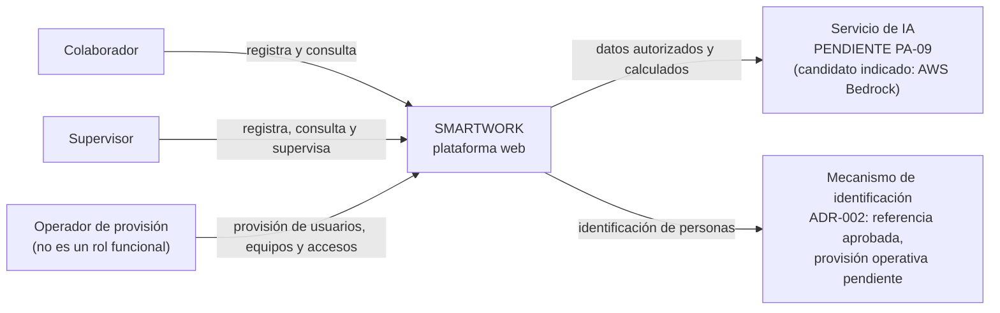
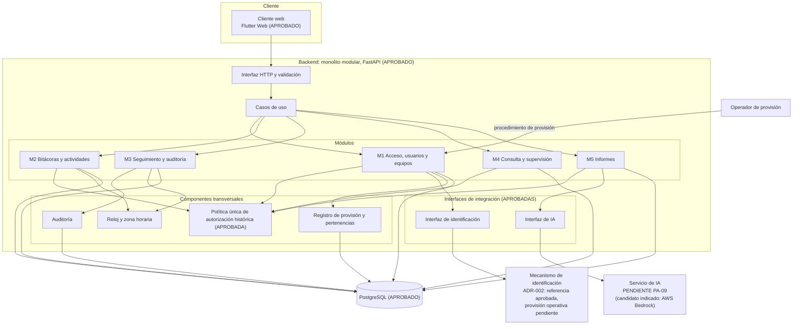
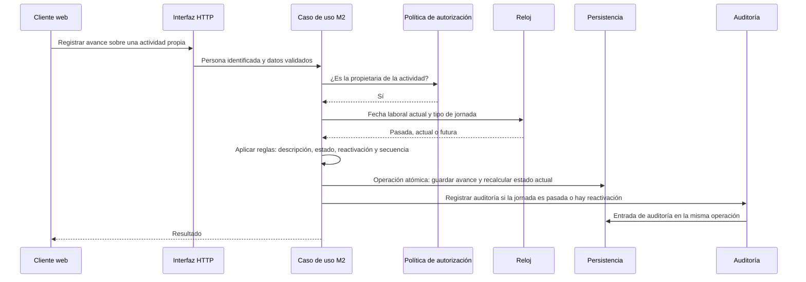
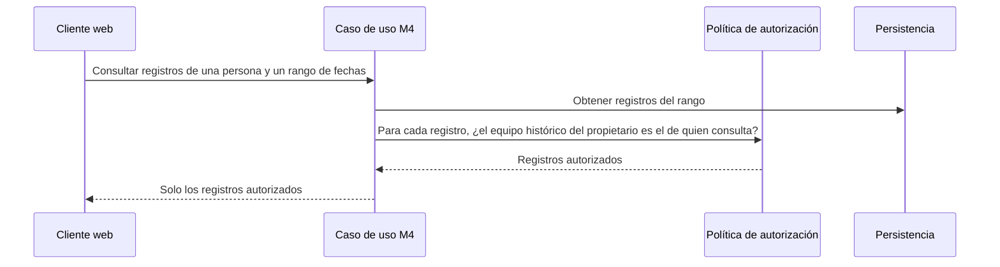
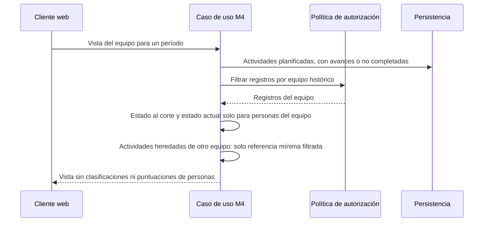
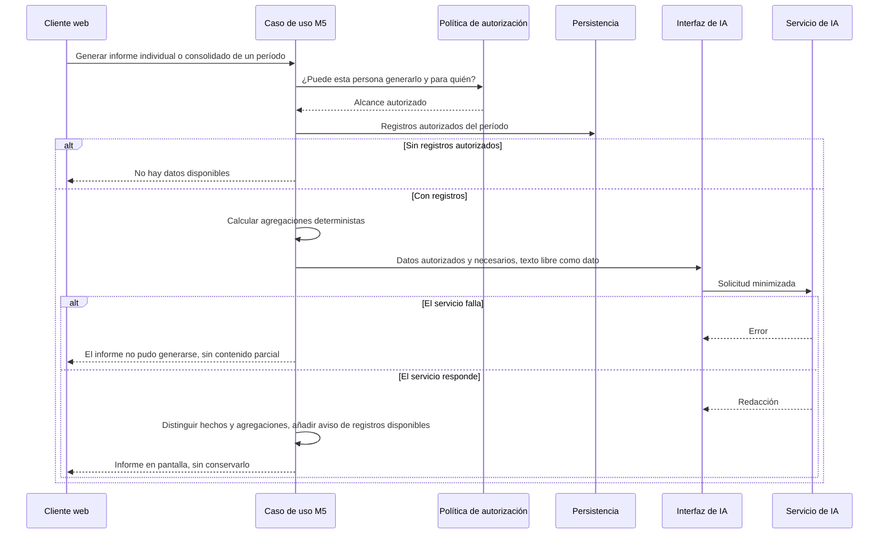

# SMARTWORK — Arquitectura lógica general

| | |
|---|---|
| **Estado** | Decisiones DT-01 a DT-04 **APROBADAS**. El resto, **PENDIENTE** o por diseñar. |
| **Versión** | 0.4 |
| **Fecha** | 2026-11-05 |
| **Base** | `docs/producto/alcance-mvp.md` (versión 0.10), `docs/producto/prd.md` (versión 0.8) y `docs/arquitectura/adr/ADR-001-stack-tecnologico.md` (versión 0.2) |

Este documento describe la arquitectura **lógica** de SMARTWORK. No incluye tablas, diagramas entidad-relación ni contratos de la interfaz: son los pasos siguientes. Los componentes cuya decisión funcional o de seguridad sigue abierta se marcan como **PENDIENTE** y no se presentan como definitivos. No se elige mecanismo de identificación ni proveedor de IA.

## 1. Decisiones aprobadas

| ID | Decisión | Estado |
|---|---|---|
| DT-01 | Flutter Web, FastAPI (Python) y PostgreSQL | **APROBADA** |
| DT-02 | Monolito modular organizado por responsabilidades | **APROBADA** |
| DT-03 | Integración de la IA y de la identificación mediante interfaces desacopladas | **APROBADA** |
| DT-04 | Política única de autorización en el backend | **APROBADA** |

La elección del stack se apoya, entre otros fundamentos, en la experiencia práctica de la persona responsable del producto con Flutter y Dart, FastAPI y Python, PostgreSQL, interfaces REST, Git y entornos de desarrollo con Docker (ADR-001). No se asume que otras personas tengan las mismas capacidades, y los riesgos de Flutter Web se mantienen (R-11).

## 2. Principios arquitectónicos

| Principio | Origen |
|---|---|
| La autorización se decide en el backend, con una **única política** aplicada a consultas, vistas de supervisión e informes. El cliente no decide permisos. | DT-04, RN-36, RN-86, RNF-01 |
| La política evalúa **el equipo al que pertenecía el propietario en la fecha laboral de cada registro**, no el equipo actual. | RN-36, RN-82, RN-87 |
| El estado actual y el orden de los avances se **calculan de forma determinista** a partir de la secuencia de avances de ejecución. | RN-65, RN-66, RN-75 |
| La fecha laboral y la noción de "jornada pasada" o "futura" dependen de **un único reloj** con la zona horaria de la organización. | RN-44, RN-72 |
| Guardar un cambio, recalcular el estado y registrar la auditoría forman **una sola operación atómica**. | RN-45, RN-49, RNF-02 |
| La auditoría **no se modifica ni se borra** por la aplicación. | RN-52 |
| Los cálculos de los informes son **deterministas**; la IA solo redacta sobre datos ya autorizados y calculados. | RN-29, RN-55 |
| El texto libre de las bitácoras es **dato, nunca instrucción**. | RN-31, RNF-12 |
| La IA y la identificación se integran **detrás de interfaces propias**, para no acoplar el producto a un proveedor o mecanismo. | DT-03 |

## 3. Contexto del sistema

## 4. Arquitectura lógica y componentes

## 5. Responsabilidades

| Componente | Responsabilidad | Estado | Reglas |
|---|---|---|---|
| Cliente web | Presenta la interfaz de los dos roles, sin decidir permisos. | **APROBADO** (DT-01) | RNF-05 |
| Interfaz HTTP y validación | Recibe las peticiones, identifica a la persona y valida el formato. | **APROBADO** como parte del backend | RF-01 |
| Casos de uso | Orquestan cada operación: autorizar, aplicar reglas, guardar y auditar. | Definido funcionalmente | Historias HU-1.1 a HU-5.5 |
| M1 Acceso, usuarios y equipos | Roles, pertenencia única a un equipo, historial de pertenencias, baja lógica y recepción de la provisión. | Funcional definido; acceso inicial **PENDIENTE** (PA-12) | RN-11, RN-28, RN-33 a RN-38 |
| M2 Bitácoras y actividades | Bitácora por persona y fecha, actividades, planificación, avances, estados, reglas de futuro y pasado. | Funcional definido | RN-07, RN-16 a RN-24, RN-27, RN-39 a RN-46, RN-65 a RN-80 |
| M3 Seguimiento y auditoría | Continuidad, cierre, reapertura, reactivación, correcciones y marca de error. | Funcional definido; retención **PENDIENTE** (PA-06) | RN-01, RN-19 a RN-22, RN-49 a RN-52, RN-59, RN-60 |
| M4 Consulta y supervisión | Consulta histórica filtrada, vista del supervisor, referencia mínima. | Funcional definido | RN-12, RN-25, RN-36, RN-47, RN-48, RN-81 a RN-85 |
| M5 Informes | Selecciona registros autorizados, calcula agregaciones, redacta con IA, etiqueta y responde. | Funcional definido; proveedor **PENDIENTE** (PA-09) | RN-26, RN-29 a RN-31, RN-53 a RN-58, RN-86 |
| Política única de autorización histórica | Decide si una persona puede ver o hacer algo sobre un registro, según rol, equipo histórico y propiedad. | **APROBADA** como principio (DT-04); diseño por hacer | RN-36, RN-82 a RN-87 |
| Auditoría | Registra autor, fecha real, operación, valor anterior y valor nuevo. | Funcional definido; retención **PENDIENTE** | RN-49 a RN-52 |
| Reloj y zona horaria | Única fuente de la fecha laboral actual y de los criterios de pasado y futuro. | Definido | RN-44, RN-72 |
| Registro de provisión y pertenencias | Conserva las altas, bajas y cambios de equipo con sus fechas. | Funcional definido | RN-28, RN-34, RN-38 |
| Interfaz de IA | Aísla el producto del servicio de IA; filtra y minimiza lo que se envía. | **APROBADA** como interfaz (DT-03); proveedor **PENDIENTE** (PA-09) | RN-30, RN-31 |
| Interfaz de identificación | Aísla el producto del mecanismo de acceso. | **APROBADA** como interfaz (DT-03); mecanismo **PENDIENTE** (PA-12) | RN-35, RN-61, RN-64 |
| PostgreSQL | Fuente de verdad y garante de la integridad. | **APROBADO** (DT-01) | RNF-02 |

## 6. Flujos funcionales de alto nivel

### 6.1 Registrar un avance de ejecución

### 6.2 Consulta con autorización histórica

### 6.3 Vista de supervisión

### 6.4 Generación de un informe con IA

### 6.5 Provisión (alto nivel)

El operador ejecuta un procedimiento de provisión fuera de los roles funcionales para crear usuarios y equipos, asignar pertenencias, dar de baja lógicamente y recuperar el acceso (RN-33, RN-34). Cada operación queda en el registro de provisión y pertenencias (RN-28). La forma concreta del procedimiento y del primer acceso está **PENDIENTE (PA-12)** y no se diseña aquí.

## 7. Estado de decisión por componente

| Componente | Estado | Qué lo condiciona |
|---|---|---|
| Stack (cliente, servidor, base de datos) | **APROBADO** | — |
| Estilo monolito modular | **APROBADO** | — |
| Interfaces de IA y de identificación | **APROBADAS** como interfaces | — |
| Política única de autorización | **APROBADA** como principio; diseño por hacer | Regla funcional cerrada (RN-81 a RN-90) |
| Auditoría | Funcional definido | PA-06 (retención), PA-04 (bitácoras sin propietario) |
| Informes y orquestación | Funcional definido | PA-09 (proveedor y datos), PA-13 (umbrales) |
| Proveedor de IA | **PENDIENTE** (AWS Bedrock indicado como candidato, sin decidir) | PA-09; podría relacionarse con DT-07, sin asumirlo |
| Identificación y recuperación de acceso | **PENDIENTE** | PA-12 |
| Procedimiento de provisión | **PENDIENTE** en su forma concreta | PA-12 |
| Despliegue, observabilidad, copias de seguridad | **No decidido** | DT-07 y PA-13 |
| Estrategia de pruebas | **No decidida** | DT-08 |

## 8. Dependencias y riesgos técnicos

| ID | Riesgo | Causa | Impacto | Mitigación propuesta (no es una decisión) |
|---|---|---|---|---|
| R-01 | **Autenticación sin definir** | PA-12 abierto | Bloquea el diseño de M1 y condiciona el servidor | Está aislada tras una interfaz propia (DT-03); decidir antes de diseñar M1 |
| R-02 | **Autorización histórica compleja** | La visibilidad depende del equipo en la fecha de cada registro y de los traslados (RN-36, RN-87) | Fugas entre equipos por una consulta mal filtrada | Política única en el backend (DT-04), probada con la matriz de permisos y casos de traslado |
| R-03 | **Fuga de alcance en vistas e informes** | Se reutilizan datos en varios flujos (RN-86) | Un informe o una vista exponen detalles de otro equipo | Que informes y vistas partan siempre de registros ya filtrados por la política |
| R-04 | **Auditoría: integridad, volumen y retención** | PA-06; cada modificación de jornada pasada genera una entrada | Pérdida de trazabilidad o crecimiento sin control | Operación atómica con el cambio; auditoría de solo adición; definir retención |
| R-05 | **Privacidad de la IA** | PA-09: qué datos salen, conservación por el proveedor, marco legal | Exposición de información laboral de personas | Enviar solo datos autorizados y necesarios; tratar el texto libre como dato; no conservar informes; decidir proveedor y condiciones antes de integrar |
| R-06 | **Inyección de instrucciones** | El texto libre de un compañero llega al modelo (RN-31) | Informes manipulados | Separar estrictamente datos e instrucciones; pruebas con entradas hostiles |
| R-07 | **Disponibilidad y coste de la IA** | Dependencia externa (RN-58) | Informes no disponibles | Fallo explícito sin contenido parcial; interfaz desacoplada |
| R-08 | **Determinismo temporal** | Zona horaria, orden por fecha y momento, desempate estable | Estados actuales inconsistentes | Un único reloj; identificador estable para el desempate; pruebas con casos límite del backlog |
| R-09 | **Rendimiento de consultas históricas** | Filtrado por equipo histórico y fechas; PA-13 sin umbrales | Lentitud en vistas e informes | Definir umbrales (PA-13) y medir con datos realistas antes de optimizar |
| R-10 | **Provisión sin panel** | RN-33: sin administración avanzada | Errores operativos y poca trazabilidad | Procedimientos verificables (RN-34) y registro de provisión |
| R-11 | **Flutter Web (aprobado, riesgos conservados)** | Accesibilidad: la interfaz dibujada no expone la estructura del navegador. Rendimiento: carga inicial. Pruebas: ecosistema de extremo a extremo menos maduro | Experiencia o mantenibilidad inferiores | Prueba de concepto de accesibilidad y de carga con las pantallas más complejas; presupuesto de carga (PA-13); estrategia de pruebas (DT-08). Condición de revisión en ADR-001 |
| R-12 | **Erosión de límites en el monolito** | Acoplamiento entre módulos | Complejidad creciente | Reglas de dependencia entre módulos y revisiones |
| R-13 | **Cobertura de la matriz de permisos** | 36 criterios de permisos más los transversales | Un acceso indebido sin detectar | Pruebas automatizadas por rol, acción y equipo histórico |
| R-14 | **Cambio de equipo reevalúa visibilidad** | RN-87: la planificación futura cambia de equipo con el traslado | Exposición inesperada al equipo nuevo | Documentado como implicación aceptada; trazabilidad en el historial de pertenencias |
| R-15 | **Conocimiento concentrado** | La experiencia con el stack recae hoy en una persona; no se asume que otras personas la tengan | Dependencia y dificultad para incorporar a otras personas | Documentación, convenciones y pruebas automatizadas |
| R-16 | **Docker en desarrollo no determina el despliegue** | La experiencia con Docker es de entornos de desarrollo | Suponer un despliegue no decidido | Mantener DT-07 como decisión separada |

## 9. Decisiones técnicas

| ID | Decisión | Estado |
|---|---|---|
| DT-01 | Flutter Web, FastAPI y PostgreSQL | **APROBADA** |
| DT-02 | Monolito modular por responsabilidades | **APROBADA** |
| DT-03 | IA e identificación detrás de interfaces propias | **APROBADA** |
| DT-04 | Política única de autorización en el backend | **APROBADA** |
| DT-05 | Mecanismo de identificación y recuperación de acceso | Arquitectura técnica de referencia **APROBADA** (ADR-002); el mecanismo operativo de la provisión sigue **PENDIENTE** (PA-12) |
| DT-06 | Proveedor, modalidad, retención y tratamiento de datos de la IA | **PENDIENTE** (PA-09, ADR-003): no se elige proveedor, modelo, región ni retención. AWS Bedrock es el candidato prioritario y la API directa de Anthropic, la alternativa |
| DT-07 | Entorno de despliegue y observabilidad | **PENDIENTE** |
| DT-08 | Estrategia de pruebas: autorización, determinismo y verificaciones de Flutter Web | **PENDIENTE** |

## 10. Decisiones funcionales cerradas para el modelo de datos

| Punto | Tema | Regla |
|---|---|---|
| PA-22 | Estado al corte de una actividad heredada de otro equipo | RN-88 a RN-90 |
| PA-23 | Correcciones que dejarían incoherente la secuencia de avances | RN-91 a RN-93 |

Quedan abiertos PA-04, PA-06, PA-09, PA-11, PA-12 y PA-13. El modelo de datos propuesto identifica qué partes dependen de ellos (`docs/modelo-datos/modelo-datos.md`).

## 11. Siguientes documentos

1. Validación del modelo de datos propuesto (`docs/modelo-datos/modelo-datos.md`).
2. ADR de autorización histórica.
3. ADR de identificación (tras decidir PA-12).
4. ADR de integración de IA (tras decidir PA-09).
5. Contratos de la interfaz del servidor para las operaciones principales.
6. Seguridad, infraestructura y despliegue, y estrategia de pruebas.
7. Estructura de ficheros del proyecto.

## 12. Historial

| Versión | Cambios |
|---|---|
| 0.4 | Alineación mínima con ADR-002 (arquitectura de autenticación de referencia aprobada) y ADR-003 (candidatos de IA): etiquetas de los diagramas y decisiones DT-05 y DT-06 |
| 0.3 | Se cierran PA-22 y PA-23 (RN-88 a RN-93). Se actualizan el estado de los módulos M3 y M4, la política de autorización y el riesgo R-04. Se referencia el modelo de datos propuesto. |
| 0.2 | Se aprueban DT-01 a DT-04. Se actualizan los diagramas y las tablas de estado. Se reescribe R-11, se añaden R-15 y R-16 y se añade la sección de decisiones funcionales pendientes. Se registra AWS Bedrock como candidato de IA, sin decidir. |
| 0.1 | Versión inicial, propuesta. |
