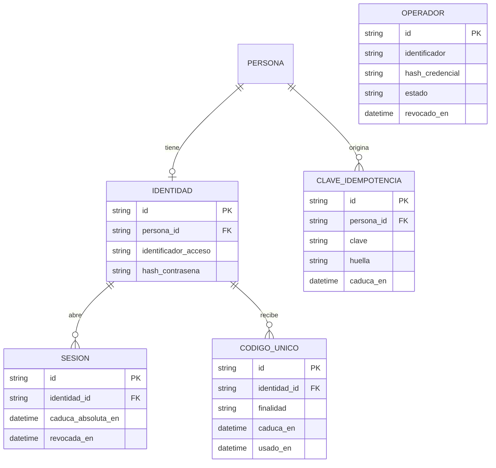
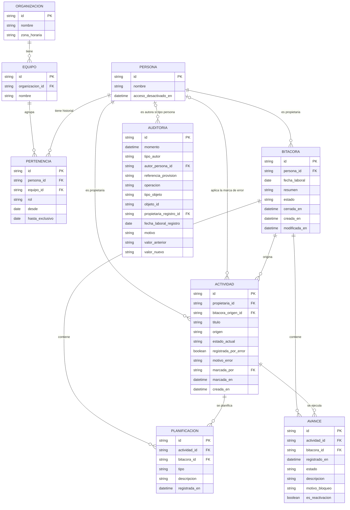

# SMARTWORK — Modelo de datos (propuesta)

| Campo | Valor |
|---|---|
| **Estado** | `[PROPUESTO]`, versión final propuesta; pendiente de aprobación por la persona responsable del producto |
| **Versión** | 0.6 |
| **Base** | `docs/producto/alcance-mvp.md` (versión 0.14), `docs/producto/prd.md` (versión 0.12), `docs/backlog/indice.md` (versión 0.9), `docs/arquitectura/arquitectura-general.md` (versión 0.3) y ADR-001 |
| **Alcance** | Modelo lógico de dominio. No incluye contratos de API, tickets, código, modelos de un ORM, migraciones ni definiciones de tablas con tipos físicos |

## 1. Propósito, límites y decisiones incorporadas

Este documento propone las entidades, relaciones y reglas de integridad que necesitan los requisitos confirmados. Nada de lo que contiene es requisito. Las decisiones sobre el modelo que la persona responsable ha aprobado se incorporan aquí. Sus efectos funcionales están incorporados en el alcance (versión 0.14), el PRD (versión 0.12) y las historias; la sección 18 los relaciona.

El modelo no decide la autenticación (PA-12), el proveedor de IA (PA-09) ni la retención de la auditoría (PA-06). La sección 17 indica qué partes dependen de cada uno.

Convenciones: los nombres de entidades y atributos son conceptuales. Los tipos físicos, los índices y las restricciones concretas de PostgreSQL se definen en el diseño técnico posterior. Las marcas **[v0.4]** señalan los cambios respecto a la versión 0.3; las marcas **[v0.3]** que se conservan señalan cambios anteriores.

### 1.1 Decisiones aprobadas y su estado

| Id | Decisión | Estado |
|---|---|---|
| PV-01 | No hay registros con fecha laboral anterior a la primera pertenencia. Un único equipo por fecha admisible, sin solapes ni huecos durante los períodos de actividad | Aprobada. RN-94 |
| PV-02 | El estado al corte se calcula con la secuencia válida completa y solo se muestra si la autorización histórica lo permite | Aprobada. RN-88 |
| PV-04 | La reactivación admite Pendiente, En progreso o Bloqueada; Bloqueada exige motivo | Aprobada. RN-100 |
| PV-05 | Las correcciones conservan los valores anteriores en la auditoría, sin versionar avances | Aprobada. RN-103 |
| PV-07 y H-1 | Los traslados ordinarios tienen fecha efectiva posterior a la fecha actual y no reasignan los registros existentes. No hay corrección histórica ordinaria de pertenencia | Aprobada. RN-95 |
| PV-08 y baja lógica | Se distinguen la desactivación de acceso (inmediata) y la finalización de pertenencia (fecha efectiva posterior a la actual) | Aprobada. RN-96, RN-97 |
| PV-09 | Los ciclos de cierre y reapertura se reconstruyen desde la auditoría | Aprobada. RN-103 |
| PV-11 | Una entrada estructurada de auditoría por operación | Aprobada. RN-103 |
| PV-12 | Un equipo en provisión puede estar incompleto; un equipo con colaboradores tiene un supervisor válido | Aprobada. RN-98 |
| H-2 y N8 | Información de actividades heredadas (sección 12) | Aprobada. RN-101 |
| OP-04 | Las operaciones programadas pueden cancelarse o sustituirse antes de su fecha efectiva | Aprobada. RN-99 |
| OP-06 | La primera pertenencia comienza en una fecha igual o posterior a la fecha actual; no hay altas históricas excepcionales en el MVP | Aprobada. RN-106 |
| Reincorporación | No se implementa ningún flujo. El modelo debe permitir representar varios períodos de actividad | Aprobada la restricción. PA-24 |
| PV-03, PV-06, PV-10 | Versionado de planificación, reubicación de avances y edición del título | **No aprobadas.** PP-43, PP-44, PP-45. Para el MVP, sin edición ordinaria de la planificación original ni del título (RN-104); no elimina las correcciones auditadas ya permitidas expresamente |

### 1.2 Decisiones de diseño (DD)

Son consecuencias técnicas de las decisiones anteriores. No son funcionalidades. La persona responsable las ha aprobado.

| Id | Decisión de diseño aprobada | Estado |
|---|---|---|
| DD-01 | Se elimina `PERSONA.fecha_baja`. Los períodos de actividad y de pertenencia se reconstruyen desde `PERTENENCIA`; `PERSONA.acceso_desactivado_en` controla la desactivación administrativa del acceso | Aprobada |
| DD-02 | Una pertenencia programada que no ha surtido efecto puede cancelarse o sustituirse. Se retira de los registros de pertenencia vigentes, pero la auditoría conserva la operación original, su cancelación, el autor y los valores necesarios para reconstruirla. No se altera silenciosamente ninguna pertenencia efectiva | Aprobada con precisión (IR-26, IR-39) |
| DD-03 | Al finalizar una pertenencia, las planificaciones futuras existentes se conservan con su identidad y trazabilidad, sin perder su relación con su propietaria ni su origen, y no se muestran como trabajo vigente ni pendiente de un equipo sin autorización. Una proyección de consulta distingue planificación conservada, planificación vigente y trabajo ejecutado, sin entidades nuevas | Aprobada con ajuste (IR-31, RA-11, DM-08) |
| DD-04 | La desactivación inmediata del acceso del único supervisor no se bloquea. El equipo queda identificado como pendiente de supervisión efectiva hasta asignar un reemplazo. No se transfieren automáticamente permisos de supervisión y se conserva la pertenencia histórica del supervisor | Aprobada con ajuste (IR-32, IR-37, RA-12, DM-09) |
| DD-05 | Recuperar una credencial no reactiva un acceso desactivado administrativamente. La reactivación administrativa es otra operación, pendiente de especificar en PA-12 | Aprobada (IR-37) |

## 2. Principios de modelado

| Id | Principio | Origen |
|---|---|---|
| P1 | La bitácora es la jornada de una persona en una fecha laboral; la fecha laboral es un atributo propio, distinto de la fecha real de registro y de la fecha de modificación. | RN-16, RN-18 |
| P2 | Una actividad tiene identidad y propietaria únicas y persiste entre jornadas y traslados. Continuar no crea otra actividad, y ninguna entidad duplica actividades. | RN-32, RN-39, RN-43, RN-81 |
| P3 | El historial se conserva: no existe borrado físico de registros de dominio ni de auditoría. Única excepción acotada: DD-02. | RN-38, RN-52, RN-59 |
| P4 | El estado actual de una actividad es consecuencia de su secuencia de avances. El valor almacenado es una copia derivada, recomputable. | RN-42, RN-66 |
| P5 | El equipo de un registro no se guarda: se deduce de la pertenencia de la propietaria en la fecha laboral. | RN-36, RN-82, RN-87 |
| P6 | Toda corrección se valida contra la secuencia completa; si es inválida no modifica nada. | RN-91 a RN-93 |
| P7 | Los informes no se persisten. El modelo no contiene entidades de IA. | RN-56, PA-09 |
| P8 | La identidad de acceso (credenciales, sesiones, primer acceso) queda fuera del dominio hasta decidir PA-12. | RN-64, PA-12 |
| P9 | Las pertenencias efectivas son inmutables. Los cambios ordinarios solo tienen efecto hacia el futuro. | PV-07, H-1 |
| P10 | Los datos de una actividad que no son de un avance (título, marca de error) se muestran según la autorización sobre su jornada de origen. | H-2 |
| P11 **[v0.3]** | Acceso y pertenencia son conceptos independientes. El acceso puede desactivarse al instante; la pertenencia solo cambia hacia el futuro. | Baja lógica |
| P12 **[v0.4]** | Se distinguen siempre el registro histórico conservado, la pertenencia vigente, el acceso activo o desactivado, la planificación vigente y la conservada, el avance de ejecución, y el supervisor asignado y el que tiene acceso efectivo (sección 7.5). | DD-03, DD-04 |

## 3. Catálogo de entidades

Las entidades siguen siendo nueve. No se añade ninguna.

### 3.1 ORGANIZACION

| Atributo | Descripción |
|---|---|
| id | Identificador estable |
| nombre | Nombre de la organización |
| zona_horaria | Zona horaria única con la que se interpreta la fecha laboral y la «fecha actual» de las reglas de pertenencia (RN-44, RN-72) |

### 3.2 EQUIPO

| Atributo | Descripción |
|---|---|
| id | Identificador estable |
| organizacion | Organización a la que pertenece |
| nombre | Nombre del equipo |

Sin atributo de estado. «Equipo operativo» es una condición derivada de sus pertenencias (IR-32).

### 3.3 PERSONA **[v0.3]**

No contiene credenciales ni datos de acceso (RN-64, P8).

| Atributo | Descripción |
|---|---|
| id | Identificador estable, usado como propietaria y como autora |
| nombre | Nombre visible |
| acceso_desactivado_en | **[v0.3]** Momento real desde el que el acceso está desactivado; vacío si está activo (IR-37) |

Se elimina `fecha_baja` (DD-01). Se deduce: una persona **tiene un período de actividad vigente** si hay un intervalo suyo que cubre la fecha actual; su **fin de pertenencia** es el `hasta_exclusivo` de un intervalo sin sucesor contiguo.

### 3.4 PERTENENCIA

Historial de pertenencias de una persona a equipos, con rol por intervalo (RN-11, RN-28, RN-37). Sin cambios estructurales respecto a v0.2.

| Atributo | Descripción |
|---|---|
| id | Identificador estable |
| persona | Persona que pertenece |
| equipo | Equipo al que pertenece |
| rol | Colaborador o supervisor |
| desde | Primera fecha laboral del intervalo, **inclusive** |
| hasta_exclusivo | Primera fecha laboral posterior al intervalo, **exclusiva**. Vacía si el intervalo no tiene fin (IR-27) |

### 3.5 BITACORA

| Atributo | Descripción |
|---|---|
| id | Identificador estable |
| persona | Propietaria de la bitácora |
| fecha_laboral | Fecha laboral según la zona horaria de la organización |
| resumen | Resumen libre de la jornada (RN-21) |
| estado | Abierta o Cerrada (RN-10) |
| cerrada_en | Momento real del último cierre; vacío si está abierta |
| creada_en | Momento real de creación |
| modificada_en | Momento real de la última modificación |

### 3.6 ACTIVIDAD

| Atributo | Descripción |
|---|---|
| id | Identificador estable |
| propietaria | Persona propietaria; no cambia (RN-43, RN-81) |
| bitacora_origen | Bitácora en la que se creó. Su fecha laboral determina la autorización sobre el título y la marca de error (RA-04) |
| titulo | Título, obligatorio (RN-112). No se edita en el flujo ordinario (IR-33) |
| origen | Planificada o no planificada; es una identificación, no un estado (RN-20) |
| estado_actual | Copia derivada del estado del último avance de ejecución; Pendiente si no hay avances (IR-12, sección 9) |
| registrada_por_error | Marca lógica; no es un quinto estado (RN-59, RN-60) |
| motivo_error | Motivo de la marca vigente |
| marcada_por | Persona que aplicó la marca vigente |
| marcada_en | Momento real de la marca vigente |
| creada_en | Momento real de creación |

### 3.7 PLANIFICACION

| Atributo | Descripción |
|---|---|
| id | Identificador estable |
| actividad | Actividad planificada |
| bitacora | Bitácora de la jornada para la que se planifica (puede ser futura) |
| tipo | Original o continuación planificada (RN-20, RN-76) |
| descripcion | Contenido de lo previsto |
| registrada_en | Momento real de registro |

Sin cadena de versiones ni edición ordinaria (IR-16).

### 3.8 AVANCE

| Atributo | Descripción |
|---|---|
| id | Identificador estable, asignado por el servidor, usado como desempate (RN-65) |
| actividad | Actividad a la que pertenece |
| bitacora | Bitácora de la jornada del avance; determina la fecha laboral y la propietaria |
| registrado_en | Momento real de registro, asignado por el servidor (RN-65, IR-09) |
| estado | Estado histórico: Pendiente, En progreso, Bloqueada o Completada (RN-08, RN-17) |
| descripcion | Descripción no vacía (RN-70) |
| motivo_bloqueo | Obligatorio si el estado es Bloqueada, también en una reactivación (RN-24, RN-69) |
| es_reactivacion | Marca el avance que reactiva una actividad Completada (RN-40, RN-68, RN-73) |

### 3.9 AUDITORIA

Registro de solo anexado: **una entrada por operación** (IR-35).

| Atributo | Descripción |
|---|---|
| id | Identificador estable |
| momento | Momento real de la operación |
| tipo_autor | Persona o provisión administrativa (IR-34). No es un rol funcional |
| autor_persona | Persona autora; obligatorio si `tipo_autor` es persona |
| referencia_provision | Referencia no secreta al procedimiento administrativo; obligatoria si `tipo_autor` es provisión. Su forma depende de PA-12 |
| operacion | Reapertura, cierre, corrección, modificación de jornada pasada, reactivación, marca de error, reversión de marca, alta, cambio de pertenencia, finalización de pertenencia, cancelación o sustitución de una operación programada, desactivación de acceso, entrega o recuperación de acceso |
| tipo_objeto | Tipo del registro afectado |
| objeto | Identificador del registro afectado |
| propietaria_registro | Propietaria del registro afectado |
| fecha_laboral_registro | Fecha laboral del registro afectado. Para una actividad, la de su bitácora de origen (IR-36) |
| motivo | Motivo, obligatorio en reaperturas y marcas de error (RN-50, RN-59) |
| valor_anterior | Valores anteriores de los campos afectados, estructurados (IR-35) |
| valor_nuevo | Valores nuevos de los campos afectados, estructurados, incluidos el estado actual anterior y nuevo cuando cambia (IR-35) |

Nunca contiene credenciales, códigos, claves ni identificadores que permitan acceder (RN-64, IR-34).

### 3.10 Estructuras técnicas propuestas (fuera de las nueve entidades)

Las **nueve entidades funcionales** son las de las secciones 3.1 a 3.9 y las del diagrama de la sección 4. Las estructuras siguientes **no son entidades de dominio**: las proponen ADR-002 y la decisión técnica T-04 para sostener el acceso y los reintentos, y están pendientes de aprobación (A12). Ninguna contiene datos del trabajo de las personas.

| Estructura | Para qué sirve | Relación con el dominio | Origen |
|---|---|---|---|
| `IDENTIDAD` | Credencial de acceso de una persona (identificador y hash de contraseña) | 1 a 0..1 con `PERSONA` | ADR-002, sección 4 |
| `SESION` | Sesión revocable en servidor | N a 1 con `IDENTIDAD` | ADR-002, sección 5 |
| `CODIGO_UNICO` | Código de un solo uso de primer acceso o recuperación | N a 1 con `IDENTIDAD` | ADR-002, sección 6 |
| `OPERADOR` | Persona operadora autorizada de la provisión; no es un rol funcional ni una persona del producto | Sin relación con `PERSONA`; su identificador consta en `AUDITORIA.referencia_provision` | ADR-002, sección 9 |
| `CLAVE_IDEMPOTENCIA` | Claves de reintento y huella de la petición, durante una ventana configurable | N a 1 con `PERSONA` | Contratos API, convenciones 5.3 |

El detalle de atributos y reglas de estas estructuras está en ADR-002, secciones 4 y 9.

## 4. Diagrama entidad-relación

`AUDITORIA` referencia el registro afectado por tipo e identificador, no mediante una relación fija: una entrada debe sobrevivir a cualquier cambio del objeto y puede referirse a objetos de distinto tipo. Por la misma razón, retirar una pertenencia programada (DD-02) no deja ninguna referencia colgante: ningún registro apunta a `PERTENENCIA`, porque el equipo se deduce por fechas.

## 5. Relaciones y cardinalidades

| Relación | Cardinalidad | Observación |
|---|---|---|
| ORGANIZACION – EQUIPO | 1 a N | Una organización, varios equipos (RN-15) |
| PERSONA – PERTENENCIA | 1 a N | Uno o varios períodos de actividad; dentro de cada período, intervalos contiguos sin solapes (IR-02, IR-28) |
| EQUIPO – PERTENENCIA | 1 a N | Un equipo agrupa muchas pertenencias a lo largo del tiempo |
| PERSONA – BITACORA | 1 a N | Una por persona y fecha laboral (IR-01); la fecha debe estar cubierta (IR-29) |
| PERSONA – ACTIVIDAD (propietaria) | 1 a N | Propietaria única, inmutable (IR-06) |
| PERSONA – ACTIVIDAD (marca) | 0..1 a N | Quien aplicó la marca vigente |
| BITACORA – ACTIVIDAD | 1 a N | Bitácora de origen de cada actividad |
| ACTIVIDAD – PLANIFICACION | 1 a N | Una original como máximo; las continuaciones son varias (IR-16, IR-17) |
| ACTIVIDAD – AVANCE | 1 a N | Secuencia ordenada (IR-09) |
| BITACORA – AVANCE | 1 a N | Varios avances de una actividad por jornada son válidos (RN-41) |
| BITACORA – PLANIFICACION | 1 a N | Incluye jornadas futuras (RN-27) |
| PERSONA – AUDITORIA | 0..1 a N | Solo si `tipo_autor` es persona (IR-34) |

## 6. Reglas de integridad y unicidad

Las reglas IR se comprueban en el servidor y, cuando es posible, se refuerzan con restricciones de la base de datos. Se señalan **[v0.3]** las modificadas o nuevas en esta versión. Las demás son las de v0.2.

### 6.1 Personas, equipos y pertenencias

| Id | Regla | Origen |
|---|---|---|
| IR-01 | Existe una única bitácora por persona y fecha laboral. | RN-16 |
| IR-02 | Los intervalos de pertenencia de una persona, semiabiertos `[desde, hasta_exclusivo)`, no se solapan. Solo el último puede carecer de `hasta_exclusivo`. | RN-28, PV-01 |
| IR-03 | En cualquier fecha laboral, un equipo tiene como máximo un intervalo de supervisor que la cubra. | RN-28 |
| IR-04 | Un supervisor pertenece al equipo que supervisa y supervisa un solo equipo. | RN-37 |
| IR-05 **[v0.3]** | La baja lógica no elimina filas de persona, pertenencia ni registros. Se compone de dos acciones independientes: la desactivación de acceso (IR-37) y la finalización de pertenencia (IR-31). | RN-38 |
| IR-27 | Los intervalos se expresan en fechas laborales. `desde` es inclusive y `hasta_exclusivo` es el primer día que ya no pertenece. En dos intervalos consecutivos sin inactividad entre ellos, el `hasta_exclusivo` del primero es igual al `desde` del segundo. | PV-08 |
| IR-28 **[v0.3]** | Los intervalos de una persona forman uno o varios **períodos de actividad**. Dentro de un período cada fecha laboral está cubierta por exactamente un intervalo: no hay solapes ni huecos. Entre dos períodos hay una **inactividad**: ninguna pertenencia la cubre y no se crea ninguna para cubrirla. Toda inactividad empieza en una finalización de pertenencia. Hoy cada persona tiene un solo período, porque la reincorporación no está implementada. | PV-01 |
| IR-29 **[v0.3]** | No se crea una bitácora, ni por tanto ningún registro, con fecha laboral no cubierta por un intervalo de su propietaria: ni antes de su primera pertenencia, ni en una inactividad, ni desde la fecha efectiva de una finalización de pertenencia. Las bitácoras ya existentes cuya fecha deja de estar cubierta por una finalización posterior se conservan sin equipo (IR-31, RA-11). | PV-01, PV-08 |
| IR-30 **[v0.4]** | Un cambio ordinario de pertenencia (traslado, cambio de rol, finalización) solo se registra con fecha efectiva estrictamente posterior a la fecha actual, medida en la zona horaria de la organización al ejecutar la operación. Un intervalo con `desde` igual o anterior a la fecha actual no se modifica, salvo cerrar el último sin fin con un `hasta_exclusivo` posterior a la fecha actual y al propio `desde`. Las operaciones programadas pueden cancelarse o sustituirse según IR-39. No existe corrección histórica ordinaria. La primera pertenencia de una persona (alta ordinaria) tiene un `desde` igual o posterior a la fecha actual. No hay altas históricas excepcionales en el MVP, aunque el modelo no impide representar períodos históricos válidos si un mecanismo extraordinario se autoriza (PA-25). | PV-07, H-1, OP-06, RN-95, RN-106 |
| IR-31 **[v0.4]** | **Finalización de pertenencia.** Se registra con una fecha efectiva `F` posterior a la fecha actual, cierra el último intervalo sin fin con `hasta_exclusivo = F` y no crea intervalo posterior. No cambia el equipo de ningún registro existente. Los registros ya existentes con fecha laboral igual o posterior a `F` (solo planificación futura, porque no se registra ejecución futura) no se eliminan: conservan su identidad, su actividad, su bitácora y su propietaria, y se clasifican como planificación conservada (RA-11, DM-08), no como trabajo vigente. | PV-08, DD-03, RN-105 |
| IR-32 **[v0.4]** | Para toda fecha laboral en la que un equipo tenga al menos un intervalo de colaborador, existe exactamente un intervalo de supervisor que la cubre (IR-03 aporta el «como máximo»). Toda operación de pertenencia, incluidas las programadas y las cancelaciones, se rechaza si violaría esta regla en cualquier fecha posterior. Un equipo sin colaboradores está en provisión y puede carecer de supervisor. La desactivación de acceso no está sujeta a esta regla: la supervisión efectiva (supervisor asignado con acceso activo) es una condición derivada (RA-12, DM-09). | PV-12, DD-04, RN-28, RN-98 |
| IR-37 **[v0.4]** | **Desactivación de acceso.** Con `acceso_desactivado_en` informado, el servidor rechaza desde ese momento toda operación autenticada de la persona, de consulta o de modificación, con independencia del mecanismo de acceso y de la vigencia de credenciales o sesiones anteriores. No modifica pertenencias, registros ni visibilidad, y no transfiere permisos de supervisión (RA-12). La registra la provisión (IR-34). No la deshace la recuperación de acceso; su reactivación exige una operación distinta, pendiente de especificar (PA-12). | Baja lógica, DD-05, RN-96 |
| IR-38 **[v0.3]** | Una persona no opera en una fecha en la que ninguna pertenencia suya la cubre (antes de la primera, en una inactividad o desde la fecha efectiva de una finalización), aunque su acceso no haya sido desactivado. | Baja lógica, PV-08 |
| IR-39 **[v0.4]** | **Operaciones programadas.** Una operación de pertenencia con fecha efectiva posterior a la fecha actual (alta, traslado, cambio de rol, finalización) puede cancelarse o sustituirse mediante provisión controlada. Cancelar retira el intervalo programado de los registros de pertenencia vigentes y restituye el fin del intervalo anterior; sustituir es cancelar y registrar la nueva operación en la misma transacción. La entrada de auditoría de la operación original permanece (IR-23), y la cancelación o sustitución añade su propia entrada con el autor y los valores retirados, suficientes para reconstruirla. Una operación con fecha efectiva igual o anterior a la fecha actual no se modifica con este procedimiento, y ninguna pertenencia efectiva se altera silenciosamente. Antes de aplicarse se valida la línea temporal resultante completa (IR-02, IR-03, IR-04, IR-28, IR-32); si falla, se rechaza sin cambios. Las operaciones relacionadas, como el relevo de un supervisor, se cancelan o sustituyen juntas en una sola operación. | OP-04, DD-02, RN-99 |

### 6.2 Actividades, planificación y avances

| Id | Regla | Origen |
|---|---|---|
| IR-06 | Una actividad tiene una única propietaria, que no cambia. | RN-43, RN-81 |
| IR-07 | Un avance pertenece a una bitácora de la misma persona que la propietaria de su actividad. | RN-23, RN-43 |
| IR-08 | El estado de un avance es uno de los cuatro estados. Un avance Bloqueada exige motivo, también si es una reactivación. La descripción no puede estar vacía. | RN-08, RN-24, RN-70 |
| IR-09 | El orden de la secuencia es total: fecha laboral de la bitácora, momento real de registro e identificador estable. El servidor asigna `registrado_en` e `id`; no se modifican después. | RN-65 |
| IR-10 | Ningún avance de ejecución tiene fecha laboral futura. | RN-27, RN-46, RN-74 |
| IR-11 | Secuencia válida: tras un avance Completada, el siguiente avance de la secuencia, si existe, es una reactivación. Una reactivación solo sigue a un avance Completada y su estado es Pendiente, En progreso o Bloqueada. La reactivación es un avance nuevo y no modifica la finalización. Los avances anteriores a una finalización no requieren reactivación. Son válidos varios ciclos. | RN-40, RN-68, RN-73, RN-77, RN-79, PV-04 |
| IR-12 | `estado_actual` es el estado del último avance de ejecución, y Pendiente si la actividad planificada no tiene avances. Solo lo escribe el procedimiento que registra o corrige avances, dentro de la misma transacción que el cambio (IR-24). Siempre es recomputable desde la secuencia. | RN-66, RN-42 |
| IR-13 | Una actividad no planificada se crea junto con su primer avance, y su estado inicial es el de ese avance. | RN-69 |
| IR-14 | La planificación no es un avance: no participa en la secuencia ni en el estado actual. | RN-71, RN-75 |
| IR-15 | La planificación futura de una actividad nueva exige estado Pendiente. | RN-46 |
| IR-16 | Una actividad planificada tiene exactamente una planificación original. Una no planificada no la tiene. La planificación, original o de continuación, no se modifica ni se elimina en el flujo ordinario y no existe cadena de versiones. | RN-20, PV-03 |
| IR-17 | No se registra una continuación planificada para una actividad cuyo último avance es Completada sin reactivación vigente. | RN-76, RN-78 |
| IR-18 | La actividad con marca de error vigente no admite avances ni reactivación, y la corrección de sus avances exige revertir antes la marca (RN-113). | RN-59, RN-60 |
| IR-33 | El título de una actividad no se modifica en el flujo ordinario. | PV-10 |

### 6.3 Bitácoras, cierre y auditoría

| Id | Regla | Origen |
|---|---|---|
| IR-19 | Una bitácora se cierra solo si contiene al menos una actividad válida (no marcada como registrada por error, RN-109) creada o continuada en esa jornada y un resumen no vacío. El cierre admite actividades en cualquier estado y no modifica ninguna. | RN-10, RN-21, RN-22 |
| IR-20 | No se cierra una bitácora de fecha laboral futura. | RN-46 |
| IR-21 | La reapertura exige motivo y queda auditada. | RN-19, RN-50 |
| IR-22 | Solo la propietaria modifica una bitácora y sus actividades, avances y planificaciones. | RN-23 |
| IR-23 | La auditoría es de solo anexado: no se actualiza ni se borra ninguna entrada. | RN-49, RN-52 |
| IR-24 | Toda operación auditable se aplica en una única transacción atómica con su entrada de auditoría y, cuando proceda, con el recálculo de `estado_actual`. No existe cambio sin entrada ni entrada sin cambio. Una operación rechazada no deja cambio ni entrada. | RN-45, RN-67, RN-93 |
| IR-25 | Toda marca de error exige motivo, solo procede si la actividad no tiene avances en jornadas posteriores a su creación y su reversión queda auditada. Marcar o revertir no obliga a reabrir la bitácora; marcar se rechaza si una jornada cerrada perdería sus condiciones de cierre (RN-109). | RN-59, RN-60 |
| IR-26 **[v0.3]** | No existe borrado físico de bitácoras, actividades, planificaciones, avances ni pertenencias, con una única excepción: el retiro de una pertenencia programada que no ha surtido efecto (IR-39), cuyos valores se conservan completos en la auditoría. | RN-52, RN-59 |
| IR-34 **[v0.3]** | `tipo_autor` es persona o provisión administrativa. Si es persona, `autor_persona` está presente y `referencia_provision` vacía; si es provisión, ocurre lo contrario. Las operaciones sobre bitácoras, actividades, planificaciones, avances, cierres, reaperturas, correcciones y marcas exigen autor persona. La provisión origina altas, cambios de pertenencia, finalizaciones, cancelaciones y sustituciones de operaciones programadas, desactivaciones de acceso, y entrega o recuperación de acceso. Ninguna entrada contiene credenciales ni códigos de acceso. | RN-33, RN-34, RN-64 |
| IR-35 **[v0.3]** | Cada operación genera una única entrada. Una operación compuesta atómica, como el relevo de un supervisor, genera una sola entrada con los valores de todos sus cambios. `valor_anterior` y `valor_nuevo` son conjuntos estructurados de los campos afectados, suficientes para reconstruir el cambio; incluyen `estado_actual` anterior y nuevo cuando varía. | RN-49, RN-50, PV-05, PV-11 |
| IR-36 | `fecha_laboral_registro` de una entrada sobre una actividad es la fecha laboral de su bitácora de origen. | RN-51 |

### 6.4 Revisión de las reglas IR, RA y DD

Se han revisado las 39 reglas IR, las 12 reglas RA y las 5 decisiones DD frente a las decisiones aprobadas.

| Elemento | Resultado de la revisión |
|---|---|
| IR-30 | Modificada: primera pertenencia no anterior a la fecha actual; sin altas históricas excepcionales |
| IR-31 | Modificada: la planificación posterior a la finalización se conserva con su identidad y trazabilidad (DD-03) |
| IR-32 | Modificada: se separa la supervisión asignada de la supervisión efectiva (DD-04) |
| IR-37 | Modificada: no transfiere permisos de supervisión; su reactivación es otra operación (DD-04, DD-05) |
| IR-39 | Modificada: la auditoría conserva la operación original, la cancelación y los valores retirados (DD-02) |
| Las otras 34 reglas IR | Revisadas sin cambio: IR-01 a IR-29, IR-33 a IR-36 e IR-38 |
| RA-11 | Modificada: planificación conservada (DD-03) |
| RA-12 | Nueva: permisos de supervisión (DD-04) |
| RA-01 a RA-10 | Revisadas sin cambio. RA-04 a RA-06 ya impiden que «el detalle» exponga el título |
| DD-01 a DD-05 | Aprobadas. Precisiones incorporadas en DD-02, DD-03 y DD-04 |

## 7. Historial de pertenencias, acceso y baja lógica

### 7.1 Semántica de los límites

- Los intervalos son semiabiertos en fechas laborales: `[desde, hasta_exclusivo)`. No existen intervalos de longitud cero.
- **Traslado** con fecha efectiva `E`: el intervalo anterior recibe `hasta_exclusivo = E` y el nuevo tiene `desde = E`.
- **Finalización** con fecha efectiva `F`: el último intervalo recibe `hasta_exclusivo = F`. El último día con registros posibles es el anterior a `F`.
- **Vigente**: cubre la fecha actual. **Programada**: su `desde` es posterior a la fecha actual, o su `hasta_exclusivo` lo es y aún no ha llegado. **Pasada**: su `hasta_exclusivo` es igual o anterior a la fecha actual. La clasificación se calcula, no se almacena.

### 7.2 Baja lógica: dos conceptos independientes

| | A. Desactivación de acceso | B. Finalización de pertenencia |
|---|---|---|
| Qué cambia | `PERSONA.acceso_desactivado_en` | Último intervalo de `PERTENENCIA` |
| Efecto | Inmediato | A partir de la fecha efectiva `F`, posterior a la actual |
| Qué impide | Toda operación autenticada desde ese momento (IR-37) | Registros con fecha igual o posterior a `F` (IR-29), y operar desde `F` (IR-38) |
| Qué conserva | Pertenencias, registros y visibilidad | Los registros anteriores y su equipo; nada se reasigna |
| Reglas | IR-37, IR-34, DD-04, DD-05 | IR-30, IR-31, IR-32, IR-28, IR-29 |

Se pueden ejecutar en la misma operación de provisión o por separado. Una baja inmediata de una persona se compone de A hoy y B con `F` a partir de mañana. Si no se desactiva el acceso, IR-38 impide por sí misma que la persona opere desde `F`. No se añade ninguna gestión de recursos humanos: no hay causas de baja, contratos ni calendarios.

### 7.3 Varios períodos de actividad (reincorporación futura)

- No se implementa ningún flujo de reincorporación: ninguna operación crea un intervalo posterior a una finalización (PA-24).
- El modelo ya permite representar varios períodos. Al quitar `PERSONA.fecha_baja` (DD-01), un segundo período es un intervalo posterior con una inactividad intermedia, sin pertenencia inventada (IR-28, IR-38).
- En la inactividad no hay equipo ni bitácora (IR-29), y los registros anteriores conservan su equipo.
- El modelo tampoco impide representar períodos históricos válidos si un mecanismo extraordinario se autoriza (PA-25): IR-02, IR-28 e IR-32 seguirían aplicándose.
- Un eventual flujo futuro tendría que decidir la reactivación del acceso (PA-12) y el tratamiento de la planificación conservada que quedara dentro del nuevo período (RN-105, PA-24).

### 7.4 Efecto de las reglas

- Toda fecha laboral admisible tiene un único equipo (IR-02, IR-28), por lo que la función «equipo en una fecha» es total en esas fechas (IR-29).
- Las pertenencias efectivas no cambian (IR-30), por lo que la visibilidad de las jornadas anteriores nunca se altera.
- Los registros de la jornada actual permanecen en el equipo en que se crearon (H-1).
- Un cambio de rol dentro del mismo equipo cierra un intervalo y abre otro en la misma fecha efectiva.
- Dar de baja o trasladar a un supervisor de un equipo operativo exige que otro supervisor empiece en la misma fecha efectiva (IR-32).
- Todas las operaciones de provisión generan una entrada de auditoría de tipo provisión (IR-34).
- Los ajustes históricos excepcionales de pertenencia no existen como operación (PA-25).

### 7.5 Conceptos que el modelo distingue **[v0.4]**

Ningún concepto añade atributos ni entidades: todos se derivan de los existentes.

| Concepto | Cómo se determina | Soporte |
|---|---|---|
| Registro histórico conservado | Cualquier bitácora, actividad, planificación, avance, pertenencia efectiva o entrada de auditoría. Nunca se elimina. Su equipo histórico se deduce de su fecha; si la fecha no está cubierta, queda sin equipo | IR-23, IR-26, RA-01, RA-11 |
| Pertenencia vigente, programada o pasada | Por las fechas del intervalo frente a la fecha actual | `PERTENENCIA`, sección 7.1 |
| Acceso activo o desactivado | `acceso_desactivado_en` vacío o informado | `PERSONA`, IR-37 |
| Persona que puede operar | Acceso activo y pertenencia vigente | IR-37, IR-38 |
| Planificación vigente | `PLANIFICACION` cuya fecha laboral está cubierta por una pertenencia de su propietaria | IR-29, RA-02 |
| Planificación conservada | `PLANIFICACION` cuya fecha laboral no está cubierta (posterior a una finalización o dentro de una inactividad) | IR-31, RA-11, DM-08 |
| Avance de ejecución | `AVANCE`. Es el único registro que participa en la secuencia y en el estado actual | IR-09, IR-11, IR-14 |
| Trabajo ejecutado | Los avances de ejecución, tal como los clasifica la proyección | DM-08 |
| Supervisor asignado | Persona con un intervalo de rol supervisor que cubre la fecha | IR-03, IR-32 |
| Supervisor con acceso efectivo | Supervisor asignado que puede operar | IR-37, RA-12 |
| Equipo pendiente de supervisión efectiva | Equipo con colaboradores en la fecha actual cuyo supervisor asignado no tiene acceso efectivo | RA-12, DM-09 |

## 8. Actividades, planificación y avances históricos

**Actividad.** Se crea en una bitácora (la de origen). Es planificada si nace de una planificación original, o no planificada si nace con su primer avance (RN-20, IR-13). Mantiene su identidad y su propietaria aunque la persona cambie de equipo (RN-81). Ninguna entidad la duplica: cómo se presenta a otro equipo es una proyección de consulta (DM-03).

**Planificación.** La original se conserva sin edición ordinaria (IR-16). Las continuaciones planificadas son filas del mismo tipo y tampoco se editan. No son avances (IR-14). Si una planificación fue un error, la vía existente es la marca de error de la actividad (sección 11.2).

**Avances.** Cada avance guarda el estado histórico, la descripción y, si procede, el motivo de bloqueo (RN-17, RN-41). Los retroactivos se insertan en su posición de la secuencia (RN-65, RN-77).

**Reactivación.** Es un avance con `es_reactivacion` verdadera, de estado Pendiente, En progreso o Bloqueada, en una jornada no futura que respeta la secuencia (IR-11). La finalización anterior no se modifica.

**Finalización.** Es un avance con estado Completada. No tiene entidad propia.

**Secuencia válida (IR-11).** Se recorre en orden. Mientras el último avance leído no sea Completada, cualquier avance de ejecución no reactivante es válido. Tras un Completada, el único válido es una reactivación con estado distinto de Completada. Una reactivación sin Completada inmediatamente anterior es inválida. Con varios ciclos la regla se aplica a cada tramo. Un avance con la misma fecha laboral que una finalización, registrado después, se ordena tras ella y exige reactivación. Este recorrido sirve para registrar un avance nuevo (RN-79) y para validar una corrección (sección 11.1).

## 9. Cálculo, persistencia e integridad del estado actual

**Decisión del modelo: valor derivado y almacenado** en `ACTIVIDAD.estado_actual`, recomputable desde la secuencia. Si no se cumplen las condiciones siguientes, la alternativa es derivarlo en cada consulta.

1. **Único camino de escritura.** Solo el procedimiento de registro y corrección de avances modifica `estado_actual` (IR-12).
2. **Atomicidad.** La escritura del avance, la entrada de auditoría y el recálculo ocurren en una transacción (IR-24).
3. **Concurrencia.** Las altas y correcciones de avances de una misma actividad se serializan (DM-01). `registrado_en` se asigna dentro de esa serialización.
4. **Verificabilidad.** Una comprobación de coherencia (derivar y comparar) se ejecuta como prueba y como verificación operativa (DM-02).
5. **Retroactivos.** Un avance retroactivo anterior no sustituye el estado de uno posterior: el recálculo toma el último de la secuencia completa (RN-66).
6. **Sin dato redundante del último avance.** No existe `avance_vigente`.
7. **Estado al corte.** No se almacena. Se calcula con la secuencia válida hasta la fecha del corte y se muestra según RA-07.

La elección definitiva entre almacenar o derivar depende de los volúmenes y tiempos de PA-13. No cambia las entidades.

## 10. Bitácoras, cierre, reapertura y auditoría

**Estado de la bitácora.** Abierta o Cerrada, con `cerrada_en` (RN-10). Cerrar no modifica actividades (RN-22).

**Reapertura.** La propietaria reabre con un motivo y se audita (RN-19, RN-50). Las correcciones posteriores son modificaciones de jornada pasada y se auditan igual (RN-45, RN-49).

**Ciclos de cierre y reapertura (PV-09).** No hay entidad propia. Cada cierre y cada reapertura son entradas de auditoría de las que se reconstruye la historia. Dependen de PA-06.

**Fechas.** Se distinguen la fecha laboral, la fecha real de registro (`registrado_en`, `registrada_en`, `creada_en`) y la fecha de modificación (`modificada_en`) (RN-18).

**Una entrada por operación (IR-35).** Una corrección, una reapertura, una marca de error, un cambio de pertenencia o una cancelación generan cada uno una entrada con autor, momento, operación, motivo, valor anterior y valor nuevo (RN-49). Una operación compuesta atómica genera una sola. Las correcciones conservan el valor anterior en la auditoría sin versionar avances (PV-05).

**Autoría de operaciones administrativas (IR-34).**

- Las operaciones de dominio las hace una persona, que consta en `autor_persona`.
- Las operaciones de provisión administrativa (RN-33) no crean un tercer rol funcional ni dan permisos a ninguna persona. Se identifican con `tipo_autor` igual a provisión y una `referencia_provision` no secreta.
- La forma de la referencia y la identificación de quien opera la provisión dependen del mecanismo de acceso: **pendiente de PA-12** (RN-102).
- Nunca se guardan credenciales ni códigos de primer acceso (RN-64).

**Visibilidad.** La entrada es visible para la propietaria y para el supervisor autorizado del equipo correspondiente al registro (RN-51; RA-10).

**Jornada pasada.** Fecha laboral anterior a la fecha actual en la zona horaria de la organización (RN-72). Toda modificación de una jornada pasada genera su entrada (RN-45), incluida la primera escritura efectiva (RN-111); abrir una bitácora vacía no cuenta.

## 11. Correcciones lógicas y marca de error

### 11.1 Corrección de avances y de finalizaciones

No existe borrado de avances (RN-52). Una corrección modifica un avance existente (estado, descripción o motivo de bloqueo) y se distingue de un avance nuevo (RN-80). No incluye cambiar la fecha laboral (PV-06 no aprobada).

Procedimiento lógico, igual para toda corrección (RN-91 a RN-93):

1. Se serializa el acceso a la actividad (DM-01) y se carga la secuencia completa.
2. Se aplica la corrección sobre una copia de la secuencia.
3. Se valida el resultado con IR-11 y las demás reglas aplicables (IR-08, IR-10, IR-18).
4. Si es válida, en una única transacción: se aplica el cambio, se crea la entrada con valor anterior y nuevo (IR-35) y se recalcula `estado_actual`.
5. Si es inválida, se rechaza sin modificar avances, estado actual ni auditoría.
6. Nunca se crea una reactivación automática (RN-93).

«Eliminar una finalización» equivale a una corrección que la deja sin efecto; no hay borrado físico.

### 11.2 Marca de actividad registrada por error

- Se aplica con motivo, solo si no hay avances en jornadas posteriores a su creación (IR-25).
- Se excluye de las vistas operativas y los recuentos ordinarios y permanece en el historial autorizado y en la auditoría (RN-60).
- No cambia `estado_actual` ni crea un quinto estado. La reversión deja una entrada con la marca anterior.
- Mientras esté vigente no se registran avances ni reactivaciones (IR-18).
- La marca y su motivo pertenecen a la jornada de origen: solo los ve quien está autorizado sobre ella (RA-04, RA-08).

## 12. Autorización histórica y aislamiento entre equipos

### 12.1 Principio

El equipo de un registro se deduce, no se almacena: es el equipo de la pertenencia de su propietaria cuyo intervalo contiene la fecha laboral del registro (RN-36). No cambia aunque la persona se traslade después (RN-82). Las reglas de esta sección las aplica la política de autorización centralizada (ADR-001) mediante la función «equipo en una fecha» (DM-04). Las consultas, las vistas de supervisión y los informes usan la misma política (RA-09).

### 12.2 Fecha que determina el equipo de cada tipo de registro

| Registro | Fecha que determina el equipo | Regla |
|---|---|---|
| Bitácora | Su fecha laboral | RN-36 |
| Avance | Fecha laboral de su bitácora | RN-36, RN-82 |
| Planificación | Fecha laboral de su bitácora, incluso futura | RN-36, RN-87 |
| Entrada de auditoría | `fecha_laboral_registro` | RN-51, IR-36 |
| Actividad (título, marca de error) | Fecha laboral de su bitácora de origen | H-2, RA-04 |
| Planificación conservada (fecha no cubierta) | Ninguna: queda sin equipo | RA-11 |

### 12.3 Reglas de autorización (RA)

No son restricciones de esquema: las aplica la política de autorización centralizada.

| Id | Regla | Origen |
|---|---|---|
| RA-01 | El equipo de un registro es el de la pertenencia de su propietaria que cubre su fecha laboral. | RN-36 |
| RA-02 | La planificación futura se evalúa con la pertenencia aplicable a su fecha laboral, incluida una pertenencia programada. Si la operación programada se cancela, la planificación vuelve a evaluarse con la pertenencia restituida. | RN-87, IR-39 |
| RA-03 | La propietaria consulta el historial completo de sus actividades, sin filtro por equipo. | RN-83 |
| RA-04 **[v0.3]** | El **título** de una actividad, y su **marca de error con el motivo**, solo los ven la propietaria y quienes están autorizados sobre su jornada de origen (RA-01 aplicado a la fecha de origen). A cualquier otro consultante se le muestra la **referencia neutral** «Actividad en continuidad», con un identificador opaco, en lugar del título; la marca y su motivo no se muestran. El título original no se expone al equipo nuevo aunque existan avances posteriores autorizados, y no hay mecanismo para revelarlo en el MVP. | H-2, N8 |
| RA-05 **[v0.3]** | Un avance, una planificación o una bitácora autorizados se muestran con el detalle propio de ese registro: su descripción y, en un avance, su motivo de bloqueo. Ese detalle **no incluye el título de la actividad ni datos de otros registros**. Los motivos de bloqueo de registros de otro equipo no se exponen. | RN-36, N8 |
| RA-06 **[v0.3]** | La referencia mínima de una actividad iniciada en otro equipo contiene la propietaria, la indicación de que se inició en otro equipo, el estado actual, la fecha del último avance solo si ese avance está autorizado, y la referencia neutral. Se distingue claramente del acceso completo al historial. No contiene título, descripciones ni motivos de bloqueo de otro equipo, nombre del equipo anterior, marca de error ni su motivo. | RN-84, RN-89, N8 |
| RA-07 | El estado al corte se calcula con la secuencia válida completa y se muestra solo si el avance que lo determina, el último hasta el corte, está autorizado para quien consulta. Si lo determina un avance de otro equipo, no se muestra. Si lo determina un avance autorizado, se muestra sin revelar los avances anteriores protegidos. | RN-88, PV-02 |
| RA-08 | Una actividad marcada por error cuyo origen no está autorizado para el consultante no aparece, ni siquiera como referencia mínima. | RN-60, H-2 |
| RA-09 | Los informes, las vistas y las consultas usan las mismas proyecciones y restricciones. Ningún informe incluye un dato que RA-01 a RA-08 y RA-11 no permitan a quien lo genera. | RN-86, RN-90 |
| RA-10 | Una entrada de auditoría es visible para la propietaria del registro y para el supervisor autorizado del equipo de `fecha_laboral_registro`. La visibilidad de las entradas de provisión no está definida (PA-06, PA-12). | RN-51 |
| RA-11 **[v0.4]** | Un registro cuya fecha laboral no está cubierta por una pertenencia de su propietaria (planificación futura posterior a una finalización de pertenencia) es una **planificación conservada**: conserva su identidad, su actividad, su bitácora y su propietaria, pero no pertenece a ningún equipo. No se muestra como trabajo vigente ni pendiente de ningún equipo y no se cuenta en vistas ni informes. La consulta la propietaria (RA-03) y consta en la auditoría. | IR-31, DD-03, RN-105 |
| RA-12 **[v0.4]** | Los permisos de supervisión derivan únicamente de un intervalo de supervisor vigente de una persona con acceso efectivo. Nunca se transfieren automáticamente a otro colaborador ni a otro supervisor. Mientras un equipo carece de supervisor con acceso efectivo, nadie lo supervisa; sus colaboradores conservan solo la lectura entre pares (RN-12). La pertenencia histórica del supervisor se conserva. Un supervisor con acceso desactivado no ejerce funciones de supervisión y la asignación de un reemplazo no es automática. | DD-04, RN-98 |

### 12.4 Visibilidad por consultante

| Consulta | Regla |
|---|---|
| Colaborador sobre registros de compañeros | Solo lectura; solo registros de su equipo histórico (RN-12, RN-63) |
| Supervisor actual | Registros de su equipo sin modificar (RN-23, RN-47); referencia mínima de actividades heredadas (RA-06) |
| Estado actual en la vista del supervisor | Solo si la propietaria pertenece al equipo (RN-48, RN-85) |
| Supervisor del equipo anterior | Mantiene sus registros históricos autorizados; no supervisa como pendiente actual el trabajo de la persona trasladada (RN-85, RN-53) |
| Propietaria | Historial completo (RA-03) |
| Informes | RA-09 |

### 12.5 Sin duplicar actividades

No hay entidad que replique actividades por equipo. Se usan dos elementos derivados, no almacenados, documentados como decisiones técnicas:

- **DM-03.** Proyección de consulta que devuelve cada actividad completa (propietaria o autorizados sobre el origen) o neutral (referencia neutral, sin título ni marca de error).
- **DM-08.** Proyección de clasificación de registros: planificación vigente, planificación conservada y trabajo ejecutado.
- **DM-04.** Función única «equipo en una fecha».

## 13. Escenarios de validación y casos límite

Verificación: **E** significa ejecutada con una comprobación desechable de las reglas de pertenencia, acceso y cobertura de bitácoras (fuera del repositorio, no es código del producto). **A** significa análisis de las reglas; no se ha ejecutado.

### 13.1 Alta y primera pertenencia

| # | Escenario | Resultado esperado | Reglas | Ver. |
|---|---|---|---|---|
| S-01 | Alta con primera pertenencia hoy | Válido; registros desde hoy | IR-30, IR-29 | E |
| S-02 | Alta con primera pertenencia mañana | Válido; la persona no opera ni registra antes | IR-38, IR-29 | E |
| S-03 | Alta con primera pertenencia en el pasado | Rechazado | IR-30, RN-106 | E |
| S-04 | Colaboradora en equipo sin supervisor | Rechazado | IR-32 | E |
| S-05 | Supervisora y colaboradora de un equipo nuevo en la misma operación | Válido | IR-32 | E |
| S-28 | Bitácora anterior a la primera pertenencia | Rechazado | IR-29 | E |
| S-49 | Intento de alta histórica excepcional | Rechazado: no existe en el MVP | IR-30, RN-106, PA-25 | E |

### 13.2 Cambio de equipo programado, cancelación y sustitución

| # | Escenario | Resultado esperado | Reglas | Ver. |
|---|---|---|---|---|
| S-06 | Traslado con efecto mañana | Válido; intervalos contiguos | IR-27, IR-30 | E |
| S-07 | Traslado con efecto hoy | Rechazado | IR-30 | E |
| S-08 | Traslado a un equipo sin supervisor | Rechazado | IR-32 | E |
| S-09 | Dos traslados sucesivos programados | Válido | IR-30, IR-02 | E |
| S-29 | Bitácora de hoy tras un traslado programado | Permanece en el equipo anterior | H-1, RA-01 | E |
| S-10 | Cancelar un traslado antes de su fecha efectiva | Válido; se restituye el equipo anterior; auditoría con los valores retirados | IR-39, IR-26 | E |
| S-11 | Cancelar un traslado que ya surtió efecto | Rechazado | IR-39, IR-30 | E |
| S-12 | Sustituir la fecha del traslado | Válido, en una sola operación | IR-39 | E |
| S-13 | Cancelar un traslado del que depende otro programado | Rechazado (solape) | IR-39, IR-02 | E |
| S-14 | Cancelar una finalización programada | Válido; el intervalo vuelve a no tener fin | IR-39 | E |
| S-42 | Cancelar un traslado cuando ya hay planificación futura creada para fechas posteriores a su fecha efectiva | La planificación vuelve al equipo anterior. Durante la ventana previa el equipo de destino pudo verla (consecuencia aceptada de RN-87) | RA-02 | A |
| S-50 | Cancelar una alta con inicio futuro | La persona queda sin pertenencia y no opera; consta la operación original, la cancelación y el autor | IR-39, IR-38 | A |

### 13.3 Baja inmediata de acceso y finalización de pertenencia

| # | Escenario | Resultado esperado | Reglas | Ver. |
|---|---|---|---|---|
| S-21 | Desactivación inmediata de acceso | Desde ese momento no opera; sus pertenencias, registros y visibilidad no cambian | IR-37 | E |
| S-22 | Desactivar el acceso del único supervisor | Permitido. El equipo queda pendiente de supervisión efectiva, su pertenencia histórica se conserva y no se transfieren permisos | IR-37, RA-12, DM-09 | E (no se bloquea) / A (resto) |
| S-45 | Recuperación de acceso tras la desactivación | No reactiva el acceso | IR-37, DD-05 | A |
| S-23 | Finalización con efecto mañana | Hoy se registra; desde mañana no; registros anteriores intactos | IR-31, IR-29 | E |
| S-24 | Finalización con efecto hoy o pasado | Rechazado | IR-31 | E |
| S-25 | Persona sin pertenencia vigente y con el acceso sin desactivar | No opera | IR-38 | E |
| S-41 | Finalización con planificación futura posterior a su fecha efectiva | La planificación se conserva con su identidad, actividad y propietaria como planificación conservada; no se muestra como trabajo vigente ni pendiente de ningún equipo | IR-31, RA-11, DM-08 | A |
| S-48 | Clasificación de una actividad con avances y planificación futura tras la finalización | Los avances son trabajo ejecutado; la planificación anterior a la finalización es vigente; la posterior es conservada | DM-08, RA-11 | A |

### 13.4 Sustitución de un supervisor

| # | Escenario | Resultado esperado | Reglas | Ver. |
|---|---|---|---|---|
| S-15 | Finalización del supervisor con colaboradores y sin sustituto | Rechazado | IR-32 | E |
| S-16 | Relevo con sustituto desde la misma fecha efectiva | Válido, en una operación | IR-32, IR-35 | E |
| S-17 | Relevo con un día sin supervisor | Rechazado | IR-32 | E |
| S-18 | Dos supervisores a la vez | Rechazado | IR-03 | E |
| S-19 | Cancelar solo la salida del supervisor, dejando al sustituto | Rechazado | IR-03, IR-39 | E |
| S-20 | Cancelar ambos cambios juntos | Válido | IR-39 | E |
| S-47 | Desactivar el acceso del supervisor y consultar los permisos del equipo | Ningún colaborador ni otro supervisor recibe permisos de supervisión hasta un relevo registrado | RA-12, IR-32 | A |

### 13.5 Varios períodos de actividad

| # | Escenario | Resultado esperado | Reglas | Ver. |
|---|---|---|---|---|
| S-26 | Persona con un período, una inactividad y un segundo período | Se representa sin pertenencia en la inactividad; allí no hay equipo ni bitácoras | IR-28, IR-29, IR-38 | E |
| S-27 | Reincorporación como operación | No existe; se rechaza | PA-24 | E |

### 13.6 Actividades, título, estado y autorización

| # | Escenario | Resultado esperado | Reglas | Ver. |
|---|---|---|---|---|
| S-30 | Actividad iniciada en el equipo T y continuada en U | Misma actividad y propietaria; el avance de U es de U; la propietaria ve todo | IR-06, RA-03, RA-05 | A |
| S-31 | Supervisor de U consulta vista, historial o informe | Ve la referencia neutral y sus avances; nunca el título original, aunque existan avances de U | RA-04, RA-06, RA-09 | A |
| S-32 | Motivos de bloqueo de T y marca de error de una actividad de T | No se exponen a U | RA-04, RA-05, RA-08 | A |
| S-33 | Reactivación en U de una actividad iniciada en T | El avance es de U; U ve el estado actual y la referencia neutral; T no lo supervisa como pendiente actual | IR-11, RA-04, RN-85 | A |
| S-34 | Estado al corte determinado por un avance de T, consultado por U | No se muestra | RA-07 | A |
| S-35 | Estado al corte determinado por un avance de U | Se muestra sin revelar avances anteriores protegidos | RA-07 | A |
| S-36 | Corrección válida de un avance | Se audita y el estado actual se recalcula | IR-24, IR-35, IR-12 | A |
| S-37 | Corrección que deja un avance tras una finalización sin reactivación | Rechazada sin cambios ni auditoría | IR-11, IR-24 | A |
| S-43 | Reactivación hacia Bloqueada sin motivo | Rechazada | IR-08 | A |

### 13.7 Auditoría de operaciones administrativas y rechazos

| # | Escenario | Resultado esperado | Reglas | Ver. |
|---|---|---|---|---|
| S-38 | Alta, traslado, finalización, cancelación o desactivación de acceso | Una entrada de tipo provisión con referencia no secreta, valores anterior y nuevo, sin credenciales | IR-34, IR-35 | A |
| S-39 | Intento de registrar una operación de dominio con autor provisión | Rechazado | IR-34 | A |
| S-40 | Operación de pertenencia rechazada | Sin cambio ni entrada | IR-24 | E (cambio) / A (entrada) |
| S-44 | Dos operaciones concurrentes sobre la misma persona o equipo | Se serializan; la segunda se valida sobre el resultado de la primera | DM-05 | A |
| S-46 | Fecha actual cerca de la medianoche | La calcula el servidor en la zona de la organización al ejecutar la operación | IR-30, DM-06 | A |

**Resultado de la comprobación ejecutada:** 29 escenarios (S-01 a S-29 de la comprobación) sin discrepancias entre lo esperado y lo obtenido. Cubre solo la consistencia de las reglas de pertenencia, acceso y cobertura. No cubre la autorización, el estado actual ni la auditoría, que son análisis. La comprobación se repitió en la versión 0.4: las reglas de pertenencia no cambiaron y el resultado fue el mismo.

## 14. Comprobación de las decisiones frente al modelo

| Decisión | Dónde se representa | Estado |
|---|---|---|
| PV-01 | `PERTENENCIA`, IR-02, IR-27, IR-28, IR-29 | Representada |
| PV-02 | RA-07, sobre IR-09 e IR-11 | Representada como regla de consulta |
| PV-04 | IR-11, IR-08 | Representada |
| PV-05, PV-09, PV-11 | IR-35, sección 11.1; sin entidad nueva | Representada |
| PV-07 y H-1 | IR-30, `PERTENENCIA` | Representada |
| Desactivación de acceso | `PERSONA.acceso_desactivado_en`, IR-37, IR-34 | Representada. Mecanismo de sesiones: PA-12 |
| Finalización de pertenencia | IR-28, IR-29, IR-30, IR-31, IR-38 | Representada |
| PV-12 | IR-03, IR-32 | Representada |
| OP-04 y DD-02 | IR-39, IR-26, IR-23, IR-35 | Representada |
| OP-06 | IR-30 | Representada |
| DD-01 | `PERSONA` sin `fecha_baja`; sección 7.3 | Representada |
| DD-03 | IR-31, RA-11, DM-08, sección 7.5 | Representada sin entidades nuevas |
| DD-04 | IR-32, IR-37, RA-12, DM-09, sección 7.5 | Representada |
| DD-05 | IR-37 | Representada. La operación de reactivación queda pendiente (PA-12) |
| N8 y H-2 | RA-04 a RA-09, IR-33, IR-36, DM-03, DM-04 | Representada como reglas de autorización, no de esquema |
| Reincorporación futura | IR-28, IR-29, IR-38; sección 7.3 | Representable; sin flujo (PA-24) |
| Autor de provisión | `AUDITORIA.tipo_autor`, `referencia_provision`, IR-34 | Parcial: forma de la referencia pendiente de PA-12 |
| PV-03, PV-06, PV-10 (no aprobadas) | IR-16, IR-33 | Sin versionado, sin reubicación, sin edición (PP-43 a PP-45) |

Que el modelo represente una regla no demuestra que se cumpla: las RA se prueban con la matriz de permisos (Anexo B del PRD).

## 15. Decisiones técnicas del modelo

| Id | Decisión | Estado |
|---|---|---|
| DM-01 | Serializar por actividad el registro y la corrección de avances. `registrado_en` e `id` se asignan dentro de esa serialización | `[PROPUESTO]` |
| DM-02 | Comprobación de coherencia de `estado_actual` (derivar y comparar) como prueba y verificación operativa | `[PROPUESTO]` |
| DM-03 | Proyección de consulta de actividad completa o neutral (RA-04), no almacenada y sin entidad duplicada | `[PROPUESTO]` |
| DM-04 | Una única función «equipo en una fecha» para toda la política de autorización | `[PROPUESTO]` |
| DM-05 | Las validaciones de IR-02, IR-03, IR-28, IR-32 e IR-39 se hacen en la escritura, sobre la línea temporal completa de las personas y equipos afectados, y serializan las operaciones concurrentes de pertenencia | `[PROPUESTO]` |
| DM-06 | La «fecha actual» de IR-30, IR-31 e IR-39 la calcula el servidor en la zona de la organización al ejecutar la operación | `[PROPUESTO]` |
| DM-07 **[v0.3]** | La comprobación de IR-37 e IR-38 se hace en la política de autorización, en cada operación, no en la validez de la sesión. Así la desactivación es inmediata con cualquier mecanismo de acceso | `[PROPUESTO]` |
| DM-08 **[v0.4]** | Proyección de clasificación de registros: cada planificación y cada avance se devuelve con una clase derivada (trabajo ejecutado, planificación vigente o planificación conservada) para que vistas, consultas e informes no confundan una planificación conservada con trabajo vigente ni pendiente. No se almacena ni añade entidades | `[PROPUESTO]` |
| DM-09 **[v0.4]** | Condición derivada de supervisión efectiva: una verificación operativa identifica los equipos con colaboradores cuyo supervisor asignado no tiene acceso efectivo, para que la provisión asigne un reemplazo. No se almacena | `[PROPUESTO]` |

## 16. Propuestas no aprobadas, fuera del flujo confirmado

No tienen entidad, atributo ni regla en el modelo.

| Propuesta | Registro | Qué añadiría si se aprobara |
|---|---|---|
| Versionado de la planificación (antes PV-03) | PP-43 | Autorreferencia en `PLANIFICACION`, cadena lineal y auditoría de las modificaciones |
| Reubicación auditada de avances entre fechas laborales (antes PV-06) | PP-44 | Un tipo de operación auditada con validación contra la secuencia, las bitácoras y los límites de pertenencia |
| Edición ordinaria del título (antes PV-10) | PP-45 | Una operación auditada; interacción con RA-04 |
| Flujo de reincorporación | PA-24 | Una operación que cree un intervalo tras una inactividad; reactivación del acceso; tratamiento de la planificación conservada |
| Ajustes históricos excepcionales de pertenencia y altas históricas | PA-25 | Un mecanismo extraordinario con validación y auditoría reforzadas |

## 17. Dependencias de decisiones abiertas

### 17.1 PA-12 (mecanismo de autenticación)

| Aspecto | Efecto en el modelo |
|---|---|
| Credenciales, sesiones, primer acceso, recuperación | No se modelan |
| Desactivación inmediata | El dominio la garantiza con DM-07 sin depender del mecanismo. Cómo se invalidan credenciales y sesiones depende de PA-12 |
| Reactivación administrativa del acceso | Operación distinta, pendiente de especificar (DD-05) |
| Autor de una provisión | Forma de `referencia_provision` y quién opera la provisión (RN-102) |
| HU-1.1, HU-1.5, HU-1.6, HU-1.7 | Con dependencia o decisión pendiente asociada |

### 17.2 PA-09 (proveedor de IA)

| Aspecto | Efecto en el modelo |
|---|---|
| Informes y entidades de IA | No se persisten; no hay entidades |
| Registro de llamadas | Solo si se decide registrarlas |
| Datos enviados | Los define la preparación de datos autorizados según RA-09 (RN-30, RN-86), no el modelo |
| HU-5.1 a HU-5.5 | Con dependencia técnica pendiente |

### 17.3 PA-06 (retención de la auditoría)

| Aspecto | Efecto en el modelo |
|---|---|
| Conservación | De solo anexado; sin depuración |
| Historial de cierres y de pertenencias retiradas | Dependen de la auditoría; una depuración los eliminaría. DD-02 exige conservarlos |
| Entradas de provisión | Duración y visibilidad sin definir |
| HU-3.5, HU-3.6 | Con decisión pendiente asociada |

### 17.4 Otros

PA-04 (bitácoras de personas sin acceso: ninguna vía modelada), PA-13 (volúmenes: condiciona almacenar o derivar el estado actual) y PA-11 (sin entidades).

## 18. Sincronización con el alcance, el PRD y las historias

Las decisiones de este modelo están incorporadas en `docs/producto/alcance-mvp.md` (versión 0.14), `docs/producto/prd.md` (versión 0.12) y `docs/backlog/` (índice versión 0.9).

| Decisión | RN | RF | Historias y criterios |
|---|---|---|---|
| PV-01 | RN-94 | RF-104 | HU-1.3 (CA-248), HU-2.7 (CA-264) |
| PV-07, H-1 | RN-95 | RF-105 | HU-1.3 (CA-243), HU-1.4 (CA-249) |
| Baja lógica, DD-05 | RN-96 | RF-106, RF-54, RF-55 | HU-1.6 (CA-254), HU-1.7 (CA-29, CA-255 a CA-258) |
| Persona sin pertenencia | RN-97 | RF-107 | HU-1.7 (CA-259) |
| PV-12, DD-04 | RN-98 | RF-108 | HU-1.2 (CA-240 a CA-242), HU-1.5 (CA-250), HU-1.7 (CA-260, CA-261) |
| OP-04, DD-02 | RN-99 | RF-109 | HU-1.3 (CA-244 a CA-247, CA-278, CA-279) |
| PV-04 | RN-100 | RF-110 | HU-3.8 (CA-269 a CA-271) |
| N8, H-2 | RN-101 | RF-111 | HU-3.7 (CA-268), HU-4.3 (CA-223, CA-272, CA-273), HU-4.4 (CA-275), HU-5.1 (CA-276), HU-5.3 (CA-277) |
| Provisión auditada | RN-102 | RF-112 | HU-1.5 (CA-251) |
| PV-05, PV-09, PV-11 | RN-103 | RF-113 | HU-3.4 (CA-266), HU-3.5 (CA-267) |
| PV-03 y PV-10 no aprobadas | RN-104 | RF-114 | HU-2.2 (CA-263), HU-3.1 (CA-265) |
| DD-03 | RN-105 | RF-115 | HU-1.7 (CA-262), HU-4.3 (CA-274) |
| OP-06 | RN-106 | RF-116 | HU-1.5 (CA-252, CA-253) |
| D-01 | RN-107 | RF-117 | HU-2.1 (CA-280 a CA-282) |
| D-02 | RN-111 | RF-121 | HU-3.5 (CA-293, CA-294) |
| D-03 | RN-112 | RF-122 | HU-2.2 (CA-295), HU-2.6 (CA-296) |
| D-04 | RN-108 | RF-118 | HU-3.4 (CA-284) |
| D-04b | RN-109 | RF-119 | HU-3.3 (CA-283), HU-3.7 (CA-287 a CA-290) |
| D-05 | RN-113 | RF-123 | HU-3.7 (CA-297, CA-298) |
| D-11 | RN-110 | RF-120 | HU-3.6 (CA-285) |

PV-02 ya estaba recogido por RN-88. DD-01 es una decisión del modelo sin regla funcional propia.

## 19. Puntos abiertos

Los identificadores OP-04, OP-06 y OP-07 que aparecen en este documento son etiquetas de trabajo de revisiones anteriores y ya están cerrados. Los demás puntos abiertos se registran en el alcance (secciones 6.2 y 6.3).

| Punto | Tema | Estado |
|---|---|---|
| PP-43 | Versionado de la planificación | Propuesta sin aprobar |
| PP-44 | Reubicación de avances entre fechas laborales | Propuesta sin aprobar |
| PP-45 | Edición ordinaria del título | Propuesta sin aprobar |
| PA-24 | Flujo de reincorporación | Abierto. El modelo lo permite |
| PA-25 | Ajustes históricos excepcionales y altas históricas | Abierto. No implementar |
| PA-26 | Texto de la referencia neutral e identificador de presentación | Abierto (DM-03) |
| PA-12 | Reactivación administrativa del acceso; quién opera la provisión; forma de `referencia_provision` | Abierto |
| PA-06 | Retención de la auditoría; visibilidad y retención de las entradas de provisión | Abierto |
| PA-04, PA-09, PA-11, PA-13 | Sin cambios | Abiertos |
| OP-13 | Cómo se comunica a la provisión la condición de equipo pendiente de supervisión efectiva (DM-09) | Decisión de diseño pendiente; no afecta al alcance |

Cerrados en esta versión: OP-04, OP-06, OP-07 y DD-01 a DD-05.

## 20. Trazabilidad entidad – reglas – historias

| Entidad | Reglas | Historias |
|---|---|---|
| ORGANIZACION | RN-15, RN-44, RN-72 | HU-2.1, HU-2.7 |
| EQUIPO | RN-15, RN-28, RN-37, RN-98 | HU-1.2, HU-1.5 |
| PERSONA | RN-11, RN-38, RN-64, RN-96, RN-97 | HU-1.1, HU-1.5, HU-1.6, HU-1.7 |
| PERTENENCIA | RN-28, RN-33, RN-37, RN-81, RN-82, RN-87, RN-94, RN-95, RN-98, RN-99, RN-106 | HU-1.2, HU-1.3, HU-1.4, HU-1.5, HU-1.7 |
| BITACORA | RN-10, RN-16, RN-18, RN-19, RN-21, RN-22, RN-72, RN-94 | HU-2.1, HU-2.7, HU-3.3, HU-3.4 |
| ACTIVIDAD | RN-20, RN-32, RN-39, RN-42, RN-43, RN-59, RN-60, RN-66, RN-69, RN-101, RN-104 | HU-2.6, HU-3.1, HU-3.2, HU-3.7 |
| PLANIFICACION | RN-20, RN-27, RN-46, RN-71, RN-75, RN-76, RN-78, RN-104, RN-105 | HU-2.2, HU-2.3, HU-1.7, HU-4.3 |
| AVANCE | RN-08, RN-17, RN-24, RN-40, RN-41, RN-65, RN-68, RN-70, RN-73, RN-74, RN-77, RN-79, RN-100 | HU-2.4, HU-2.5, HU-2.8, HU-2.9, HU-3.8 |
| Correcciones | RN-67, RN-80, RN-91, RN-92, RN-93 | HU-3.4, HU-3.8 |
| AUDITORIA | RN-33, RN-34, RN-45, RN-49, RN-50, RN-51, RN-52, RN-64, RN-99, RN-102, RN-103 | HU-1.3, HU-1.5, HU-1.6, HU-3.4, HU-3.5, HU-3.6 |
| Autorización histórica | RN-12, RN-36, RN-47, RN-48, RN-53, RN-60, RN-63, RN-83 a RN-90, RN-98, RN-101, RN-105 | HU-1.4, HU-4.1 a HU-4.4, HU-5.1, HU-5.3 |

## 21. Historial

| Versión | Cambios |
|---|---|
| 0.6 | Ajustes mínimos de coherencia con los contratos y las reglas confirmadas: el título es obligatorio (RN-112); IR-18, IR-19 e IR-25 reflejan RN-109 y RN-113; la primera escritura efectiva sobre una jornada pasada se audita (RN-111); la referencia neutral es «Actividad en continuidad». Se añade la sección 3.10, que distingue las nueve entidades funcionales de las estructuras técnicas propuestas (identidad, sesiones, códigos, operadores e idempotencia). No cambian las nueve entidades |
| 0.5 | Se confirman RN-99, RN-102 y RN-104 con su redacción ajustada. Se precisa en RA-12 que un supervisor con acceso desactivado no ejerce funciones de supervisión y que el reemplazo no es automático. Se actualizan las referencias a las versiones del alcance, el PRD y el índice. No cambian las entidades |
| 0.4 | Versión final propuesta. Se incorporan DD-01 a DD-05 y OP-06 con las precisiones aprobadas. Se actualizan IR-30, IR-31, IR-32, IR-37 e IR-39 y se añaden RA-12, DM-08 y DM-09; RA-11 pasa a definir la planificación conservada. Se añaden la revisión de IR, RA y DD (6.4) y los conceptos que el modelo distingue (7.5). Los puntos abiertos pasan a registrarse en el alcance como PP-43 a PP-45 y PA-24 a PA-26. La sección 18 relaciona las decisiones con RN-94 a RN-106, RF-104 a RF-116 y los criterios CA-240 a CA-277. Se añaden los escenarios S-47 a S-50 |
| 0.3 | Se distinguen la desactivación de acceso y la finalización de pertenencia. Se elimina `PERSONA.fecha_baja` y se añade `PERSONA.acceso_desactivado_en`. IR-28 se formula por períodos de actividad. Se reescriben IR-29, IR-30 e IR-31. Se corrige un defecto de v0.2: IR-29 e IR-31 exigían que no existieran bitácoras desde la baja, lo que no es posible si ya hay planificación futura (DD-03). Nuevas IR-37, IR-38 e IR-39 para acceso, persona sin pertenencia y operaciones programadas. Se modifican IR-05, IR-26, IR-32, IR-34 e IR-35. Nuevas RA-11 y DM-07. Se ajustan RA-04 a RA-06 para impedir que «todo el detalle» exponga el título. Se añaden escenarios de validación y las redacciones para alcance, PRD e historias |
| 0.2 | Se incorporan PV-01, PV-02, PV-04, PV-05, PV-07, PV-08, PV-09, PV-11, PV-12, H-1 y H-2. PV-03, PV-06 y PV-10 quedan no aprobadas. Se elimina `ACTIVIDAD.avance_vigente` y `PERSONA.activa`. `PERTENENCIA` pasa a intervalos semiabiertos. `AUDITORIA` distingue el tipo de autor |
| 0.1 | Primera propuesta del modelo de datos, para validación |
