# SMARTWORK

> Plataforma web para registrar y consultar bitácoras laborales: qué se planea hacer, qué se hizo realmente, qué quedó pendiente y qué bloqueos hubo.

**Estado (2026-11-19).** Los cinco módulos del MVP (M1 a M5) están implementados con **Flutter Web, FastAPI y PostgreSQL** y tienen cierre técnico documentado, y la interfaz usa un sistema visual unificado (rediseño UX-T1 a UX-T9). **No está habilitado para producción** y no hay despliegue. La generación de narrativa con IA de M5 es **experimental y está desactivada por defecto**; el proveedor local (Ollama) no está validado para uso habitual y no se han autorizado datos laborales reales con un LLM. Las reservas están en la [sección 9](#9-limitaciones-reservas-y-decisiones-pendientes).

| Módulo | Estado | Matriz de trazabilidad |
|---|---|---|
| **M1** Acceso y equipos | Cerrado técnicamente con reservas documentadas | [M1](docs/evidencia/matriz-trazabilidad-m1.md) |
| **M2** Registro diario | Cerrado técnicamente | [M2 y M3](docs/evidencia/matriz-trazabilidad-m2-m3.md) |
| **M3** Seguimiento y auditoría | Cerrado técnicamente | [M2 y M3](docs/evidencia/matriz-trazabilidad-m2-m3.md) |
| **M4** Consulta histórica y supervisión | Cerrado con reservas | [M4](docs/evidencia/matriz-trazabilidad-m4.md) |
| **M5** Informes individuales y consolidados | Cerrado técnicamente con reservas | [M5](docs/evidencia/matriz-trazabilidad-m5.md) |

## Índice

0. [Ficha del proyecto](#0-ficha-del-proyecto)
1. [Descripción general del producto](#1-descripción-general-del-producto)
   - [1.1. Objetivo](#11-objetivo)
   - [1.2. Módulos y funcionalidades principales](#12-módulos-y-funcionalidades-principales)
   - [1.3. Diseño y experiencia de usuario](#13-diseño-y-experiencia-de-usuario)
   - [1.4. Instrucciones de instalación y ejecución](#14-instrucciones-de-instalación-y-ejecución)
   - [1.5. Inteligencia artificial en M5](#15-inteligencia-artificial-en-m5)
2. [Arquitectura del sistema](#2-arquitectura-del-sistema)
3. [Modelo de datos](#3-modelo-de-datos)
4. [Especificación de la API](#4-especificación-de-la-api)
5. [Historias de usuario](#5-historias-de-usuario)
6. [Tickets de trabajo](#6-tickets-de-trabajo)
7. [Pull requests](#7-pull-requests)
8. [Estado de implementación](#8-estado-de-implementación)
9. [Limitaciones, reservas y decisiones pendientes](#9-limitaciones-reservas-y-decisiones-pendientes)
10. [Mapa de la documentación](#10-mapa-de-la-documentación)

---

## 0. Ficha del proyecto

### **0.1. Tu nombre completo:**

Edwin Quintana (EQ)

### **0.2. Nombre del proyecto:**

SMARTWORK

### **0.3. Descripción breve del proyecto:**

SMARTWORK sustituye la comunicación informal de las actividades diarias por mensajería con una bitácora laboral estructurada y consultable. Cada persona registra lo planificado, lo realizado, lo pendiente y los bloqueos; el supervisor ve el estado de su equipo; y los informes individuales y consolidados se construyen a partir de lo realmente registrado, con indicadores calculados de forma determinista y, de forma opcional y experimental, una narrativa asistida por IA.

### **0.4. URL del proyecto:**

No hay despliegue: el producto no está publicado. Se ejecuta en local siguiendo la [sección 1.4](#14-instrucciones-de-instalación-y-ejecución).

### 0.5. URL o archivo comprimido del repositorio

<https://github.com/marlonbossa09/AI4Devs-finalproject>, rama **`final-project-eq`**. Es el repositorio del proyecto final del curso AI4Devs, cuyas plantillas oficiales (`readme.md` y `prompts.md`) estructuran esta documentación. SMARTWORK se documenta como un producto de software profesional.

**Entrega.** Según lo comunicado por la persona responsable: rama `final-project-eq`, plataforma Typeform y fecha límite del **9 de diciembre de 2026**. **Estos datos están pendientes de contraste con el enunciado oficial**, que no se encuentra en el repositorio; no se incluye ningún enlace al formulario.

---

## 1. Descripción general del producto

### **1.1. Objetivo:**

**Problema.** Los equipos comunican hoy sus actividades diarias por mensajería instantánea. Eso provoca tres pérdidas: la información queda enterrada en conversaciones, no hay una forma fiable de consultar qué se hizo, cuándo y por qué, y quien necesita un informe lo reconstruye a mano. Además, no se distingue **lo planeado de lo realmente hecho**, ni se conserva **lo que quedó pendiente** y **los bloqueos**.

**Qué aporta.** Un único lugar donde cada persona registra su jornada; el trabajo que continúa de un día a otro se sigue sin duplicarse; toda corrección retroactiva queda auditada; y los informes se apoyan solo en los registros almacenados.

**Roles.** Dos roles funcionales y ningún tercero:

- **Colaborador:** registra y modifica sus propias actividades y consulta, en solo lectura, lo que le corresponde por su equipo. Genera su propio informe.
- **Supervisor:** pertenece al equipo que supervisa, registra su propia bitácora, dispone de una vista de supervisión de su equipo (sin modificar los registros ajenos) y genera informes individuales de su equipo y el informe consolidado.

Los equipos y los supervisores se crean mediante una provisión administrativa por línea de órdenes del servidor; un supervisor puede además crear colaboradores en su equipo y emitir su código de primer acceso desde la aplicación. No hay panel de administración ni tercer rol. SMARTWORK **no** es una herramienta de evaluación del desempeño: no incorpora rankings ni valoraciones de personas. Detalle: [alcance del MVP](docs/producto/alcance-mvp.md) y [PRD](docs/producto/prd.md).

### **1.2. Módulos y funcionalidades principales:**

Solo se describen capacidades implementadas y comprobadas (ver las matrices de trazabilidad y la [sección 8](#8-estado-de-implementación)).

| Módulo | Historias | Contratos |
|---|---|---|
| **M1** Acceso y equipos | HU-1.1 a HU-1.7 | [M1](docs/api/m1-acceso-usuarios-equipos.md) |
| **M2** Registro diario | HU-2.1 a HU-2.9 | [M2](docs/api/m2-bitacoras.md) |
| **M3** Seguimiento y auditoría | HU-3.1 a HU-3.8 | [M3](docs/api/m3-seguimiento-auditoria.md) |
| **M4** Consulta histórica y supervisión | HU-4.1 a HU-4.4 | [M4](docs/api/m4-consulta-supervision.md) |
| **M5** Informes individuales y consolidados | HU-5.1 a HU-5.5 | [M5-01](docs/api/m5-01-informe-individual-v0.2.md) y [M5-02](docs/api/m5-02-informe-consolidado-v0.2.md) |

Las 33 historias y sus 301 criterios de aceptación están en [docs/backlog/](docs/backlog/indice.md).

#### M1 — Acceso y equipos

- Inicio y cierre de sesión con credenciales propias; sesiones revocables en el servidor, cookie `__Host-` y protección CSRF.
- Pertenencia de cada persona a un único equipo con un único supervisor; historial de pertenencias con equipo y rol por intervalo de fechas laborales, y la política de **visibilidad histórica** (el equipo de un registro es el de su propietaria en esa fecha).
- Provisión administrativa por la CLI del servidor (`backend/scripts/provision.py`): crear equipos y personas, registrar traslados y cambios de rol, finalizar pertenencias, cancelar o sustituir operaciones programadas y desactivar el acceso (baja lógica).
- Primer acceso y recuperación con **código de un solo uso**, emitido por la CLI y canjeado en la aplicación; limitación de intentos fallidos de inicio de sesión con esperas crecientes (429).
- *Reservas:* el medio de entrega de los códigos y la verificación de identidad no están decididos (PA-12); no existe la reactivación de un acceso desactivado; el tope agregado de 100 fallos está diferido. Ver [sección 9](#9-limitaciones-reservas-y-decisiones-pendientes).

#### M2 — Registro diario

- Una bitácora por persona y fecha laboral, con sus tres fechas diferenciadas (laboral, de registro y de modificación).
- Actividades estructuradas con cuatro estados (Pendiente, En progreso, Bloqueada, Completada); la **planificación original se conserva**; los avances llevan descripción y su estado histórico, y **Bloqueada exige un motivo**.
- Planificación de jornadas futuras y de continuaciones, actividades no planificadas, jornadas pasadas, resumen libre de la jornada, y consulta de detalle y listado de las propias actividades.
- Operaciones idempotentes (`Idempotency-Key`).

#### M3 — Seguimiento y auditoría

- Continuidad de una actividad entre jornadas sin duplicarla; el estado actual es siempre coherente con la secuencia de avances.
- Cierre de la jornada con sus condiciones y reapertura con motivo obligatorio; reactivación de una actividad completada; corrección auditada de un avance; marca de una actividad como registrada por error y su reversión, sin borrar nada.
- Auditoría de solo anexado (autor, fecha real, operación, valor anterior y valor nuevo), consultable por la propietaria y por el supervisor autorizado.

#### M4 — Consulta histórica y supervisión

- Lectura (solo lectura) de la bitácora de una compañera o compañero y **histórico por fechas** (rango máximo de 92 días, filtro opcional por persona y paginación), según el equipo que tenía cada persona en la fecha del registro.
- **Supervisión** del equipo en un período: actividades por estado al corte, estado actual aparte, historial de cada actividad y su auditoría; una actividad iniciada en otro equipo se muestra solo como «Actividad en continuidad» (referencia neutral) y nunca con datos del equipo anterior.
- Sin rankings ni controles de modificación para quien supervisa.
- *Reservas:* ver [sección 9](#9-limitaciones-reservas-y-decisiones-pendientes) y la [matriz de M4](docs/evidencia/matriz-trazabilidad-m4.md).

#### M5 — Informes individuales y consolidados

- **Informe individual** de un período de hasta 31 días (propio, o de una persona del equipo para quien supervisa) e **informe consolidado** del equipo (solo supervisión, máximo 400 hechos por solicitud).
- Cada informe indica su período, su fecha de generación y una declaración fija de que **se basa únicamente en los registros disponibles y autorizados**; separa lo **calculado** (seis agregaciones deterministas), lo **registrado** (actividades, avances y bloqueos autorizados) y lo **redactado con IA** (narrativa opcional, siempre aparte).
- Sin datos autorizados: informa que no hay datos, sin inventar contenido. Si la generación falla: avisa de que el informe no pudo generarse y no muestra contenido parcial. No se guardan informes.
- Estado de la IA y límites: [sección 1.5](#15-inteligencia-artificial-en-m5).

### **1.3. Diseño y experiencia de usuario:**

Interfaz web en Flutter, en español: barra lateral oscura, barra superior con la fecha del servidor, tarjetas, indicadores, calendario y formularios, con tipografías DM Sans y Manrope. Es responsive: escritorio, tableta (hasta 1100 px) y móvil (hasta 700 px, donde la barra lateral pasa a ser un menú desplegable). Las pantallas de M1 a M5 comparten un **sistema visual unificado**: tokens de diseño (espaciado, tipografía, color), componentes compartidos, ningún texto informativo menor de 12 px, objetivos táctiles de al menos 40 px y estados dichos siempre con palabras, no solo con color. **«Nueva actividad» es un panel lateral** (pantalla completa en móvil) que se abre desde Panel principal, Mi bitácora, Actividades y Planificación.

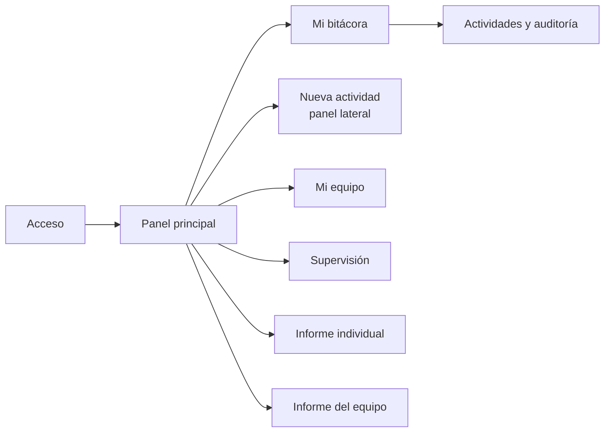

| Pantalla | Quién | Qué muestra |
|---|---|---|
| Acceso | Todas | Formulario de usuario y contraseña; un error de credenciales no dice cuál de los dos falló. Pantallas de primer acceso y recuperación con código |
| Panel principal | Todas | Fecha laboral y «Nueva actividad», cinco indicadores (total, pendientes, en progreso, bloqueadas y completadas; siempre por estado actual y sin porcentajes), actividades de la fecha elegida, estado de la jornada (Abierta, Cerrada o sin bitácora) y calendario |
| Mi bitácora | Todas | Fecha y estado de la jornada junto al título, actividades con filtro por tipo (planificadas y no planificadas), avances, resumen, cierre y reapertura y acceso a la auditoría |
| Nueva actividad | Todas | Panel lateral con dos tipos: **planificada** (estado inicial Pendiente, sin avances) y **no planificada** (estado, descripción y motivo de bloqueo cuando corresponde). Una sola pregunta al descartar cambios sin guardar |
| Planificación y Actividades | Todas | Planificación (abre el panel «Nueva actividad»), continuaciones, lista con filtro por estado y detalle de las propias actividades, corregir, reactivar, marcar por error y consultar la auditoría |
| Mi equipo | Todas | Solo lectura: lista de integrantes vigentes y detalle; la bitácora de un compañero se carga al elegirlo, y el histórico es por fechas |
| Gestión del equipo | Supervisor | Crear colaboradores en su equipo, emitir su código de primer acceso (se muestra una sola vez) y finalizar su pertenencia. No crea equipos ni supervisores (esa provisión sigue siendo por línea de órdenes) |
| Supervisión | Supervisor | Actividades del equipo en un período con totales por estado al corte, «Estado al corte» y «Estado actual» por separado en cada fila, historial de cada actividad y su auditoría |
| Informe individual | Todas (supervisión puede elegir a una persona de su equipo) | Informe con cifras CALCULADO, registros y bloqueos REGISTRADO y narrativa REDACTADO CON IA aparte |
| Informe del equipo | Supervisor | Cifras del equipo y cada persona con registros autorizados, sin clasificaciones |

Capturas reales del rediseño (clon limpio, FastAPI sirviendo el cliente y PostgreSQL desechable, solo datos ficticios; el informe usa el generador **simulado**, que no es inteligencia artificial):

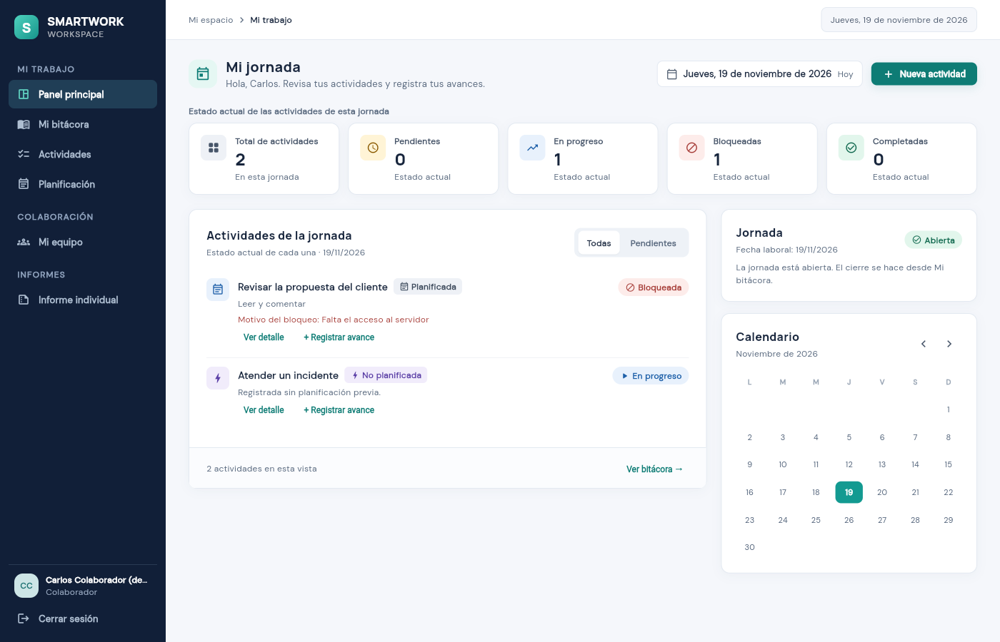

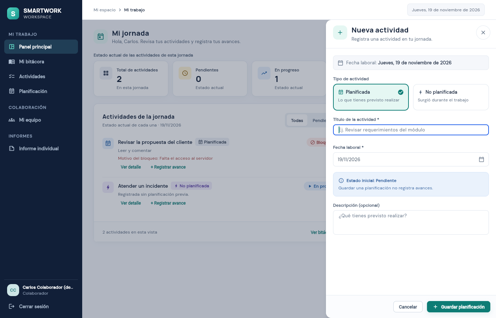

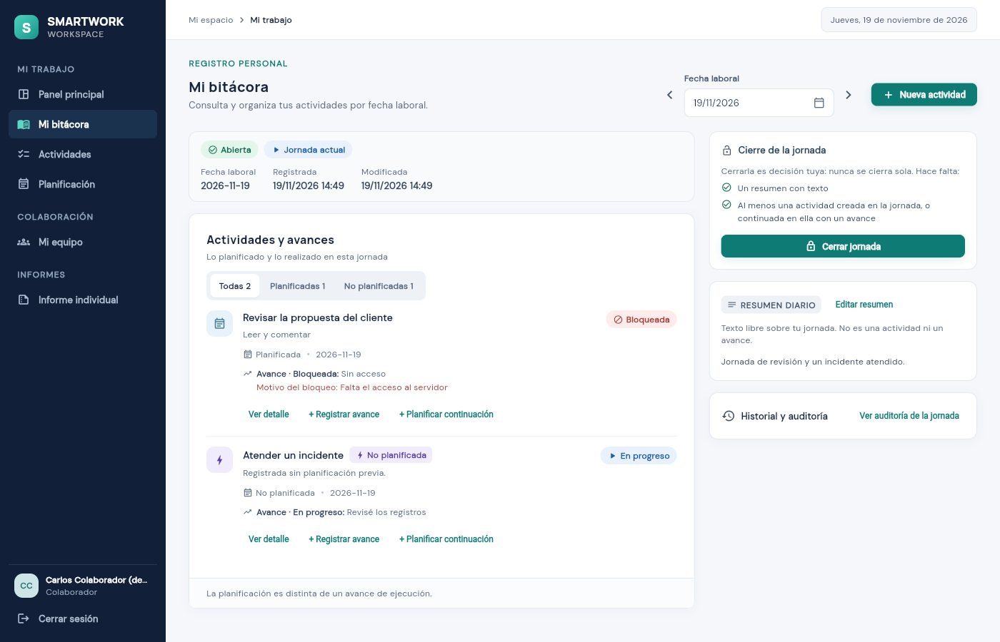

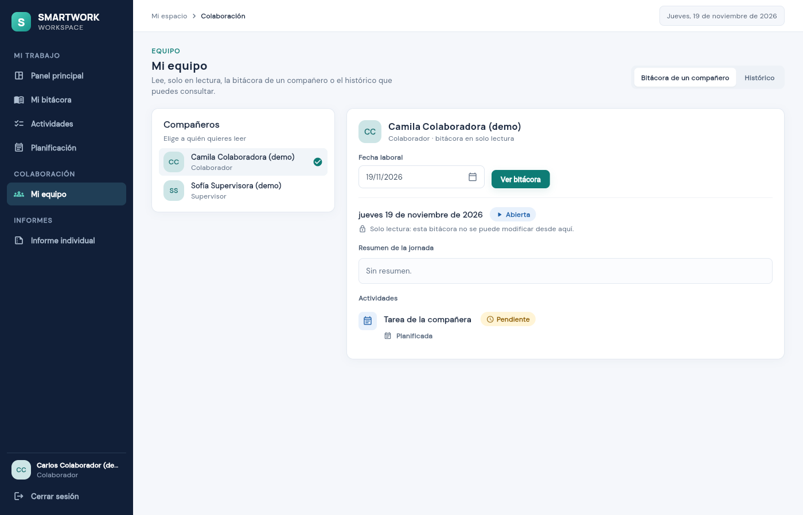

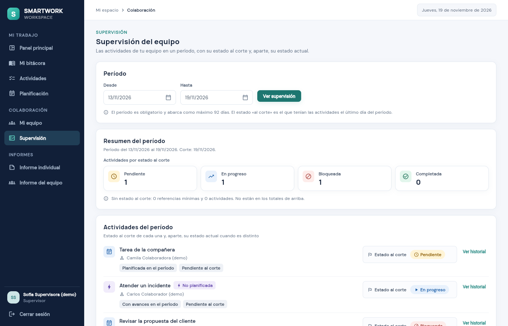

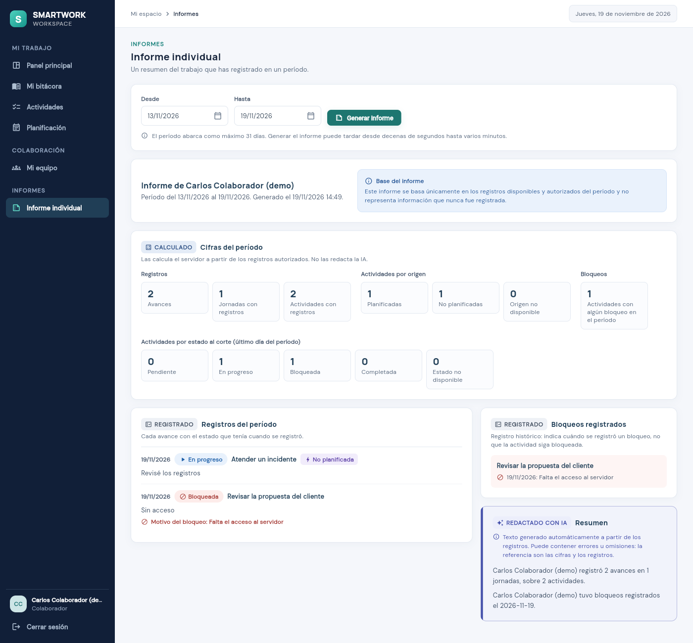

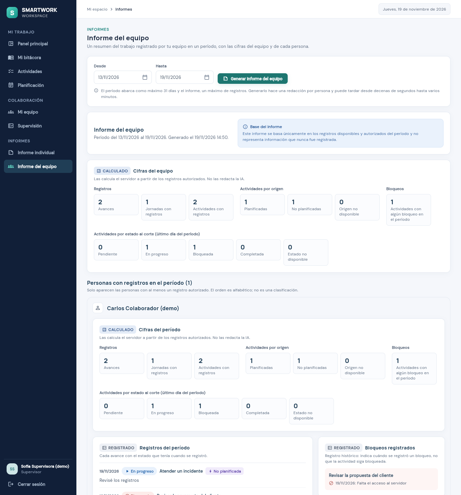

Móvil (la barra lateral es un menú desplegable):

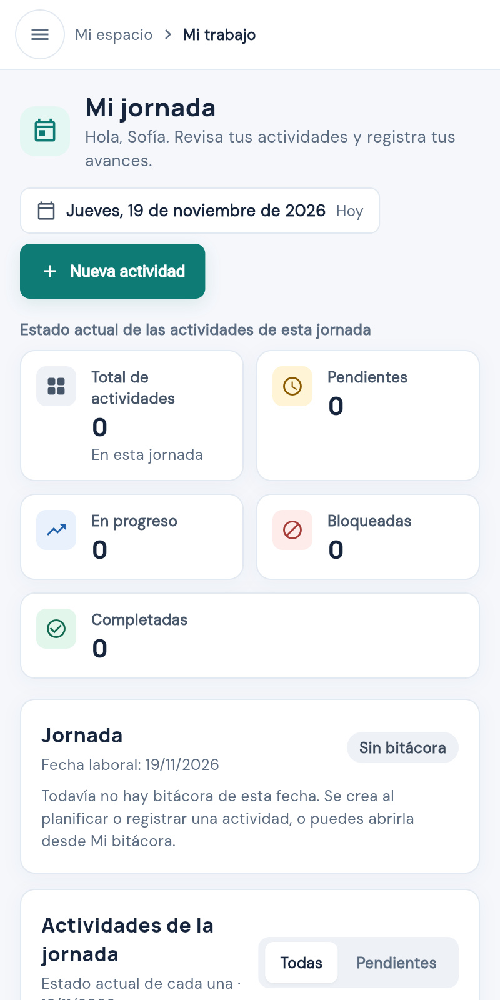

Las capturas anteriores al rediseño (`docs/evidencia/01-acceso.jpg` a `07-movil-menu.jpg`) se conservan como histórico y ya no representan la interfaz actual.

**Decisiones de diseño.**

- Los iconos son Material, porque los glifos Unicode se dibujan como cuadrados vacíos en Flutter Web si falta la fuente.
- Los indicadores cuentan las actividades que la API devuelve para la jornada elegida (una fecha por consulta) y muestran su **estado actual**; no hay porcentajes ni barras de progreso, y un valor desconocido se muestra como un guion, nunca como un cero.
- No se muestran horarios ni duraciones de actividad: no se registran. Solo aparecen momentos reales de registro, cierre o generación.
- «Nueva actividad» es un único panel lateral reutilizable en lugar de dos pantallas: tras guardar se cierra, se permanece donde se estaba y se refrescan los datos; guardar para otra fecha lo dice en el aviso sin cambiar el día visible.
- El botón de notificaciones aparece deshabilitado con una explicación, porque no hay notificaciones.
- Un informe de M5 no tiene porcentaje de avance: el servidor no informa progreso, y la pantalla avisa de que la generación puede tardar.
- Las tipografías se cargan desde Google Fonts al abrir la aplicación. Es una petición externa de solo fuentes, sin datos de las bitácoras; servirlas desde el propio origen queda como mejora.

La propuesta visual de partida no está publicada en el repositorio y por eso no se enlaza.

### **1.4. Instrucciones de instalación y ejecución:**

**Requisitos.** Git, PostgreSQL 16 o superior (probado con 18.4), [uv](https://docs.astral.sh/uv/) (descarga Python 3.13 por su cuenta, así que hace falta conexión a Internet), Flutter 3.35.3 con Dart 3.9.2 y un navegador moderno. Probado en Windows 11 con Git Bash. **Verificación (2026-11-19).** Los pasos 1, 2 y 4 a 8 se ejecutaron sobre un clon limpio del repositorio, con un clúster de PostgreSQL 18.4 desechable en otro puerto: roles y bases, `backend/.env`, `uv sync`, migraciones hasta 0018, semilla, compilación de Flutter Web, FastAPI sirviendo el cliente y un recorrido real de ambos roles en Chrome (35 comprobaciones HTTP de M1 a M5 superadas). El paso 3 (rol de provisión) **no se pudo automatizar**: `\password` pide la contraseña por la consola y no acepta una tubería; en la verificación el rol se creó con el propio script y su contraseña se fijó con `ALTER ROLE` en la base desechable. El paso 9 (pruebas) no se repitió en el clon: se ejecutó en el repositorio de trabajo.

**Convenciones.**

- Las órdenes están escritas para **Bash** (en Windows, Git Bash). En PowerShell no sirven `&&` ni la barra invertida `\` de continuación de línea: escribir cada orden en una sola línea y por separado.
- **Cada bloque parte de la raíz del repositorio** y termina de vuelta en ella (`cd ..`).
- En Windows el instalador de PostgreSQL **no añade `psql` al `PATH`**: añadir la carpeta `bin` (por ejemplo `C:\Program Files\PostgreSQL\18\bin`) o invocarlo con la ruta completa.
- **No se versionan secretos.** Todo valor que dice `CAMBIAR` o `ELEGIR` lo elige quien instala y no se guarda en el repositorio.

**1. Obtener el código y la rama.**

```bash
git clone https://github.com/marlonbossa09/AI4Devs-finalproject.git
cd AI4Devs-finalproject
git switch final-project-eq
```

**2. Roles y bases de datos de PostgreSQL.** El script crea dos roles con privilegios mínimos (`smartwork_owner` para las migraciones y `smartwork_app` para la API, sin DDL) y dos bases separadas (`smartwork_dev` y `smartwork_test`). No contiene secretos: las contraseñas se pasan como variables. Se ejecuta **una vez**, como superusuario (`psql` pide su contraseña).

**Elegir contraseñas que solo usen letras, números y `-`, `_`, `.` o `~`.** Irán dentro de una URL en el paso 4: un `@`, `/`, `:` o `%` la rompe, salvo que se escriba codificado (`@` → `%40`). Síntoma de una contraseña mal codificada: la API arranca pero `/health/ready` responde 503.

```bash
psql -h 127.0.0.1 -p 5432 -U postgres -d postgres \
     -v owner_password='ELEGIR-UNA' -v app_password='ELEGIR-OTRA' \
     -f backend/scripts/provision_db.sql
```

**3. Rol de provisión.** Las migraciones 0009 y 0010 exigen que el rol de PostgreSQL `smartwork_provision` exista **antes de migrar** (la migración no puede crear roles) y fallan con un mensaje claro si no existe. Lo crea `backend/scripts/provision_rol_de_provision.sql`, una vez, como superusuario. La contraseña la pide `\password` sin eco (dos veces). El script solo acepta `-v base=smartwork_test`: crea el rol (que es del servidor) y le concede conexión únicamente a esa base.

```bash
psql -h 127.0.0.1 -p 5432 -U postgres -d postgres \
     -v base=smartwork_test -f backend/scripts/provision_rol_de_provision.sql
```

En PowerShell, la misma orden en una sola línea: `& "C:\Program Files\PostgreSQL\18\bin\psql.exe" -h 127.0.0.1 -p 5432 -U postgres -d postgres -v base=smartwork_test -f backend\scripts\provision_rol_de_provision.sql`.

**4. Configuración (`backend/.env`).** Copiar la plantilla (el archivo `.env` está ignorado por Git; solo se versiona `.env.example`):

```bash
cp backend/.env.example backend/.env
```

Editar `backend/.env`:

- Sustituir `CAMBIAR` por las contraseñas elegidas: la de `smartwork_app` en `DATABASE_URL` y `TEST_DATABASE_URL`; la de `smartwork_owner` en `MIGRATIONS_DATABASE_URL` y `TEST_MIGRATIONS_DATABASE_URL`; la del rol de provisión en `PROVISION_DATABASE_URL` y `TEST_PROVISION_DATABASE_URL`. Si PostgreSQL no usa el puerto 5432, cambiarlo en esas URL. No cambiar los nombres de las bases: la de pruebas debe llamarse exactamente `smartwork_test`.
- **`AUTH_PEPPER`** (obligatorio): secreto propio de al menos 32 caracteres. Sin él, la API no arranca. Generar uno: `python -c "import secrets; print(secrets.token_urlsafe(48))"`.
- **`CODE_PEPPER`** (obligatorio): segundo secreto, **distinto** de `AUTH_PEPPER` y de al menos 32 caracteres, que se genera igual. Sin él, la API no arranca.
- `APP_ENV=development` (por defecto): solo se admiten `development` y `test`.
- `TRUSTED_PROXIES`: vacío por defecto; solo se rellena si hay un proxy inverso delante.
- `COMPROMISED_PASSWORDS_DIR`: opcional y vacío por defecto. Sin él, la comprobación de contraseñas comprometidas está inactiva (rige solo la longitud mínima) y la API lo avisa al arrancar; ver [docs/operacion/pwned-passwords.md](docs/operacion/pwned-passwords.md).
- **Informes (M5):** `INFORME_HABILITADO=false` e `INFORME_GENERADOR=ninguno` por defecto (generación desactivada). Ver la [sección 1.5](#15-inteligencia-artificial-en-m5).

Los parámetros marcados «local» (longitudes máximas de texto, ventana de idempotencia, mínimo de contraseña, duración de la sesión, control de intentos) son valores de desarrollo configurables: **no son reglas definitivas del producto**.

**5. Backend: dependencias, migraciones y datos ficticios.**

```bash
cd backend
uv sync
uv run alembic upgrade head
uv run python -m scripts.seed_dev
cd ..
```

`alembic upgrade head` aplica las **18 migraciones (0001 a 0018)**; la última es `0018_indice_historico_de_bitacoras`. En una base creada antes, hay que tener el rol de provisión (paso 3) antes de aplicarlas. La semilla crea una organización, un equipo y tres personas ficticias (`supervisor.demo`, `colaborador1.demo` y `colaborador2.demo`). Sus contraseñas se generan al ejecutarla y **se muestran una sola vez**: hay que anotarlas, porque no se guardan ni se versionan. La semilla se niega a ejecutarse fuera de un servidor local, con otro entorno que no sea de desarrollo o pruebas, o sobre una base cuyo nombre no termine en `_dev` o `_test` (salvo autorización por su nombre exacto en esa ejecución con `SMARTWORK_SEED_DATABASE=<nombre>`), y no sobrescribe una base que ya contiene datos. Las pertenencias de la semilla empiezan 60 días atrás para poder demostrar jornadas pasadas.

*Cuentas locales adicionales (opcional).* `backend/scripts/crear_cuentas.py` crea personas con su identidad y su pertenencia a un equipo, de forma idempotente y sin borrar nada. Lee las cuentas de `backend/.local/cuentas.json` y la contraseña inicial de `backend/.local/contrasena` (una sola línea, mínimo 10 caracteres; la carpeta `.local/` está ignorada por Git). Los roles posibles son `colaborador` y `supervisor`. `--simular` valida todo y deshace la transacción:

```bash
cd backend
uv run python -m scripts.crear_cuentas --base smartwork_dev --puerto 5432 --simular
uv run python -m scripts.crear_cuentas --base smartwork_dev --puerto 5432 --archivo-contrasena .local/contrasena
cd ..
```

*Provisión oficial.* Las órdenes de `uv run python -m scripts.provision <orden>` (crear equipos y personas, traslados, códigos de acceso) exigen una persona operadora identificada y el rol de provisión; sus invocaciones están en el [contrato de M1](docs/api/m1-acceso-usuarios-equipos.md). Los scripts del repositorio conceden al rol de provisión conexión solo a `smartwork_test`; usarlo sobre `smartwork_dev` exige un permiso adicional que **no está documentado ni verificado**. Para una demostración, usar la semilla y `crear_cuentas`.

**6. Cliente web (Flutter).** Los archivos generados (`*.g.dart`) están versionados, así que no hace falta ejecutar `build_runner`:

```bash
cd frontend
flutter pub get
flutter build web --release
cd ..
```

Para regenerarlos tras cambiar modelos o proveedores: `dart run build_runner build --delete-conflicting-outputs`.

**7. Arrancar FastAPI, que sirve también el cliente.** Por defecto `WEB_CLIENT_DIR=../frontend/build/web`, así que FastAPI sirve la API y el cliente compilado **en el mismo origen** (como pide [ADR-002](docs/arquitectura/adr/ADR-002-autenticacion-y-acceso.md)). La orden no termina: deja el servidor en marcha en esa terminal.

```bash
cd backend
uv run uvicorn app.main:app --host 127.0.0.1 --port 8000
```

*Modo de desarrollo del cliente (opcional, no verificado en esta revisión).* El código del cliente admite apuntar a otro origen de la API: `flutter run -d chrome --web-port 8080 --dart-define=API_BASE_URL=http://localhost:8000` desde `frontend/` (el origen `http://localhost:8080` figura en `CORS_ALLOWED_ORIGINS` de la plantilla). El recorrido de referencia es el del paso 7.

**8. Acceder y probar el flujo principal.**

1. Comprobar el servidor: <http://localhost:8000/health> responde `{"status":"ok"}` y <http://localhost:8000/health/ready> confirma la base de datos.
2. Abrir <http://localhost:8000> e iniciar sesión con `colaborador1.demo` y la contraseña que mostró la semilla.
3. En **Panel principal**, **Nueva actividad**: en el panel lateral, tipo **Planificada**, escribir un título y guardar. El panel se cierra, se permanece en el Panel principal y la actividad aparece como Pendiente. Recargar la página: la sesión y la actividad siguen ahí, porque están en PostgreSQL.
4. En **Mi bitácora**: **Registrar avance** (estado y descripción; **Bloqueada** exige motivo), **Nueva actividad** con el tipo **No planificada**, **Escribir resumen**; en **Actividades**, **Ver detalle**. **Cerrar jornada** (pide confirmación) y **Reabrir jornada** (motivo obligatorio, con constancia en la auditoría).
5. Repetir un registro con `colaborador2.demo`. Con `colaborador1.demo`, abrir **Mi equipo** y leer la bitácora de la compañera.
6. Con `supervisor.demo`: **Supervisión** (actividades del equipo por estado al corte, historial y auditoría), **Informe individual** (elegir a una persona del equipo) e **Informe del equipo**. Sin generador habilitado, un informe **sin datos** se muestra, y uno **con datos** avisa de que no pudo generarse (es el comportamiento por defecto). Para ver una narrativa de demostración, habilitar el generador simulado como se indica en la [sección 1.5](#15-inteligencia-artificial-en-m5). Hay un guion de unos 15 minutos en la [guía de demostración](docs/operacion/guia-de-demostracion.md).

La documentación interactiva de la API (`/docs`) solo existe en desarrollo (`APP_ENV=development`). Si tras recompilar el cliente el navegador muestra una versión antigua, es la caché del *service worker* de Flutter: borrar los datos del sitio desde las herramientas de desarrollo del navegador (Application → Storage).

**9. Ejecutar las pruebas.** Necesitan `TEST_DATABASE_URL`, `TEST_MIGRATIONS_DATABASE_URL` y `TEST_PROVISION_DATABASE_URL` de `backend/.env` apuntando a `smartwork_test`; si no, abortan antes de tocar nada. **La base de pruebas es aparte y debe llamarse exactamente `smartwork_test`**: las pruebas son destructivas (vacían tablas y revierten migraciones) y nunca deben apuntarse a la base de desarrollo ni a una compartida.

```bash
cd backend
uv run pytest
cd ../frontend
flutter test
flutter analyze
cd ..
```

La suite completa del backend tarda unos 16 minutos. Las pruebas que usan un Ollama real (`test_generador_ollama_real.py` y `test_evaluacion_ollama.py`) **se omiten por defecto** y necesitan una variable explícita. Para M5, una ejecución focalizada del backend:

```bash
cd backend
uv run pytest tests/test_informe_individual.py tests/test_informe_consolidado.py tests/test_generacion_informes.py tests/test_informes_http.py
cd ..
```

### **1.5. Inteligencia artificial en M5:**

**Qué existe.**

| Pieza | Estado |
|---|---|
| Núcleo determinista (selección autorizada, seis agregaciones, proyección neutral) | Implementado y probado |
| API de informes (`POST /api/v1/informes/individuales` y `/consolidados`, contratos v0.2) | Implementada y probada |
| Interfaz Flutter de informes | Implementada y probada |
| Generador **simulado** (`INFORME_GENERADOR=simulado`) | Disponible solo para desarrollo y pruebas. **No es un modelo de lenguaje**: escribe plantillas fijas a partir de los hechos |
| Ollama local (`INFORME_GENERADOR=ollama`) | **Experimental**, solo desarrollo local, con datos ficticios. Calidad **insuficiente para uso habitual** (evaluación parcial con muestras pequeñas: [plan de M5, sección 24](docs/backlog/tickets/m5-plan-implementacion.md)) |
| OpenRouter (`INFORME_GENERADOR=openrouter`) | **Experimental**, solo desarrollo y **solo datos ficticios**: los datos **salen de la máquina** hacia un tercero. Modelo gratuito, clave en el entorno (nunca versionada). Calidad variable y sin garantías ([ADR-003, sección 21](docs/arquitectura/adr/ADR-003-integracion-de-ia.md)) |
| Amazon Bedrock y AWS Lambda | **Arquitectura futura aplazada y no evaluada**: no se ha configurado ni usado nada de AWS ([ADR-003](docs/arquitectura/adr/ADR-003-integracion-de-ia.md)) |

**Reglas vigentes.** La generación está **desactivada por defecto** (`INFORME_HABILITADO=false`): sin habilitarla no se envía ningún dato a ningún generador. El rango máximo es de 31 días, hay un máximo de 400 hechos por solicitud y no hay reintentos de validación (`INFORME_MAX_RANGE_DAYS`, `INFORME_MAX_HECHOS` e `INFORME_REINTENTOS_VALIDACION`). **No se autoriza el uso de datos laborales reales con un LLM.** Toda narrativa se valida con comprobaciones deterministas (estructura, referencias, cifras, fechas y contenido no admitido), que **no** garantizan fidelidad, ausencia de valoraciones ni de órdenes citadas del texto libre.

**Habilitar el generador simulado (solo en un entorno de desarrollo seguro, con la base `_dev`).** En `backend/.env`:

```text
INFORME_HABILITADO=true
INFORME_GENERADOR=simulado
```

Con `APP_ENV=development` o `test`: el simulado se rechaza en cualquier otro entorno. Reiniciar FastAPI. Volver a `false` y `ninguno` al terminar. Las variables de Ollama (`INFORME_OLLAMA_URL`, `INFORME_OLLAMA_MODELO`, `INFORME_OLLAMA_TIMEOUT_SEGUNDOS` e `INFORME_OLLAMA_NUM_CTX`) existen como ejemplo comentado en la plantilla; no son necesarias para evaluar el proyecto y **no deben usarse con datos reales**.

**Limitaciones medidas.** La generación local con un modelo de 8 000 millones de parámetros en CPU tarda de 155 a 285 segundos por informe individual, y el consolidado hace una llamada por persona: el flujo HTTP síncrono resulta inviable en la práctica para ese caso. No hay colas ni ejecución asíncrona (los informes no se guardan). Detalle y resultados reales: [matriz de M5](docs/evidencia/matriz-trazabilidad-m5.md).

---

## 2. Arquitectura del Sistema

### **2.1. Diagrama de arquitectura:**

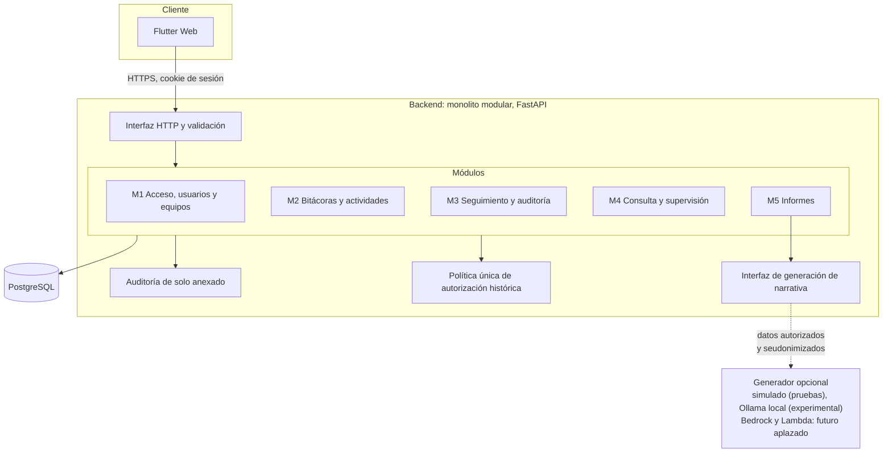

**Patrón y justificación.** Monolito modular con un módulo por funcionalidad, una única política de autorización en el backend y la IA detrás de una interfaz propia. Se eligió porque el producto necesita operaciones atómicas (guardar un cambio, recalcular el estado y auditar a la vez), una autorización histórica única para consulta, supervisión e informes, y poder cambiar de proveedor de IA sin tocar el resto. Ver [ADR-001](docs/arquitectura/adr/ADR-001-stack-tecnologico.md) y la [arquitectura general](docs/arquitectura/arquitectura-general.md).

### **2.2. Descripción de componentes principales:**

| Componente | Tecnología | Responsabilidad |
|---|---|---|
| Cliente web | Flutter Web, Riverpod y Dio | Presentación; no decide autorizaciones |
| Interfaz HTTP | FastAPI (Python 3.13) | Validación, errores comunes, prefijo `/api/v1` |
| Módulos M1 a M5 | FastAPI, SQLAlchemy 2.0 | Casos de uso de cada funcionalidad |
| Autorización histórica | Backend | Decide quién ve qué según el equipo de la persona en la fecha laboral del registro; la usan consulta, supervisión e informes |
| Auditoría | Backend y PostgreSQL | Entrada única por operación, atómica con el cambio; no se modifica ni se borra |
| Interfaz de generación | Backend | Genera la narrativa de los informes sin acoplarse a un proveedor; valida siempre la salida |
| Persistencia | PostgreSQL, Alembic | Datos del dominio, identidad, sesiones y auditoría (los informes no se persisten) |

### **2.3. Descripción de alto nivel del proyecto y estructura de ficheros**

```text
.
├── readme.md  prompts.md  CLAUDE.md
├── docs/                        Especificación (alcance, PRD, historias, ADR, modelo, API, tickets)
│   └── evidencia/               Capturas y matrices de trazabilidad M1 a M5
├── backend/                     FastAPI + SQLAlchemy 2.0 + Alembic (monolito modular)
│   ├── app/
│   │   ├── main.py  config.py  db.py  errores.py  salud.py
│   │   ├── seguridad/           Argon2id, sesiones y token CSRF, verificación del origen
│   │   ├── compartido/          Política de acceso y visibilidad, auditoría, idempotencia, fechas
│   │   ├── provision/           CLI de provisión oficial (M1)
│   │   └── modulos/             acceso, bitacoras, auditoria, consulta (M4) e informes (M5)
│   ├── migrations/versions/     0001 a 0018 (SQL escrito a mano)
│   ├── scripts/                 provision.py, seed_dev.py y crear_cuentas.py (desarrollo), provision_db.sql,
│   │                            provision_rol_de_provision.sql, verificar_datos.py, lista_contrasenas.py
│   └── tests/                   Integración sobre PostgreSQL real y extremo a extremo
└── frontend/                    Flutter Web, Riverpod y Dio
    └── lib/
        ├── config/  core/       URL de la API, red, errores, tema, diseño y widgets reutilizables
        └── features/            auth, logbook, team, supervision y reports
```

El frontend sigue una arquitectura limpia por funcionalidad: `presentation` depende de `domain`, `data` implementa el contrato de `domain`, y `domain` no importa Flutter ni Dio. El código y los identificadores del frontend están en inglés; los campos JSON conservan los nombres en español de los contratos.

### **2.4. Infraestructura y despliegue**

El despliegue **no está decidido** (decisión DT-07) ni realizado. Las condiciones que el diseño ya impone son un único origen para la aplicación y la API detrás de un proxy inverso, HTTPS en todo el tráfico y un reloj sincronizado en el servidor:

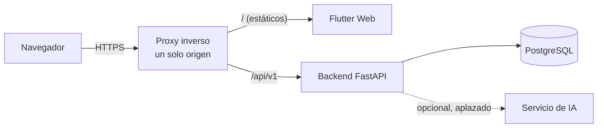

En local, FastAPI sirve el cliente compilado y la API desde un único origen, que es la condición que el diseño exige al proxy inverso. La arquitectura futura de IA (Amazon Bedrock y AWS Lambda) está decidida solo para planificación y **no se ha implementado ni configurado**.

### **2.5. Seguridad**

**Implementado y comprobado:**

- **Contraseñas con Argon2id** (19 MiB, 2 iteraciones, paralelismo 1, configurables), con un mínimo de 10 caracteres (ADR-002, A8). Solo se guarda el hash. Comprobación opcional contra contraseñas comprometidas con un conjunto local.
- **Sesiones revocables en el servidor**, guardadas en PostgreSQL; la cookie lleva un secreto aleatorio de 256 bits y la base solo guarda su hash. Caducan tras 1 hora de inactividad y a las 24 horas.
- **Cookie `__Host-`** con `Secure`, `HttpOnly`, `SameSite=Strict` y sin `Domain`.
- **CSRF:** token en una cabecera propia, derivado con HMAC del secreto de la sesión, más verificación del `Origin` (o `Referer`).
- **Protección frente a intentos fallidos (M1-T7):** cinco intentos libres y, después, esperas que se duplican hasta 1 hora, por identificador normalizado y origen; respuesta 429.
- **Códigos de un solo uso (M1-T8)** para el primer acceso y la recuperación: solo se guarda su HMAC, caducan y no se reutilizan.
- **Errores uniformes:** un identificador inexistente y una contraseña incorrecta dan la misma respuesta; un recurso inexistente y uno ajeno son indistinguibles.
- **Privilegios mínimos en la base de datos:** la API no puede crear objetos, no borra nada y solo inserta y lee en la auditoría, que es de solo anexado.
- **Provisión por CLI del servidor**, sin endpoints HTTP administrativos, con persona operadora identificada y rol de PostgreSQL propio.
- **Idempotencia** de las operaciones que crean registros y **concurrencia** controlada con bloqueos de fila.
- **Autorización histórica única** en el backend para consulta, supervisión e informes; una actividad de otro equipo se proyecta de forma neutral; los informes no devuelven identificadores internos ni datos de acceso.
- **IA:** generación desactivada por defecto; el destino de Ollama solo puede ser local; el texto libre viaja al generador como dato delimitado, nunca como instrucciones; la narrativa se trata como contenido no confiable y se muestra como texto plano; no se registran prompts, respuestas ni cuerpos de informes.
- **Datos de prueba protegidos:** la semilla se niega fuera de un servidor local y de una base `_dev` o `_test`; las pruebas abortan si no usan una base `_test`; no hay suplantación de identidad ni cabecera de elusión de la autenticación. Sin secretos en el repositorio: `backend/.env` está ignorado y solo se versiona `.env.example`.

**Limitaciones que hay que resolver antes de cualquier despliegue** (no hay despliegue hecho ni probado):

1. **Cabeceras de proxy (DT-07).** El control de intentos usa la dirección de la conexión como origen y solo acepta `X-Forwarded-For` de un proxy expresamente configurado en `TRUSTED_PROXIES`.
2. **HTTPS obligatorio.** La cookie `__Host-` es `Secure`: sin HTTPS no se establece la sesión.
3. **Credenciales y roles.** Hoy salen de `backend/.env`. En un despliegue deben venir de un gestor de secretos, con dos identidades distintas: `smartwork_owner` solo para migraciones y `smartwork_app` sin DDL.
4. **Conexiones.** El tamaño del *pool* por instancia multiplicado por el número de instancias debe caber en las conexiones máximas de PostgreSQL; no se ha medido.
5. **Tope agregado de intentos fallidos.** El tope de 100 fallos con deshabilitación de la contraseña (ADR-002, A9) está diferido.
6. **Auditoría.** La retención (PA-06) no está decidida y no hay copias de seguridad definidas.
7. **Observabilidad.** Hay un identificador de correlación en los errores y los informes no registran contenido, pero no se ha definido la recogida de registros y métricas.
8. **Origen del cliente.** Servirlo desde otro sitio (CDN, S3) exige replantear el origen, la cookie y el CSRF.
9. **Verificación de seguridad.** No se ha hecho una prueba de penetración ni una auditoría de dependencias. Las pruebas de interfaz en navegador se hicieron a mano con Chrome (y con guiones ajenos al repositorio); no hay pruebas automáticas en navegador dentro del repositorio ni se probaron otros navegadores.
10. **Idempotencia.** Una clave caducada se trata como nueva y no hay tarea de limpieza de sus filas.
11. **Datos laborales reales con un LLM:** no autorizados; ver la [sección 9](#9-limitaciones-reservas-y-decisiones-pendientes).

### **2.6. Tests**

Resultados de las **ejecuciones documentadas** (no se repitieron para redactar este README). Las de backend usan PostgreSQL real desechable; las de Flutter usan repositorios en memoria que imitan al servidor, por lo que **no sustituyen** a la integración real.

| Verificación | Resultado | Fecha y origen |
|---|---|---|
| Backend (`pytest`, suite completa) | **3139 superadas y 13 omitidas, 0 fallos.** Las omitidas son pruebas de Ollama real (que requieren una variable explícita) y una omisión previa conocida | 2026-11-19, cierre de M5 ([matriz de M5](docs/evidencia/matriz-trazabilidad-m5.md)) |
| Frontend (`flutter test`) | **1062 superadas** (repositorios en memoria) | 2026-11-19, validación del rediseño visual (una sola ejecución completa) |
| Frontend, ejecución focalizada posterior | **149 superadas** (Mi bitácora, resumen, cierre, Mi equipo y Supervisión, pruebas generales) | 2026-11-19 |
| `flutter analyze` | Sin incidencias | 2026-11-19 |
| Instalación limpia y recorrido real | Migraciones hasta 0018, semilla y 35 comprobaciones HTTP de M1 a M5 superadas con FastAPI y PostgreSQL desechable; recorrido en Chrome de ambos roles | 2026-11-19, ver sección 1.4 |
| Migración actual | **0018** | `alembic heads` |

Las pruebas de backend cubren esquema y restricciones, autenticación, CSRF y origen, M1 a M5 (provisión, acceso, bitácoras, cierre y reapertura, correcciones, auditoría, consulta histórica, supervisión, informes y adaptador local), concurrencia, atomicidad y arranque real con uvicorn. Las de Flutter cubren modelos, cliente HTTP, reglas puras, pantallas con repositorios falsos y diseño responsive (sin desbordes a 1400, 900 y 400 px, también con texto al 150 %).

**Evidencia de extremo a extremo.** Recorridos reales en Chrome contra FastAPI y PostgreSQL desechable: M2 y M3 (cierre técnico del 2026-11-11), M4 (M4-T7 a M4-T9) y los informes de M5 (M5-T6, con el generador **simulado**, datos ficticios y bases desechables ya eliminadas). Detalle por criterio:

| Matriz de trazabilidad | Contenido |
|---|---|
| [M1](docs/evidencia/matriz-trazabilidad-m1.md) | 65 criterios de HU-1.1 a HU-1.7 (al cierre de M1) |
| [M2 y M3](docs/evidencia/matriz-trazabilidad-m2-m3.md) | Contrato → criterio → componente → prueba → estado |
| [M4](docs/evidencia/matriz-trazabilidad-m4.md) | 61 criterios vinculados (59 implementados y probados; CA-19 y CA-20 reconciliados después en la de M5) |
| [M5](docs/evidencia/matriz-trazabilidad-m5.md) | 38 criterios propios: 34 implementados y probados y 4 parciales (CA-161, CA-163, CA-166 y CA-224) |
| [Verificación integral de M2](docs/evidencia/verificacion-integral-m2.md) | Recorrido real del cierre de M2 |

Ninguna prueba del repositorio usa datos laborales reales. Las pruebas de backend solo pueden tocar `smartwork_test`, en un servidor local y con un rol que no sea administrador (se comprueba antes de importar la aplicación, al abrir la sesión y antes de cada limpieza).

---

## 3. Modelo de Datos

### **3.1. Diagrama del modelo de datos:**

Nueve entidades funcionales. Las estructuras técnicas de identidad, sesiones, códigos, operadores e idempotencia se describen aparte (sección 3.10 del [modelo](docs/modelo-datos/modelo-datos.md)). **Los informes no se persisten**: el modelo no contiene entidades de IA.

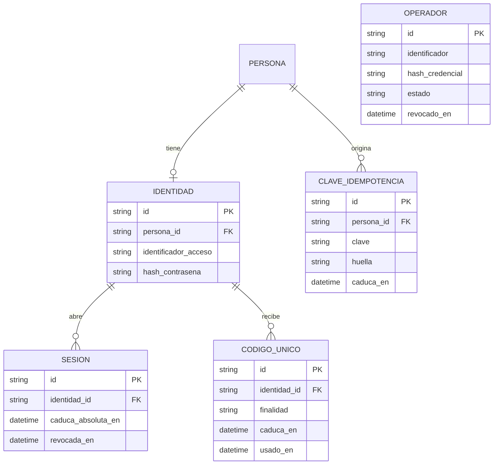

### **3.2. Descripción de entidades principales:**

| Entidad | Qué representa | Claves y relaciones principales |
|---|---|---|
| `ORGANIZACION` | La organización y su zona horaria única | 1 a N con `EQUIPO` |
| `EQUIPO` | Un equipo; «operativo» se deduce de sus pertenencias | N a 1 con `ORGANIZACION`; 1 a N con `PERTENENCIA` |
| `PERSONA` | Quien registra o consulta; sin credenciales; `acceso_desactivado_en` | 1 a N con `PERTENENCIA`, `BITACORA` y `ACTIVIDAD` |
| `PERTENENCIA` | Historial de equipo y rol por intervalo semiabierto de fechas laborales | Sin solapes; el equipo de un registro se deduce de ella |
| `BITACORA` | La jornada de una persona en una fecha laboral; única por persona y fecha | 1 a N con `ACTIVIDAD`, `PLANIFICACION` y `AVANCE` |
| `ACTIVIDAD` | Unidad de trabajo con propietaria inmutable, título obligatorio y `estado_actual` derivado | 1 a N con `PLANIFICACION` y `AVANCE` |
| `PLANIFICACION` | Lo previsto (original o continuación); no es un avance y no se edita | N a 1 con `ACTIVIDAD` y `BITACORA` |
| `AVANCE` | Registro de ejecución con estado histórico; ordenado por fecha laboral, momento e identificador | N a 1 con `ACTIVIDAD` y `BITACORA` |
| `AUDITORIA` | Entrada única por operación, de solo anexado | Referencia al registro afectado por tipo e identificador |

Atributos, tipos conceptuales, restricciones y las reglas de integridad: [modelo de datos](docs/modelo-datos/modelo-datos.md).

---

## 4. Especificación de la API

La especificación completa está en [docs/api/](docs/api/indice.md) (contratos por módulo, convenciones y errores). Las rutas son relativas a `/api/v1`. Operaciones implementadas:

| Módulo | Método y ruta |
|---|---|
| M1 | `POST /sesion` · `POST /sesion/cierre` · `GET /sesion` · `POST /acceso/primer-acceso` · `POST /acceso/recuperacion` |
| M2 | `GET /mi/bitacoras/{fecha}` · `POST /mi/bitacoras` · `PUT /mi/bitacoras/{fecha}/resumen` · `POST /mi/bitacoras/{fecha}/planificaciones` · `POST /mi/actividades/{id}/continuaciones-planificadas` · `POST /mi/actividades/{id}/avances` · `POST /mi/actividades-no-planificadas` · `GET /mi/actividades/{id}` · `GET /mi/actividades` |
| M3 | `POST /mi/bitacoras/{fecha}/cierre` · `POST /mi/bitacoras/{fecha}/reapertura` · `PATCH /mi/avances/{id}` · `POST /mi/actividades/{id}/reactivacion` · `POST /mi/actividades/{id}/marca-error` · `POST /mi/actividades/{id}/marca-error/reversion` · `GET /auditoria?tipo_objeto=&objeto_id=` |
| M4 | `GET /personas/{persona_id}/bitacoras/{fecha}` · `GET /historico` · `GET /equipo/supervision` · `GET /equipo/actividades/{id}` · `GET /equipo/integrantes` |
| M5 | `POST /informes/individuales` · `POST /informes/consolidados` |

La provisión administrativa de M1 (equipos, personas, traslados, desactivación y emisión de códigos) **no es HTTP**: son órdenes de la CLI del servidor. Toda operación que crea registros, y el cierre y la reapertura, exigen la cabecera `Idempotency-Key`. Los listados devuelven `{"elementos": [...], "siguiente": ...}`. Los informes no se guardan: cada solicitud genera uno nuevo con su propia fecha de generación. Las respuestas de informes tienen una estructura cerrada (contratos [M5-01](docs/api/m5-01-informe-individual-v0.2.md) y [M5-02](docs/api/m5-02-informe-consolidado-v0.2.md), versión 0.2 aprobada) y errores `INFORME_EXCEDE_LIMITES` (422) e `INFORME_NO_GENERADO` (503).

Ejemplo de petición a `POST /api/v1/mi/actividades/{actividad_id}/avances` (datos ficticios): `{"fecha_laboral": "2026-11-09", "estado": "En progreso", "descripcion": "Revisión de los requisitos del módulo de acceso"}`.

Ejemplo de petición a `POST /api/v1/informes/individuales` (datos ficticios; `persona_id` es opcional y solo lo admite quien supervisa): `{"desde": "2026-11-03", "hasta": "2026-11-09"}`.

### Salud y disponibilidad

Dos comprobaciones de infraestructura, en la raíz (sin `/api/v1`) y fuera de los contratos de negocio. No requieren autenticación y nunca incluyen credenciales, cadenas de conexión ni datos de personas.

| Endpoint | Para qué sirve | Respuesta |
|---|---|---|
| `GET /health` | **Vivacidad:** el proceso atiende peticiones. No usa la base de datos | `200` `{"status": "ok"}` |
| `GET /health/ready` | **Disponibilidad:** ejecuta `SELECT 1` en PostgreSQL | `200` `{"status": "ok", "checks": {"database": "ok"}}`, o `503` si la base no responde |

La espera máxima a PostgreSQL la fija `DB_CONNECT_TIMEOUT_SECONDS` (3 s por defecto). Las respuestas llevan `Cache-Control: no-store`.

---

## 5. Historias de Usuario

33 historias con criterios DADO / CUANDO / ENTONCES, trazadas a reglas de negocio y requisitos: [índice](docs/backlog/indice.md). Una por módulo, con enlace a la historia completa:

| Módulo | Historia | Criterio de ejemplo |
|---|---|---|
| M1 | [HU-1.1 Identificarme para acceder](docs/backlog/M1-autenticacion-usuarios-equipos/HU-1.1-identificarme-para-acceder.md) | **CA-01:** sin identificar no se muestra ningún dato |
| M2 | [HU-2.4 Registrar avances conservando el estado histórico](docs/backlog/M2-bitacoras-laborales-hibridas/HU-2.4-registrar-avances-conservando-el-estado-historico.md) | **CA-45:** DADO una actividad mía CUANDO registro un avance en una jornada ENTONCES el avance conserva el estado que tenía la actividad en ese momento |
| M3 | [HU-3.3 Cerrar mi jornada](docs/backlog/M3-seguimiento-de-actividades-y-auditoria/HU-3.3-cerrar-mi-jornada.md) | **CA-93:** DADO una jornada con el resumen vacío CUANDO intento cerrarla ENTONCES no se permite |
| M4 | [HU-4.3 Supervisar mi equipo en un período](docs/backlog/M4-consulta-historica-y-supervision/HU-4.3-supervisar-mi-equipo-en-un-periodo.md) | **CA-146:** DADO un supervisor CUANDO consulta la vista ENTONCES solo incluye actividades de su equipo y no de otros equipos |
| M5 | [HU-5.4 Informe cuando faltan registros](docs/backlog/M5-informes-individuales-y-consolidados-con-ia/HU-5.4-informe-cuando-faltan-registros.md) | **CA-172:** DADO un período sin ningún registro autorizado CUANDO se genera un informe ENTONCES el informe indica explícitamente que no hay datos disponibles |

---

## 6. Tickets de Trabajo

34 tickets documentales (base de datos, backend y frontend) con su orden y prioridad: [índice de tickets](docs/backlog/tickets/indice.md). La implementación se planificó por módulo, con análisis, decisiones y evidencia por ticket: [plan de M1](docs/backlog/tickets/m1-plan-implementacion.md), [plan de M4](docs/backlog/tickets/m4-plan-implementacion.md) y [plan de M5](docs/backlog/tickets/m5-plan-implementacion.md). Un ejemplo:

**BE-08 — Avances, secuencia y estado actual**
- **Prioridad:** P0 · **Capa:** Backend
- **Objetivo:** Registrar avances manteniendo una secuencia válida y el estado actual correcto.
- **Historias y criterios:** HU-2.4, HU-2.5, HU-2.8, HU-2.9, HU-3.8.
- **Dependencias:** BE-07, DB-03.
- **Terminado cuando:**
  - Un avance retroactivo anterior a una finalización se acepta sin reactivar y no altera el estado de uno posterior.
  - Un avance tras una finalización sin reactivación se rechaza.
  - Dos registros simultáneos sobre una actividad dejan un estado actual coherente con la secuencia.

---

## 7. Pull Requests

No hay pull requests abiertos ni documentados en este repositorio. El trabajo se desarrolló en la rama `final-project-eq` mediante commits locales por ticket. Si el enunciado oficial de la entrega exige pull requests, quedan pendientes de contraste con él (ver la sección 0.5).

---

## 8. Estado de implementación

| Módulo | Implementado y verificado | Reservas y pendiente |
|---|---|---|
| **M1** | Sesión y control de intentos, pertenencias e historial, visibilidad histórica, provisión por CLI, desactivación de acceso, códigos de primer acceso y recuperación, comprobación opcional de contraseñas comprometidas. **Cerrado técnicamente con reservas** | Medio de entrega de códigos y verificación de identidad (PA-12); reactivación de un acceso (sin regla); tope agregado de 100 fallos diferido; la matriz de M1 conserva el estado de su cierre y no está reconciliada con M4 ni M5 |
| **M2** | Todo el alcance de M2. **Cerrado técnicamente** | Ninguna del alcance de M2 |
| **M3** | Todo el alcance de M3 (cierre, reapertura, corrección, reactivación, marca de error, auditoría propia y del supervisor). **Cerrado técnicamente** | Ninguna del alcance de M3 |
| **M4** | Lectura entre pares, histórico, supervisión, historial de actividad y auditoría del supervisor. **Cerrado con reservas** | Mejoras no bloqueantes y riesgos de volumen y despliegue de la [matriz de M4](docs/evidencia/matriz-trazabilidad-m4.md) |
| **M5** | Núcleo determinista, API M5-01 y M5-02, interfaz de informes y adaptador local. **Cerrado técnicamente con reservas** (34 de 38 criterios implementados y probados y 4 parciales) | Calidad de la narrativa real insuficiente; D-M5-06 parcialmente abierta; P-14 pendiente de esquema; sin evaluación de Bedrock y Lambda; datos reales con un LLM no autorizados |

**Interfaz.** Las pantallas de M1 a M5 tienen el sistema visual unificado (UX-T1 a UX-T9) y «Nueva actividad» es un panel lateral; el rediseño no cambió contratos, reglas de negocio, permisos ni estados. Reservas de la interfaz: no se verificó el teclado virtual en móvil ni lectores de pantalla reales, y las capturas de tableta y móvil son parciales.

**Producción: no habilitada.** No hay despliegue, ni HTTPS, ni gestión de secretos, ni observabilidad definida.

---

## 9. Limitaciones, reservas y decisiones pendientes

**Inteligencia artificial (M5).**

- La narrativa de IA es **experimental y está desactivada por defecto**. Ollama no está validado para uso habitual: con `qwen2.5:3b-instruct`, 1 de 5 informes individuales fue aceptado por el validador y el consolidado fue rechazado; con `qwen3:8b`, 3 de 5 fueron aceptados (155 a 285 s por informe) y el consolidado no se ejecutó. **Son muestras exploratorias y no permiten extrapolar tasas de éxito.**
- Un modelo puede **citar o convertir en hechos las instrucciones maliciosas** del texto libre, afirmar lo que el registro no dice o valorar a una persona; el validador determinista no lo detecta. Un texto aceptado por el validador no es por ello un informe de calidad satisfactoria.
- **Datos laborales reales con un LLM: no autorizados** (D-M5-08). Faltan, entre otros, la base de tratamiento y privacidad, la detección de datos personales en el texto libre, la evaluación semántica por muestras y el control de consumo y disponibilidad ([matriz de M5](docs/evidencia/matriz-trazabilidad-m5.md), sección 9).
- **Decisiones abiertas:** máximo de tokens de entrada y de salida, plazo total y concurrencia (D-M5-06; los valores de 1024 tokens, 360 s y concurrencia 1 son propuestas de evaluación); esquema del motivo del fallo en la interfaz (P-14); proveedor, modelo, región y retención (PA-09, resuelto en parte). **La ejecución asíncrona no está autorizada.** Amazon Bedrock y AWS Lambda están aplazados y no evaluados.
- Criterios parciales de M5: CA-161, CA-163 y CA-166 (calidad de la narrativa real) y CA-224 (la interfaz no ofrece el informe de quien ya no integra el equipo).

**Decisiones de implementación que no están en los contratos** (técnicas, sin cambiar ningún requisito):

- El token CSRF no se almacena: se deriva con HMAC del secreto de la sesión, porque M1-01c debe poder devolverlo.
- El rechazo por CSRF u origen responde `SOLICITUD_INVALIDA` (400) con el motivo en `detalles` (PA-30, provisional).
- Política de contraseñas: mínimo de **10 caracteres** (ADR-002, A8), decidido por la persona responsable; se aparta a propósito de los 15 que recomienda NIST SP 800-63B-4, que es una referencia y no una obligación.
- Valores locales (zona horaria `America/Bogota` de la semilla, duración de sesión, longitudes máximas de texto, ventana de idempotencia): configurables y sin valor de requisito.

**Otras decisiones pendientes** (registradas en el [alcance](docs/producto/alcance-mvp.md), sección 6.3): mecanismo operativo de la provisión y valores de sesión, códigos y contraseñas (PA-12); retención de la auditoría (PA-06); objetivos de rendimiento y volumen (PA-13); métricas de éxito (PA-11); despliegue y observabilidad (DT-07) y estrategia de pruebas (DT-08, [arquitectura general](docs/arquitectura/arquitectura-general.md)).

Flutter Web conserva riesgos conocidos de accesibilidad, carga inicial y pruebas en navegador. Todo contenido marcado `[PROPUESTO]` no es un requisito hasta que la persona responsable lo apruebe.

---

## 10. Mapa de la documentación

| Documento | Contenido |
|---|---|
| [docs/producto/alcance-mvp.md](docs/producto/alcance-mvp.md) | Alcance del MVP y registro de decisiones |
| [docs/producto/prd.md](docs/producto/prd.md) | Requisitos funcionales y no funcionales, trazabilidad y matriz de permisos |
| [docs/backlog/indice.md](docs/backlog/indice.md) | 33 historias y 301 criterios de aceptación |
| [docs/backlog/tickets/indice.md](docs/backlog/tickets/indice.md) | Tickets de implementación y flujo principal |
| [docs/arquitectura/arquitectura-general.md](docs/arquitectura/arquitectura-general.md) | Arquitectura, riesgos y decisiones técnicas |
| [docs/arquitectura/adr/](docs/arquitectura/adr/) | ADR-001 (stack), ADR-002 (autenticación), ADR-003 (IA) |
| [docs/modelo-datos/modelo-datos.md](docs/modelo-datos/modelo-datos.md) | Modelo de datos y reglas de integridad |
| [docs/api/indice.md](docs/api/indice.md) | Contratos de la API (M5: versión 0.2; [contrato interno de IA](docs/api/m5-integracion-ia.md)) |
| [docs/evidencia/](docs/evidencia/) | Capturas del rediseño (`ux/`) y matrices de trazabilidad M1 a M5 |
| [docs/operacion/pwned-passwords.md](docs/operacion/pwned-passwords.md) | Instalación local de la comprobación de contraseñas comprometidas |
| [docs/operacion/despliegue-ec2.md](docs/operacion/despliegue-ec2.md) | Demostración en Amazon EC2 con Docker Compose: contenedores, acceso por túnel SSH, comandos y bloqueos pendientes del HTTPS público |
| [docs/operacion/guia-de-demostracion.md](docs/operacion/guia-de-demostracion.md) | Guion breve para demostrar M1 a M5 con datos ficticios y el generador simulado |
| [docs/operacion/resumen-del-proyecto.md](docs/operacion/resumen-del-proyecto.md) | Resumen del estado real: objetivo, arquitectura, módulos, pruebas, limitaciones y requisitos |
| [backend/](backend/) y [frontend/](frontend/) | Código de la aplicación |
| [prompts.md](prompts.md) | Registro del uso de IA en el desarrollo |
| [CLAUDE.md](CLAUDE.md) | Reglas de trabajo para asistentes que colaboran en el repositorio |
