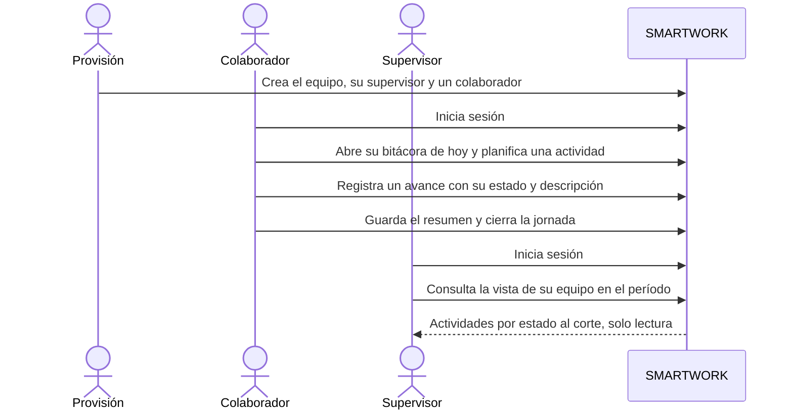
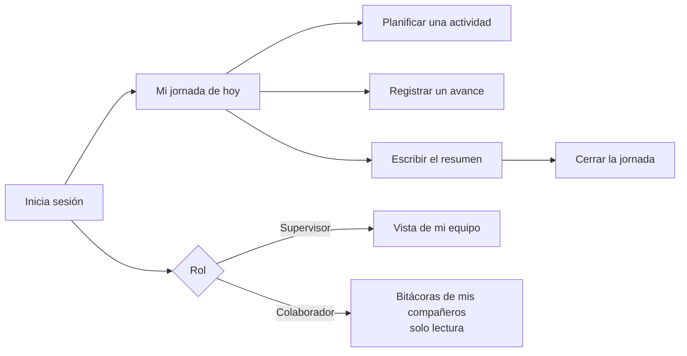
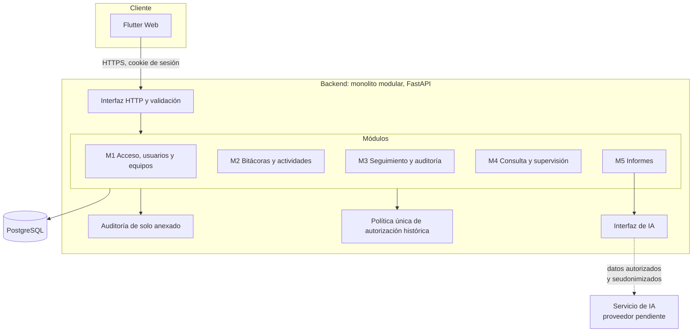
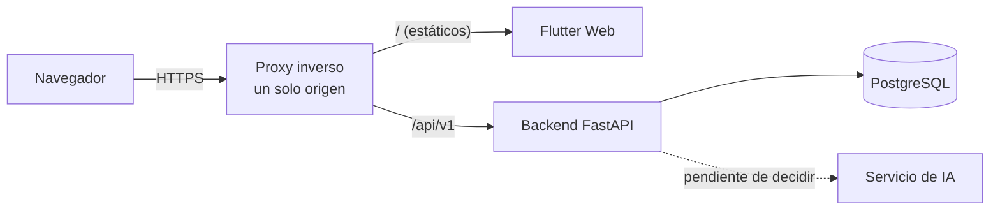
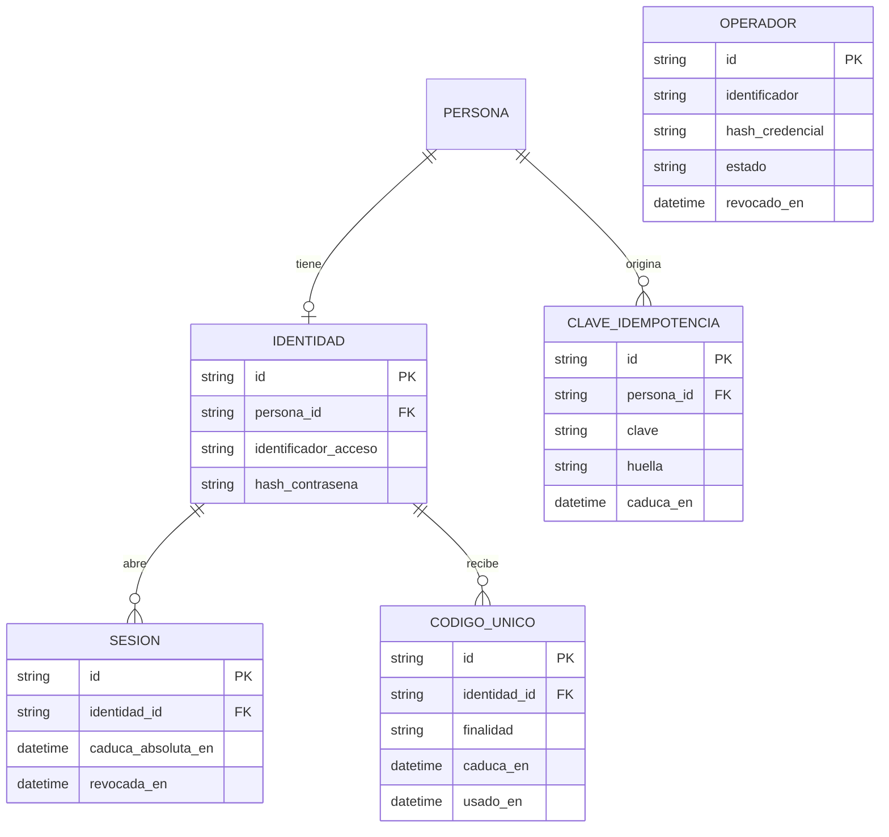

# SMARTWORK

> Plataforma web para registrar y consultar bitácoras laborales: qué se planea hacer, qué se hizo realmente, qué quedó pendiente y qué bloqueos hubo.

**Estado de esta entrega.** Documentación técnica del producto: alcance, requisitos, historias y criterios de aceptación, arquitectura, modelo de datos, contratos de la API y tickets de implementación. **No contiene código funcional, despliegue ni pruebas ejecutadas del producto.** Los detalles viven en [docs/](docs/); este documento los resume y enlaza en lugar de copiarlos.

## Índice

0. [Ficha del proyecto](#0-ficha-del-proyecto)
1. [Descripción general del producto](#1-descripción-general-del-producto)
2. [Arquitectura del sistema](#2-arquitectura-del-sistema)
3. [Modelo de datos](#3-modelo-de-datos)
4. [Especificación de la API](#4-especificación-de-la-api)
5. [Historias de usuario](#5-historias-de-usuario)
6. [Tickets de trabajo](#6-tickets-de-trabajo)
7. [Pull requests](#7-pull-requests)
8. [Alcance de las siguientes entregas](#8-alcance-de-las-siguientes-entregas)
9. [Decisiones y limitaciones técnicas pendientes](#9-decisiones-y-limitaciones-técnicas-pendientes)

---

## 0. Ficha del proyecto

### **0.1. Tu nombre completo:**

Edwin Quintana (EQ)

### **0.2. Nombre del proyecto:**

SMARTWORK

### **0.3. Descripción breve del proyecto:**

SMARTWORK sustituye la comunicación informal de las actividades diarias por mensajería con una bitácora laboral estructurada y consultable. Cada persona registra lo planificado, lo realizado, lo pendiente y los bloqueos; el supervisor ve el estado de su equipo; y los informes individuales y consolidados se generan con apoyo de IA a partir de lo realmente registrado.

### **0.4. URL del proyecto:**

No hay despliegue en esta entrega: el producto aún no está publicado.

### 0.5. URL o archivo comprimido del repositorio

<https://github.com/marlonbossa09/AI4Devs-finalproject>, rama `feature/entrega-1-eq`. Es el repositorio del proyecto final del curso AI4Devs, cuyas plantillas oficiales (`readme.md` y `prompts.md`) estructuran esta documentación. SMARTWORK se documenta como un producto de software profesional.

---

## 1. Descripción general del producto

### **1.1. Objetivo:**

**Problema.** Los equipos comunican hoy sus actividades diarias por mensajería instantánea. Eso provoca tres pérdidas: la información queda enterrada en conversaciones, no hay una forma fiable de consultar qué se hizo, cuándo y por qué, y quien necesita un informe lo reconstruye a mano. Además, no se distingue **lo planeado de lo realmente hecho**, ni se conserva **lo que quedó pendiente** y **los bloqueos**.

**Qué aporta.** Un único lugar donde cada persona registra su jornada; el trabajo que continúa de un día a otro se sigue sin duplicarse; toda corrección retroactiva queda auditada; y los informes se apoyan solo en los registros almacenados.

**Usuarios objetivo.** Dos roles funcionales y ningún tercero:

- **Colaborador:** registra y modifica sus propias actividades y consulta, en solo lectura, lo que le corresponde por su equipo.
- **Supervisor:** pertenece al equipo que supervisa, registra su propia bitácora y dispone de una vista consolidada de su equipo, sin modificar los registros ajenos.

La creación de usuarios y equipos se hace mediante una provisión administrativa controlada, sin panel de administración ni tercer rol. SMARTWORK **no** es una herramienta de evaluación del desempeño: no incorpora rankings ni valoraciones de personas.

Detalle: [alcance del MVP](docs/producto/alcance-mvp.md) y [PRD](docs/producto/prd.md).

### **1.2. Características y funcionalidades principales:**

Las cinco funcionalidades obligatorias (*must-have*) del MVP:

| Módulo | Qué hace | Historias | Contratos |
|---|---|---|---|
| **M1** Autenticación, usuarios y equipos | Acceso con credenciales propias, pertenencia de cada persona a un único equipo con un único supervisor, historial de pertenencias, baja lógica y provisión controlada | HU-1.1 a HU-1.7 | [M1](docs/api/m1-acceso-usuarios-equipos.md) |
| **M2** Bitácoras laborales híbridas | Una bitácora por persona y fecha laboral, con actividades estructuradas (cuatro estados, planificación original conservada, avances con descripción) y un resumen libre | HU-2.1 a HU-2.9 | [M2](docs/api/m2-bitacoras.md) |
| **M3** Seguimiento de actividades y auditoría | Continuidad entre jornadas sin duplicar, estado actual coherente con la secuencia de avances, cierre y reapertura de la jornada, correcciones, reactivación y auditoría de solo anexado | HU-3.1 a HU-3.8 | [M3](docs/api/m3-seguimiento-auditoria.md) |
| **M4** Consulta histórica y supervisión | Lectura de las bitácoras del equipo según el equipo al que pertenecía cada persona en esa fecha, histórico por fechas y vista consolidada del supervisor con estado al corte | HU-4.1 a HU-4.4 | [M4](docs/api/m4-consulta-supervision.md) |
| **M5** Informes individuales y consolidados con IA | Informes en pantalla a partir de registros autorizados, con indicadores calculados de forma determinista, sin valoraciones y con fallo explícito si la IA no responde | HU-5.1 a HU-5.5 | [M5](docs/api/m5-informes.md) |

Las 33 historias y sus 301 criterios de aceptación están en [docs/backlog/](docs/backlog/indice.md).

**Flujo principal de extremo a extremo (FP-1)**, el primero que se implementará:



Este flujo cubre M1 a M4 con prioridad máxima. M5 se implementa después (indicadores deterministas primero, narrativa con IA al final) porque depende de decisiones abiertas del proveedor. Detalle en los [tickets](docs/backlog/tickets/indice.md).

### **1.3. Diseño y experiencia de usuario:**

Todavía no existe interfaz: la experiencia se implementa en la entrega siguiente. El recorrido previsto de una persona es:



Las capturas o el vídeo de la experiencia se añadirán cuando haya interfaz. Los criterios de aceptación describen el comportamiento observable de cada pantalla.

### **1.4. Instrucciones de instalación:**

No aplica en esta entrega: no hay código que instalar. Cuando exista, el stack aprobado es Flutter Web, FastAPI (Python) y PostgreSQL ([ADR-001](docs/arquitectura/adr/ADR-001-stack-tecnologico.md)). Las instrucciones de puesta en marcha local, las migraciones y las semillas de datos ficticios (ticket [DB-07](docs/backlog/tickets/base-de-datos.md)) se documentarán al implementarlas.

---

## 2. Arquitectura del Sistema

### **2.1. Diagrama de arquitectura:**



**Patrón y justificación.** Monolito modular con un módulo por funcionalidad, una única política de autorización en el backend y la IA detrás de una interfaz propia. Se eligió porque el producto necesita operaciones atómicas (guardar un cambio, recalcular el estado y auditar a la vez), una sola fuente de verdad para la autorización histórica y bajo coste operativo para un equipo pequeño. La IA y la identificación se integran detrás de interfaces para no acoplar el producto a un proveedor. Detalle y alternativas: [ADR-001](docs/arquitectura/adr/ADR-001-stack-tecnologico.md) y [arquitectura general](docs/arquitectura/arquitectura-general.md).

### **2.2. Descripción de componentes principales:**

| Componente | Tecnología | Responsabilidad |
|---|---|---|
| Cliente web | Flutter Web | Presentación; no decide autorizaciones |
| Interfaz HTTP | FastAPI (Python) | Validación, errores comunes, prefijo `/api/v1` |
| Módulos M1 a M5 | FastAPI (Python) | Casos de uso de cada funcionalidad |
| Autorización histórica | Backend | Decide quién ve qué según el equipo de la persona en la fecha laboral del registro |
| Auditoría | Backend y PostgreSQL | Entrada única por operación, atómica con el cambio; no se modifica ni se borra |
| Interfaz de IA | Backend | Genera la narrativa de los informes sin acoplarse a un proveedor |
| Persistencia | PostgreSQL | Datos del dominio, identidad, sesiones y auditoría |

### **2.3. Descripción de alto nivel del proyecto y estructura de ficheros**

Estructura actual del repositorio (solo documentación):

```text
.
├── readme.md                  Este documento
├── prompts.md                 Registro del uso de IA en el desarrollo
├── CLAUDE.md                  Reglas de trabajo para asistentes de código
└── docs/
    ├── producto/              Alcance del MVP y requisitos (PRD)
    ├── backlog/               33 historias, 301 criterios y tickets de implementación
    │   └── tickets/           Base de datos, backend y frontend
    ├── arquitectura/          Arquitectura general y ADR (stack, autenticación, IA)
    ├── modelo-datos/          Modelo de datos
    └── api/                   Contratos de la API
```

El código se organizará como monolito modular (un módulo por funcionalidad) con el cliente web en una carpeta aparte; esa estructura se definirá al implementar y no existe todavía.

### **2.4. Infraestructura y despliegue**

El despliegue **no está decidido** (decisión DT-07). Las condiciones que el diseño ya impone son un único origen para la aplicación y la API detrás de un proxy inverso, HTTPS en todo el tráfico y un reloj sincronizado en el servidor:



No se ha realizado ningún despliegue.

### **2.5. Seguridad**

Prácticas diseñadas (ninguna implementada todavía):

- **Autorización centralizada en el backend** y respuestas idénticas ante un registro inexistente y uno no autorizado, para no revelar su existencia.
- **Autenticación propia** con contraseñas protegidas con Argon2id, sesiones revocables en el servidor, cookies `HttpOnly`, `Secure` y `SameSite`, protección CSRF y HTTPS ([ADR-002](docs/arquitectura/adr/ADR-002-autenticacion-y-acceso.md)).
- **Códigos de un solo uso** para el primer acceso y la recuperación; desactivación inmediata del acceso con revocación de sesiones.
- **Auditoría de solo anexado**, atómica con cada cambio; ninguna credencial se registra.
- **Idempotencia** de las operaciones no repetibles frente a reintentos.
- **IA con datos mínimos:** solo registros autorizados, personas seudonimizadas, sin el resumen libre, y el texto libre tratado siempre como dato ([ADR-003](docs/arquitectura/adr/ADR-003-integracion-de-ia.md)).

### **2.6. Tests**

No se ha ejecutado ninguna prueba del producto porque no existe. Lo que sí se ha comprobado son los documentos, con scripts de trabajo que no forman parte del repositorio:

- Los 301 criterios de aceptación cumplen el formato DADO / CUANDO / ENTONCES.
- Todos los requisitos confirmados están cubiertos por algún criterio, y cada regla de negocio llega a un criterio.
- Los 35 contratos de la API citan historias, requisitos y reglas que existen, y cubren los criterios de las historias (ver [índice de la API](docs/api/indice.md)).

Plan para la implementación: los criterios se convierten en pruebas de aceptación, con una matriz de permisos por rol y equipo, pruebas de seguridad ([ADR-002](docs/arquitectura/adr/ADR-002-autenticacion-y-acceso.md), sección 13) y una evaluación de la IA en español ([ADR-003](docs/arquitectura/adr/ADR-003-integracion-de-ia.md), sección 13).

---

## 3. Modelo de Datos

### **3.1. Diagrama del modelo de datos:**

Nueve entidades funcionales. Las estructuras técnicas de identidad, sesiones, códigos, operadores e idempotencia se describen aparte (sección 3.10 del [modelo](docs/modelo-datos/modelo-datos.md)).



### **3.2. Descripción de entidades principales:**

| Entidad | Qué representa | Claves y relaciones principales |
|---|---|---|
| `ORGANIZACION` | La organización y su zona horaria única | 1 a N con `EQUIPO` |
| `EQUIPO` | Un equipo; «operativo» se deduce de sus pertenencias | N a 1 con `ORGANIZACION`; 1 a N con `PERTENENCIA` |
| `PERSONA` | Quien registra o consulta; sin credenciales; `acceso_desactivado_en` | 1 a N con `PERTENENCIA`, `BITACORA` y `ACTIVIDAD` |
| `PERTENENCIA` | Historial de equipo y rol por intervalo semiabierto de fechas laborales | Sin solapes; el equipo de un registro se deduce de ella |
| `BITACORA` | La jornada de una persona en una fecha laboral; única por persona y fecha | 1 a N con `ACTIVIDAD`, `PLANIFICACION` y `AVANCE` |
| `ACTIVIDAD` | Unidad de trabajo con propietaria inmutable, título obligatorio y `estado_actual` derivado | 1 a N con `PLANIFICACION` y `AVANCE` |
| `PLANIFICACION` | Lo previsto (original o continuación); no es un avance y no se edita | N a 1 con `ACTIVIDAD` y `BITACORA` |
| `AVANCE` | Registro de ejecución con estado histórico; ordenado por fecha laboral, momento e identificador | N a 1 con `ACTIVIDAD` y `BITACORA` |
| `AUDITORIA` | Entrada única por operación, de solo anexado | Referencia al registro afectado por tipo e identificador |

Atributos, tipos conceptuales, restricciones y las 39 reglas de integridad: [modelo de datos](docs/modelo-datos/modelo-datos.md).

---

## 4. Especificación de la API

La especificación completa son 35 contratos (propuestos): [docs/api/](docs/api/indice.md). Extracto de tres operaciones principales en formato OpenAPI:

```yaml
openapi: 3.0.3
info:
  title: SMARTWORK API (extracto)
  version: 0.5-propuesto
servers:
  - url: /api/v1
paths:
  /mi/bitacoras:
    post:
      summary: Abrir mi bitácora de una fecha laboral (M2-01b)
      description: Idempotente. Si la bitácora ya existe, devuelve la misma sin modificarla.
      requestBody:
        required: true
        content:
          application/json:
            schema:
              type: object
              required: [fecha_laboral]
              properties:
                fecha_laboral: {type: string, format: date, example: "2026-11-09"}
      responses:
        "201": {description: Bitácora creada (creada true)}
        "200": {description: Bitácora existente, sin cambios (creada false)}
        "422": {description: FECHA_NO_CUBIERTA, la fecha no está cubierta por una pertenencia de la persona}
        "403": {description: ACCESO_DESACTIVADO o SIN_PERTENENCIA_VIGENTE}
  /mi/actividades/{actividad_id}/avances:
    post:
      summary: Registrar un avance sobre una actividad propia (M2-05)
      parameters:
        - {name: actividad_id, in: path, required: true, schema: {type: string}}
        - {name: Idempotency-Key, in: header, required: true, schema: {type: string}}
      requestBody:
        required: true
        content:
          application/json:
            schema:
              type: object
              required: [fecha_laboral, estado, descripcion]
              properties:
                fecha_laboral: {type: string, format: date}
                estado: {type: string, enum: [Pendiente, En progreso, Bloqueada, Completada]}
                descripcion: {type: string, description: No vacía}
                motivo_bloqueo: {type: string, description: Obligatorio si el estado es Bloqueada}
      responses:
        "201": {description: Avance creado y actividad con su estado_actual recalculado}
        "409": {description: ACTIVIDAD_COMPLETADA o BITACORA_CERRADA}
        "422": {description: ESTADO_INVALIDO, MOTIVO_BLOQUEO_OBLIGATORIO, DESCRIPCION_OBLIGATORIA o FECHA_FUTURA_NO_PERMITIDA}
        "404": {description: RECURSO_NO_DISPONIBLE, indistinguible para actividad inexistente o ajena}
  /equipo/supervision:
    get:
      summary: Vista de supervisión del equipo en un período (M4-03)
      description: Solo supervisor con acceso efectivo. El corte es el último día del período.
      parameters:
        - {name: desde, in: query, required: true, schema: {type: string, format: date}}
        - {name: hasta, in: query, required: true, schema: {type: string, format: date}}
        - {name: limite, in: query, schema: {type: integer}}
        - {name: continuar_desde, in: query, schema: {type: string}}
      responses:
        "200":
          description: Actividades autorizadas con su estado al corte
          content:
            application/json:
              schema:
                type: object
                properties:
                  periodo: {type: object}
                  corte: {type: string, format: date}
                  totales_por_estado: {type: object}
                  elementos: {type: array, items: {type: object}}
                  siguiente: {type: string, nullable: true}
        "403": {description: OPERACION_NO_PERMITIDA para un colaborador}
```

Ejemplo de petición a `POST /api/v1/mi/actividades/{actividad_id}/avances` (datos ficticios): `{"fecha_laboral": "2026-11-09", "estado": "En progreso", "descripcion": "Revisión de los requisitos del módulo de acceso"}`.

---

## 5. Historias de Usuario

33 historias con criterios DADO / CUANDO / ENTONCES, trazadas a reglas de negocio y requisitos: [índice](docs/backlog/indice.md). Tres de las principales:

**HU-2.4 — Registrar avances conservando el estado histórico**

> Como colaborador, quiero que cada avance conserve el estado que tenía mi actividad en ese momento, para que el historial de la actividad no cambie cuando cambia su estado actual.

- **Reglas y requisitos:** RN-08, RN-17; RF-08, RF-40.
- **Criterios de aceptación (selección):**
  - **CA-45** (positivo): DADO una actividad mía CUANDO registro un avance en una jornada ENTONCES el avance conserva el estado que tenía la actividad en ese momento.
  - **CA-46** (positivo): DADO una actividad con avances anteriores CUANDO su estado actual cambia ENTONCES los avances anteriores siguen mostrando el estado que tenían.
  - **CA-47** (límite): DADO cualquier actividad CUANDO se consulta su estado ENTONCES es uno de estos cuatro: Pendiente, En progreso, Bloqueada o Completada.
  - **CA-48** (negativo): DADO una actividad CUANDO intento asignarle un valor que no es uno de los cuatro estados ENTONCES no se acepta.
- **Historia completa:** [HU-2.4](docs/backlog/M2-bitacoras-laborales-hibridas/HU-2.4-registrar-avances-conservando-el-estado-historico.md)

**HU-3.3 — Cerrar mi jornada**

> Como colaborador, quiero cerrar manualmente mi jornada, para dejarla consolidada sin perder el seguimiento de lo no terminado.

- **Reglas y requisitos:** RN-10, RN-21, RN-22, RN-46, RN-23, RN-109; RF-17, RF-18, RF-19, RF-44, RF-68, RF-119.
- **Criterios de aceptación (selección):**
  - **CA-90** (positivo): DADO una jornada con al menos una actividad creada en ella y un resumen con texto CUANDO la cierro ENTONCES queda cerrada.
  - **CA-92** (negativo): DADO una jornada sin ninguna actividad creada ni continuada CUANDO intento cerrarla ENTONCES no se permite.
  - **CA-93** (negativo): DADO una jornada con el resumen vacío CUANDO intento cerrarla ENTONCES no se permite.
  - **CA-97** (negativo): DADO una jornada con fecha laboral posterior a la actual CUANDO intento cerrarla ENTONCES no se permite.
- **Historia completa:** [HU-3.3](docs/backlog/M3-seguimiento-de-actividades-y-auditoria/HU-3.3-cerrar-mi-jornada.md)

**HU-4.3 — Supervisar mi equipo en un período**

> Como supervisor, quiero una vista consolidada de mi equipo para un período, para saber qué está pendiente, en progreso, bloqueado y completado.

- **Reglas y requisitos:** RN-13, RN-47, RN-48, RN-60, RN-36, RN-23, RN-75, RN-84, RN-85, RN-88, RN-89, RN-101, RN-105; RF-27, RF-69, RF-70, RF-45, RF-78, RF-25, RF-83, RF-94, RF-95, RF-98, RF-99, RF-111, RF-115.
- **Criterios de aceptación (selección):**
  - **CA-137** (positivo): DADO un supervisor CUANDO selecciona un período ENTONCES ve las actividades de su equipo clasificadas en Pendiente, En progreso, Bloqueada y Completada.
  - **CA-141** (negativo): DADO una actividad del equipo completada antes del período y sin avances en él CUANDO el supervisor consulta la vista de ese período ENTONCES no aparece en la vista.
  - **CA-146** (permisos): DADO un supervisor CUANDO consulta la vista ENTONCES solo incluye actividades de su equipo y no de otros equipos.
  - **CA-218** (positivo): DADO el supervisor de U y una actividad pendiente de P, iniciada en T y sin registros en U CUANDO consulta la vista ENTONCES ve una referencia mínima con el propietario, la indicación de que se inició en otro equipo y su estado actual.
- **Historia completa:** [HU-4.3](docs/backlog/M4-consulta-historica-y-supervision/HU-4.3-supervisar-mi-equipo-en-un-periodo.md)

---

## 6. Tickets de Trabajo

34 tickets documentales (base de datos, backend y frontend), con un flujo principal de extremo a extremo: [índice de tickets](docs/backlog/tickets/indice.md). Tres de ellos:

**BE-08 — Avances, secuencia y estado actual**
- **Prioridad:** P0 · **Capa:** Backend
- **Objetivo:** Registrar avances manteniendo una secuencia válida y el estado actual correcto.
- **Historias y criterios:** HU-2.4, HU-2.5, HU-2.8, HU-2.9 (CA-45 a CA-52, CA-66 a CA-80, CA-185, CA-186), HU-3.8 (CA-190, CA-203 a CA-208).
- **Contratos y documentos:** M2-05; modelo, secciones 8 y 9 (IR-09 a IR-12, DM-01, DM-02).
- **Descripción técnica:** Orden total por fecha laboral, momento de registro e identificador; validación de la secuencia (IR-11) para altas retroactivas; recálculo de `estado_actual` en la misma transacción; serialización por actividad; solo se exige abierta la bitácora de la fecha del avance.
- **Dependencias:** BE-07, DB-03.
- **Terminado cuando:**
  - Un avance retroactivo anterior a una finalización se acepta sin reactivar y no altera el estado de uno posterior.
  - Un avance tras una finalización sin reactivación se rechaza.
  - Dos registros simultáneos sobre una actividad dejan un estado actual coherente con la secuencia (comprobación DM-02).

**FE-05 — Actividades: planificar, registrar avances, listar y detalle**
- **Prioridad:** P0 · **Capa:** Frontend
- **Objetivo:** El flujo central de trabajo diario.
- **Historias y criterios:** HU-2.2 a HU-2.6, HU-2.8, HU-2.9 (CA-37 a CA-58, CA-66 a CA-80, CA-179 a CA-186), HU-3.1 y HU-3.2 (CA-81 a CA-88).
- **Contratos y documentos:** M2-03 a M2-08.
- **Descripción técnica:** Formularios de planificación, avance y actividad no planificada con estado, descripción y motivo de bloqueo condicional; selección explícita de la actividad que se continúa; detalle con la secuencia, el estado actual y la planificación diferenciados.
- **Dependencias:** FE-04, BE-07, BE-08.
- **Terminado cuando:**
  - El motivo de bloqueo solo se pide si el estado es Bloqueada.
  - Una actividad Completada indica que hay que reactivarla antes de continuarla.
  - La planificación se distingue visualmente del avance de ejecución.

**DB-03 — Bitácoras, actividades, planificaciones y avances**
- **Prioridad:** P0 · **Capa:** Base de datos
- **Objetivo:** Persistir el núcleo de M2 y M3 con sus invariantes.
- **Historias y criterios:** HU-2.1 a HU-2.9 (CA-32 a CA-80, CA-179 a CA-186, CA-209, CA-210, CA-263, CA-264, CA-280 a CA-282, CA-295, CA-296).
- **Contratos y documentos:** M2-01a a M2-08, M3-01 a M3-06; modelo, secciones 3.5 a 3.8 y 6.2 (IR-01, IR-06 a IR-18, IR-33).
- **Descripción técnica:** `BITACORA` (única por persona y fecha), `ACTIVIDAD` (propietaria inmutable, `estado_actual` derivado, marca de error), `PLANIFICACION` (original y continuación, sin edición), `AVANCE` (estado ∈ cuatro, descripción no vacía, motivo si Bloqueada, `registrado_en` e identificador asignados por el servidor). La secuencia válida (IR-11) y el recálculo de `estado_actual` (IR-12) se aplican en la capa de servicio, serializados por actividad (DM-01).
- **Dependencias:** DB-01.
- **Terminado cuando:**
  - Dos bitácoras de la misma persona y fecha no pueden coexistir.
  - No es posible cambiar la propietaria de una actividad ni borrar un avance.
  - Un avance con estado Bloqueada y sin motivo es rechazado por la base de datos.
  - Una actividad nueva sin título es rechazada.
  - Una consulta de comprobación (derivar y comparar) detecta cualquier `estado_actual` incoherente con la secuencia (DM-02).

---

## 7. Pull Requests

En esta entrega no hay pull requests: el trabajo está en la rama `feature/entrega-1-eq`, todavía sin publicar. Las pull requests se documentarán al implementar el flujo principal.

---

## 8. Alcance de las siguientes entregas

| Entrega | Contenido |
|---|---|
| **Entrega 1 (esta)** | Documentación técnica: alcance, requisitos, historias y criterios, arquitectura y decisiones, modelo de datos, contratos de la API, tickets, README y registro del uso de IA |
| **Entrega 2 (prevista)** | Implementar el flujo principal FP-1 (tickets P0: esquema de datos, autorización, sesiones, provisión, bitácoras, actividades, avances, cierre, auditoría y vista de supervisión), con pruebas de aceptación de sus criterios |
| **Posteriores (previstas)** | Completar el núcleo del MVP (tickets P1: reapertura, correcciones, marca de error, consulta de equipo e histórico, códigos de acceso e idempotencia), informes con IA una vez decidido el proveedor (tickets P2), despliegue y pruebas de seguridad |

Las prioridades y dependencias están en el [índice de tickets](docs/backlog/tickets/indice.md).

---

## 9. Decisiones y limitaciones técnicas pendientes

| Pendiente | Efecto | Dónde se documenta |
|---|---|---|
| **Proveedor de IA, modelo, región, retención y marco legal** (PA-09). AWS Bedrock es el candidato prioritario y la API directa de Anthropic, la alternativa | La integración interna de M5; los contratos públicos no dependen de él | [ADR-003](docs/arquitectura/adr/ADR-003-integracion-de-ia.md) |
| **Mecanismo operativo de la provisión** y valores de sesión, códigos y contraseñas (PA-12) | Órdenes de M1; medio de entrega de códigos y verificación de identidad | [ADR-002](docs/arquitectura/adr/ADR-002-autenticacion-y-acceso.md) |
| Reactivación administrativa del acceso | Falta una regla de negocio | ADR-002, sección 11 |
| Despliegue y observabilidad (DT-07); estrategia de pruebas (DT-08) | No hay entorno ni pruebas definidos | [Arquitectura general](docs/arquitectura/arquitectura-general.md) |
| Retención de la auditoría (PA-06); objetivos de rendimiento y volumen (PA-13); métricas de éxito (PA-11) | Valores de parámetros configurables | [Alcance](docs/producto/alcance-mvp.md), sección 6.3 |
| Reincorporación de personas (PA-24); ajustes históricos de pertenencia (PA-25) | Fuera del MVP | Alcance |

**Limitaciones.** No hay código, interfaz, despliegue ni pruebas del producto. Flutter Web conserva riesgos conocidos de accesibilidad, carga inicial y pruebas. Todo contenido marcado `[PROPUESTO]` no es un requisito hasta que la persona responsable lo apruebe.

## Mapa de la documentación

| Documento | Contenido |
|---|---|
| [docs/producto/alcance-mvp.md](docs/producto/alcance-mvp.md) | Alcance del MVP y registro de decisiones |
| [docs/producto/prd.md](docs/producto/prd.md) | Requisitos funcionales y no funcionales, trazabilidad y matriz de permisos |
| [docs/backlog/indice.md](docs/backlog/indice.md) | 33 historias y 301 criterios de aceptación |
| [docs/backlog/tickets/indice.md](docs/backlog/tickets/indice.md) | Tickets de implementación y flujo principal |
| [docs/arquitectura/arquitectura-general.md](docs/arquitectura/arquitectura-general.md) | Arquitectura, riesgos y decisiones técnicas |
| [docs/arquitectura/adr/](docs/arquitectura/adr/) | ADR-001 (stack), ADR-002 (autenticación), ADR-003 (IA) |
| [docs/modelo-datos/modelo-datos.md](docs/modelo-datos/modelo-datos.md) | Modelo de datos y reglas de integridad |
| [docs/api/indice.md](docs/api/indice.md) | Contratos de la API |
| [prompts.md](prompts.md) | Uso de IA en el desarrollo |
