# SMARTWORK

> Plataforma web para registrar y consultar bitácoras laborales: qué se planea hacer, qué se hizo realmente, qué quedó pendiente y qué bloqueos hubo.

**Estado.** La documentación técnica (Entrega 1) está completa y en [docs/](docs/). La **Entrega 2** añade un primer recorrido funcional de extremo a extremo, con los tres bloques conectados: cliente Flutter Web, API FastAPI y PostgreSQL. Una persona inicia sesión, abre o consulta su bitácora, **registra una actividad planificada para una fecha válida**, y esa actividad queda guardada en PostgreSQL y se vuelve a ver en Flutter. Es un subconjunto deliberado del MVP: no están implementados el resto de operaciones de M1 a M4 ni M5 (informes con IA). Ver los límites en la [sección 9](#9-decisiones-y-limitaciones-técnicas-pendientes).

## Índice

0. [Ficha del proyecto](#0-ficha-del-proyecto)
1. [Descripción general del producto](#1-descripción-general-del-producto)
2. [Arquitectura del sistema](#2-arquitectura-del-sistema)
3. [Modelo de datos](#3-modelo-de-datos)
4. [Especificación de la API](#4-especificación-de-la-api)
5. [Historias de usuario](#5-historias-de-usuario)
6. [Tickets de trabajo](#6-tickets-de-trabajo)
7. [Pull requests](#7-pull-requests)
8. [Alcance de las siguientes entregas](#8-alcance-de-las-siguientes-entregas)
9. [Decisiones y limitaciones técnicas pendientes](#9-decisiones-y-limitaciones-técnicas-pendientes)

---

## 0. Ficha del proyecto

### **0.1. Tu nombre completo:**

Edwin Quintana (EQ)

### **0.2. Nombre del proyecto:**

SMARTWORK

### **0.3. Descripción breve del proyecto:**

SMARTWORK sustituye la comunicación informal de las actividades diarias por mensajería con una bitácora laboral estructurada y consultable. Cada persona registra lo planificado, lo realizado, lo pendiente y los bloqueos; el supervisor ve el estado de su equipo; y los informes individuales y consolidados se generan con apoyo de IA a partir de lo realmente registrado.

### **0.4. URL del proyecto:**

No hay despliegue en esta entrega: el producto aún no está publicado.

### 0.5. URL o archivo comprimido del repositorio

<https://github.com/marlonbossa09/AI4Devs-finalproject>. Entrega 1 (documentación): rama `feature/entrega-1-eq`. Entrega 2 (implementación del primer recorrido): rama `feature/entrega-2-eq`. Es el repositorio del proyecto final del curso AI4Devs, cuyas plantillas oficiales (`readme.md` y `prompts.md`) estructuran esta documentación. SMARTWORK se documenta como un producto de software profesional.

---

## 1. Descripción general del producto

### **1.1. Objetivo:**

**Problema.** Los equipos comunican hoy sus actividades diarias por mensajería instantánea. Eso provoca tres pérdidas: la información queda enterrada en conversaciones, no hay una forma fiable de consultar qué se hizo, cuándo y por qué, y quien necesita un informe lo reconstruye a mano. Además, no se distingue **lo planeado de lo realmente hecho**, ni se conserva **lo que quedó pendiente** y **los bloqueos**.

**Qué aporta.** Un único lugar donde cada persona registra su jornada; el trabajo que continúa de un día a otro se sigue sin duplicarse; toda corrección retroactiva queda auditada; y los informes se apoyan solo en los registros almacenados.

**Usuarios objetivo.** Dos roles funcionales y ningún tercero:

- **Colaborador:** registra y modifica sus propias actividades y consulta, en solo lectura, lo que le corresponde por su equipo.
- **Supervisor:** pertenece al equipo que supervisa, registra su propia bitácora y dispone de una vista consolidada de su equipo, sin modificar los registros ajenos.

La creación de usuarios y equipos se hace mediante una provisión administrativa controlada, sin panel de administración ni tercer rol. SMARTWORK **no** es una herramienta de evaluación del desempeño: no incorpora rankings ni valoraciones de personas.

Detalle: [alcance del MVP](docs/producto/alcance-mvp.md) y [PRD](docs/producto/prd.md).

### **1.2. Características y funcionalidades principales:**

Las cinco funcionalidades obligatorias (*must-have*) del MVP:

| Módulo | Qué hace | Historias | Contratos |
|---|---|---|---|
| **M1** Autenticación, usuarios y equipos | Acceso con credenciales propias, pertenencia de cada persona a un único equipo con un único supervisor, historial de pertenencias, baja lógica y provisión controlada | HU-1.1 a HU-1.7 | [M1](docs/api/m1-acceso-usuarios-equipos.md) |
| **M2** Bitácoras laborales híbridas | Una bitácora por persona y fecha laboral, con actividades estructuradas (cuatro estados, planificación original conservada, avances con descripción) y un resumen libre | HU-2.1 a HU-2.9 | [M2](docs/api/m2-bitacoras.md) |
| **M3** Seguimiento de actividades y auditoría | Continuidad entre jornadas sin duplicar, estado actual coherente con la secuencia de avances, cierre y reapertura de la jornada, correcciones, reactivación y auditoría de solo anexado | HU-3.1 a HU-3.8 | [M3](docs/api/m3-seguimiento-auditoria.md) |
| **M4** Consulta histórica y supervisión | Lectura de las bitácoras del equipo según el equipo al que pertenecía cada persona en esa fecha, histórico por fechas y vista consolidada del supervisor con estado al corte | HU-4.1 a HU-4.4 | [M4](docs/api/m4-consulta-supervision.md) |
| **M5** Informes individuales y consolidados con IA | Informes en pantalla a partir de registros autorizados, con indicadores calculados de forma determinista, sin valoraciones y con fallo explícito si la IA no responde | HU-5.1 a HU-5.5 | [M5](docs/api/m5-informes.md) |

Las 33 historias y sus 301 criterios de aceptación están en [docs/backlog/](docs/backlog/indice.md).

**Flujo principal de extremo a extremo (FP-1)**, el primero que se implementará:

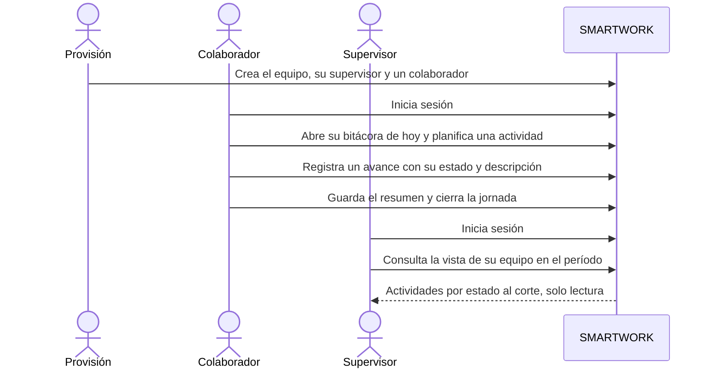

Este flujo cubre M1 a M4 con prioridad máxima. M5 se implementa después (indicadores deterministas primero, narrativa con IA al final) porque depende de decisiones abiertas del proveedor. Detalle en los [tickets](docs/backlog/tickets/indice.md).

### **1.3. Diseño y experiencia de usuario:**

Interfaz web en Flutter, en español, con el diseño aprobado en el prototipo `smartwork_design_proposal.html`: barra lateral oscura, barra superior con la fecha del servidor, tarjetas, indicadores, calendario y formularios, con tipografías DM Sans y Manrope. Es responsive: escritorio, tableta (hasta 1100 px) y móvil (hasta 700 px, donde la barra lateral pasa a ser un menú desplegable).

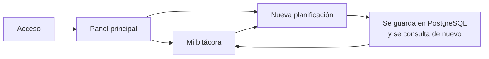

| Pantalla | Qué muestra, con datos reales |
|---|---|
| Acceso | Panel de marca y formulario de usuario y contraseña. Un error de credenciales no dice cuál de los dos falló |
| Panel principal | Saludo, indicadores (registradas, pendientes, en progreso, completadas) y lista de actividades de la fecha elegida, calendario del mes y progreso de completadas |
| Mi bitácora | Estado de la bitácora con sus tres fechas por separado (laboral, registro y modificación), actividades planificadas y selector de fecha. Si no existe, lo indica y permite abrirla |
| Nueva planificación | Título, fecha, estado inicial (siempre pendiente) y descripción |

Capturas reales con datos ficticios. Los indicadores y la lista salen de lo que el servidor guarda para la fecha elegida:

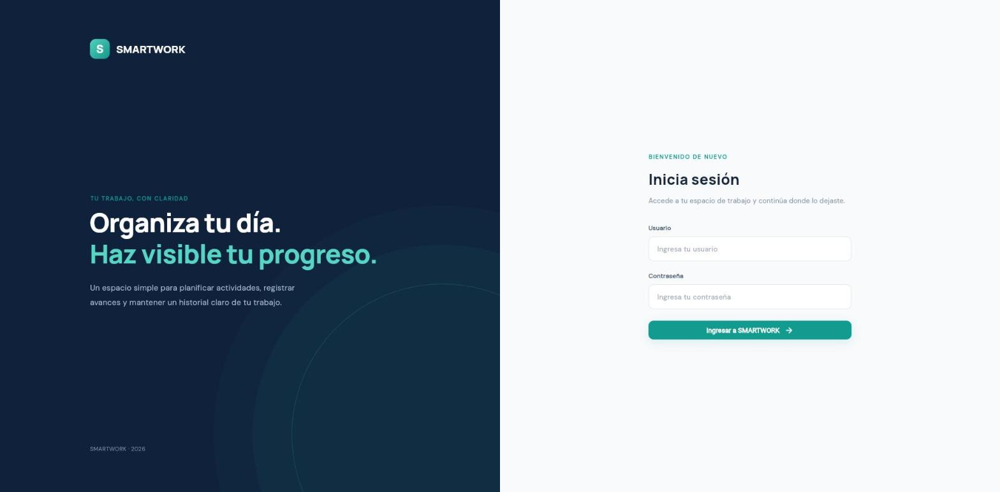

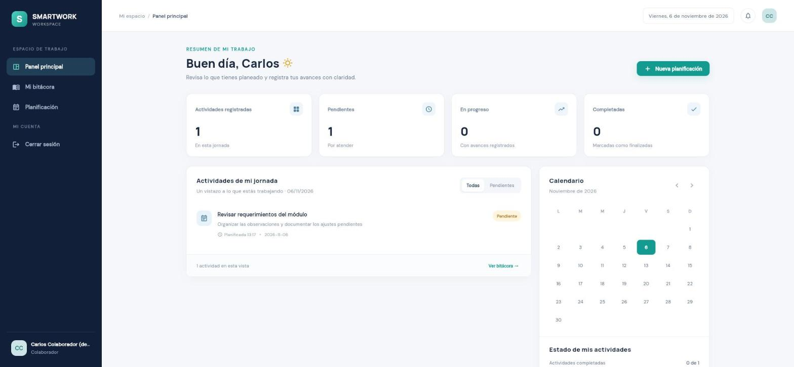

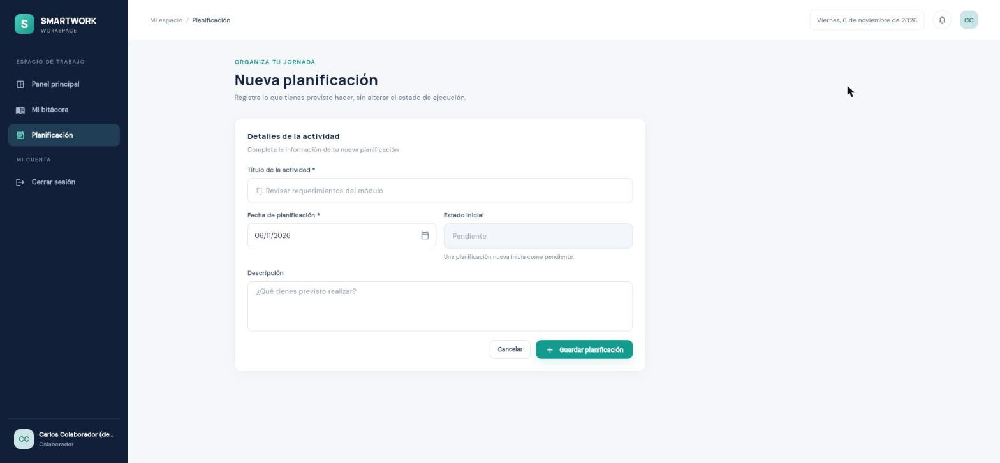

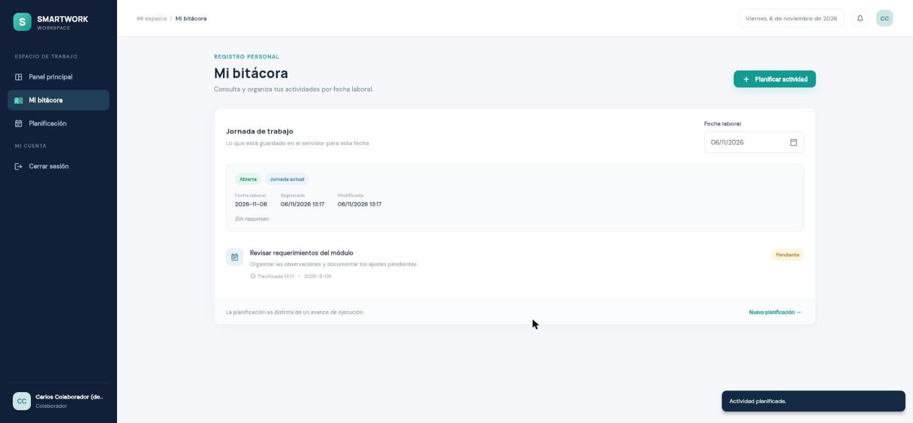

Tableta y móvil (el móvil con su menú desplegable):

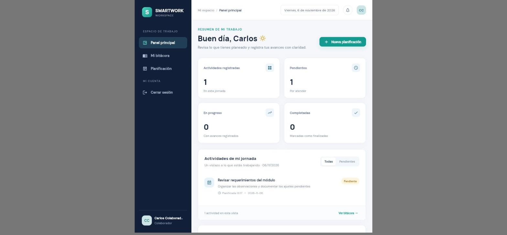


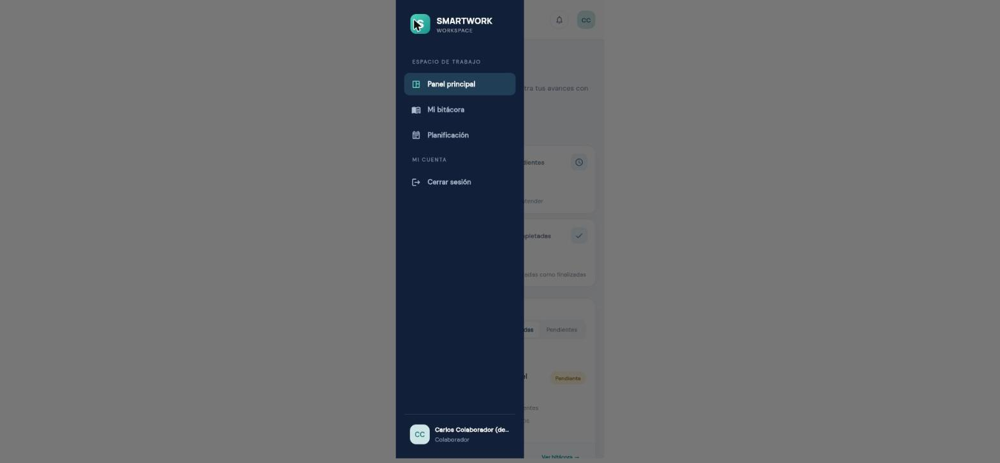

**Diferencias respecto al prototipo.** Se aplicaron porque el prototipo usaba datos simulados o elementos que no existen todavía:

- Los iconos son Material, no los glifos Unicode del prototipo, que en Flutter Web se dibujan como cuadrados vacíos si falta la fuente.
- Los indicadores y el progreso se calculan sobre la jornada elegida, no sobre un «historial»: la API devuelve una fecha por consulta. El calendario no marca los días con actividad por el mismo motivo; marca el día elegido y el de hoy, y sus flechas cambian de mes.
- La barra lateral muestra solo el rol («Colaborador»), no el equipo, porque la API de sesión no lo devuelve.
- Se omiten el aviso «Prototipo visual», el texto de vista conceptual y los valores precargados del acceso.
- El botón de notificaciones aparece deshabilitado con una explicación, porque no hay notificaciones.
- «Mi bitácora» añade lo que ya es real: estado, tres fechas y apertura de la bitácora.
- En móvil, las acciones del formulario de planificación se apilan a ancho completo.
- Las tipografías se cargan desde Google Fonts al abrir la aplicación, como hacía el prototipo. Es una petición externa de solo fuentes, sin datos de las bitácoras; servirlas desde el propio origen queda como mejora.

No hay vídeo. El resto del recorrido previsto (avances, resumen, cierre, supervisión) se describe en los criterios de aceptación y en los [tickets](docs/backlog/tickets/indice.md).

### **1.4. Instrucciones de instalación:**

**Requisitos.** Git, PostgreSQL 16 o superior (probado con 18.4), [uv](https://docs.astral.sh/uv/) (descarga Python 3.13 por su cuenta, así que hace falta conexión a Internet), Flutter 3.35.3 con Dart 3.9.2 y un navegador moderno. Probado en Windows 11 con Git Bash.

**Convenciones de este apartado.**

- Las órdenes están escritas para **Bash** (en Windows, Git Bash). En PowerShell no sirven `&&` ni la barra invertida `\` de continuación de línea: escribir cada orden en una sola línea y por separado.
- **Cada bloque parte de la raíz del repositorio** y termina de vuelta en ella (`cd ..`).
- En Windows el instalador de PostgreSQL **no añade `psql` al `PATH`**. O se añade la carpeta `bin` (por ejemplo `C:\Program Files\PostgreSQL\18\bin`) al `PATH`, o se invoca con la ruta completa.

**0. Obtener el código.** La rama de la Entrega 2 es `feature/entrega-2-eq`:

```bash
git clone https://github.com/marlonbossa09/AI4Devs-finalproject.git
cd AI4Devs-finalproject
git switch feature/entrega-2-eq
```

**1. Roles y bases de datos.** El script crea dos roles con privilegios mínimos (`smartwork_owner` para las migraciones y `smartwork_app` para la API, sin DDL) y dos bases separadas (`smartwork_dev` y `smartwork_test`). No contiene secretos: las contraseñas se pasan como variables. Se ejecuta una vez como superusuario; `psql` pide su contraseña de forma interactiva. Si PostgreSQL no escucha en el puerto 5432, cambiar el valor de `-p`.

**Elegir contraseñas que solo usen letras, números y `-`, `_`, `.` o `~`.** Irán dentro de una URL en el paso 2: un `@`, `/`, `:` o `%` la rompe, salvo que se escriba codificado (`@` → `%40`). El síntoma de una contraseña mal codificada es que la API arranca pero `/health/ready` responde 503.

```bash
psql -h 127.0.0.1 -p 5432 -U postgres -d postgres \
     -v owner_password='ELEGIR-UNA' -v app_password='ELEGIR-OTRA' \
     -f backend/scripts/provision_db.sql
```

**2. Configuración.** Copiar `backend/.env.example` a `backend/.env` (no se versiona) y editarlo:

```bash
cp backend/.env.example backend/.env
```

- Sustituir `CAMBIAR` por las contraseñas elegidas: la de `smartwork_app` en `DATABASE_URL` y `TEST_DATABASE_URL`, y la de `smartwork_owner` en `MIGRATIONS_DATABASE_URL` y `TEST_MIGRATIONS_DATABASE_URL`.
- Si PostgreSQL no usa el puerto 5432, cambiarlo en esas **cuatro** URL.
- No tocar los nombres de las bases: la de pruebas debe llamarse exactamente `smartwork_test` (ver más abajo).

Los parámetros marcados «local» (duración de sesión, longitudes máximas de texto, ventana de idempotencia, mínimo de contraseña) son valores de desarrollo configurables: **no son reglas del producto**.

**3. Backend: dependencias, migraciones y datos ficticios.**

```bash
cd backend
uv sync
uv run alembic upgrade head
uv run python -m scripts.seed_dev
cd ..
```

La semilla crea una organización, un equipo y tres personas ficticias (`supervisor.demo`, `colaborador1.demo` y `colaborador2.demo`). Sus contraseñas se generan al ejecutarla y **se muestran una sola vez**: hay que anotarlas en ese momento, porque no se guardan ni se versionan. La semilla se niega a ejecutarse fuera de un servidor local, contra una base que no termine en `_dev` o `_test`, o si la base ya tiene datos.

**4. Cliente web.** Los archivos generados (`*.g.dart`) están versionados, así que no hace falta ejecutar `build_runner`:

```bash
cd frontend
flutter pub get
flutter build web --release
cd ..
```

Para regenerarlos tras cambiar modelos o proveedores: `dart run build_runner build --delete-conflicting-outputs`.

**5. Arrancar.** FastAPI sirve la API y el cliente compilado en el mismo origen (como pide [ADR-002](docs/arquitectura/adr/ADR-002-autenticacion-y-acceso.md)). La orden no termina: deja el servidor en marcha en esa terminal.

```bash
cd backend
uv run uvicorn app.main:app --host 127.0.0.1 --port 8000
```

**6. Probar el flujo principal.**

1. Comprobar el servidor: <http://localhost:8000/health> debe responder `{"status":"ok"}` y <http://localhost:8000/health/ready> debe confirmar la base de datos.
2. Abrir <http://localhost:8000> e iniciar sesión con `colaborador1.demo` y la contraseña que mostró la semilla.
3. En **Panel principal** pulsar **Nueva planificación**, escribir un título y **Guardar planificación**.
4. La aplicación lleva a **Mi bitácora**, que muestra la actividad guardada. Recargar la página: la sesión y la actividad siguen ahí, porque están en PostgreSQL.
5. Cerrar sesión e iniciar con `supervisor.demo`: no ve la bitácora del colaborador (cada persona solo consulta la suya).

La documentación interactiva de la API (`/docs`) solo existe en desarrollo (`APP_ENV=development`). Si tras recompilar el cliente el navegador sigue mostrando una versión antigua, es la caché del *service worker* de Flutter: borrar los datos del sitio desde las herramientas de desarrollo del navegador (Application → Storage → Clear site data).

**Una base con otro nombre (opcional).** Si ya existe una base, por ejemplo `smartwork_app`, se puede usar sin renombrarla ni cambiar su propietario. Como superusuario, conectado a la base `postgres` (omitir un `CREATE ROLE` si ese rol ya existe):

```sql
CREATE ROLE smartwork_owner LOGIN PASSWORD 'ELEGIR-UNA'  NOSUPERUSER NOCREATEDB NOCREATEROLE NOREPLICATION;
CREATE ROLE smartwork_app   LOGIN PASSWORD 'ELEGIR-OTRA' NOSUPERUSER NOCREATEDB NOCREATEROLE NOREPLICATION;
GRANT CONNECT ON DATABASE smartwork_app TO smartwork_owner, smartwork_app;
\connect smartwork_app
CREATE EXTENSION IF NOT EXISTS btree_gist;
GRANT USAGE, CREATE ON SCHEMA public TO smartwork_owner;
GRANT USAGE ON SCHEMA public TO smartwork_app;
```

Después, en `backend/.env` apuntar `DATABASE_URL` y `MIGRATIONS_DATABASE_URL` a esa base. La semilla se niega a escribir en una base cuyo nombre no termine en `_dev` o `_test`, salvo que se autorice **por su nombre exacto en esa ejecución**: `SMARTWORK_SEED_DATABASE=smartwork_app uv run python -m scripts.seed_dev` (en PowerShell: `$env:SMARTWORK_SEED_DATABASE='smartwork_app'` y luego la orden).

**Cuentas locales de prueba (opcional).** `backend/scripts/crear_cuentas.py` crea personas con su identidad y su pertenencia a un equipo, de forma idempotente y sin borrar ni modificar nada existente. Es genérico y no contiene datos personales: lee las cuentas de `backend/.local/cuentas.json` y la contraseña de `backend/.local/contrasena`. La carpeta `backend/.local/` no existe al clonar y git la ignora; hay que crearla.

1. Crear `backend/.local/cuentas.json`. Los roles posibles son `colaborador` y `supervisor` (no existe un rol de administrador), y un equipo admite un solo supervisor. La organización puede ser una existente (la de la semilla se llama «Organización Demo») o nueva, en cuyo caso hace falta `zona_horaria`:

   ```json
   {
     "organizacion": "Organización Demo",
     "zona_horaria": "America/Bogota",
     "equipo": "Equipo de prueba",
     "cuentas": [
       {"nombre": "Ana Supervisora", "usuario": "ana@example.test", "rol": "supervisor"},
       {"nombre": "Beto Colaborador", "usuario": "beto@example.test", "rol": "colaborador"}
     ]
   }
   ```

2. Crear `backend/.local/contrasena` con un editor: una sola línea con la contraseña inicial, de al menos 10 caracteres (parámetro `PASSWORD_MIN_LENGTH`, ADR-002). No puede ir en `cuentas.json`, que la rechaza. Se guarda con Argon2id y no se imprime ni se registra. También se admite la variable `SMARTWORK_CUENTAS_PASSWORD` o, en una terminal, se pide sin eco.
3. Ejecutar, con la base y el puerto **exactos** de `backend/.env` (el script comprueba con el propio servidor que son los indicados, que el servidor es local y que el rol no es administrador). `--simular` valida todo y deshace la transacción:

   ```bash
   cd backend
   uv run python -m scripts.crear_cuentas --base smartwork_dev --puerto 5432 --simular
   uv run python -m scripts.crear_cuentas --base smartwork_dev --puerto 5432 --archivo-contrasena .local/contrasena
   cd ..
   ```

**Pruebas.** Necesitan `TEST_DATABASE_URL` y `TEST_MIGRATIONS_DATABASE_URL` de `backend/.env` apuntando a `smartwork_test`; si no, abortan antes de tocar nada.

```bash
cd backend
uv run pytest
cd ../frontend
flutter test
flutter analyze
cd ..
```

**La base de pruebas es aparte y debe llamarse exactamente `smartwork_test`.** Las pruebas son destructivas (vacían tablas y revierten migraciones), así que nunca se apuntan a la base de desarrollo ni a una base compartida: ver la sección 2.6.

---

## 2. Arquitectura del Sistema

### **2.1. Diagrama de arquitectura:**

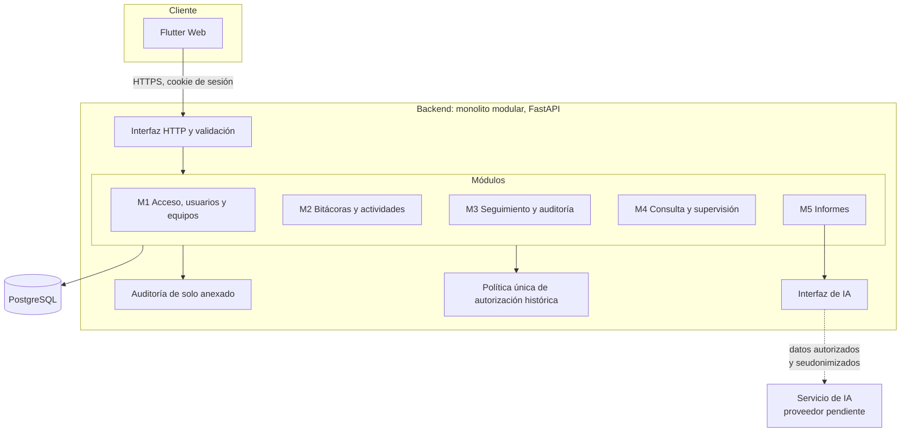

**Patrón y justificación.** Monolito modular con un módulo por funcionalidad, una única política de autorización en el backend y la IA detrás de una interfaz propia. Se eligió porque el producto necesita operaciones atómicas (guardar un cambio, recalcular el estado y auditar a la vez), una sola fuente de verdad para la autorización histórica y bajo coste operativo para un equipo pequeño. La IA y la identificación se integran detrás de interfaces para no acoplar el producto a un proveedor. Detalle y alternativas: [ADR-001](docs/arquitectura/adr/ADR-001-stack-tecnologico.md) y [arquitectura general](docs/arquitectura/arquitectura-general.md).

### **2.2. Descripción de componentes principales:**

| Componente | Tecnología | Responsabilidad |
|---|---|---|
| Cliente web | Flutter Web | Presentación; no decide autorizaciones |
| Interfaz HTTP | FastAPI (Python) | Validación, errores comunes, prefijo `/api/v1` |
| Módulos M1 a M5 | FastAPI (Python) | Casos de uso de cada funcionalidad |
| Autorización histórica | Backend | Decide quién ve qué según el equipo de la persona en la fecha laboral del registro |
| Auditoría | Backend y PostgreSQL | Entrada única por operación, atómica con el cambio; no se modifica ni se borra |
| Interfaz de IA | Backend | Genera la narrativa de los informes sin acoplarse a un proveedor |
| Persistencia | PostgreSQL | Datos del dominio, identidad, sesiones y auditoría |

### **2.3. Descripción de alto nivel del proyecto y estructura de ficheros**

```text
.
├── readme.md  prompts.md  CLAUDE.md
├── docs/                        Especificación (alcance, PRD, historias, ADR, modelo, API, tickets)
│   └── evidencia/               Capturas de la aplicación en ejecución
├── backend/                     FastAPI + SQLAlchemy 2.0 + Alembic (monolito modular)
│   ├── app/
│   │   ├── main.py              Aplicación, prefijo /api/v1, errores y servicio del cliente
│   │   ├── config.py            Parámetros configurables (nada fijado en el código)
│   │   ├── db.py  errores.py  salud.py   Salud y disponibilidad (/health, /health/ready)
│   │   ├── seguridad/           Argon2id, sesiones y token CSRF, verificación del origen
│   │   ├── compartido/          Política de acceso, auditoría, idempotencia, fechas, dependencias
│   │   └── modulos/
│   │       ├── acceso/          M1-01a/b/c: iniciar, cerrar y consultar la sesión
│   │       └── bitacoras/       M2-01a/b y M2-03: consultar, abrir y planificar
│   ├── migrations/versions/     0001 a 0005 (SQL escrito a mano)
│   ├── scripts/                 provision_db.sql, seed_dev.py, crear_cuentas.py, verificar_datos.py
│   └── tests/                   Integración sobre PostgreSQL real y extremo a extremo
└── frontend/                    Flutter Web, Riverpod y Dio
    └── lib/
        ├── config/              Configuración (URL de la API)
        ├── core/                network, errors, utils, theme, layout (barra lateral y superior) y widgets reutilizables
        └── features/
            ├── auth/            data (models, remote, repository), domain, presentation (login)
            └── logbook/         data, domain, presentation (providers, pages: dashboard, logbook, planning)
```

El frontend sigue una arquitectura limpia por funcionalidad: `presentation` depende de `domain`, `data` implementa el contrato de `domain`, y `domain` no importa Flutter ni Dio. El código y los identificadores del frontend están en inglés; los campos JSON conservan los nombres en español de los contratos mediante su mapeo. El backend conserva el vocabulario del modelo de datos (tablas, columnas y códigos de error en español) para mantener la trazabilidad con la especificación.

### **2.4. Infraestructura y despliegue**

El despliegue **no está decidido** (decisión DT-07). Las condiciones que el diseño ya impone son un único origen para la aplicación y la API detrás de un proxy inverso, HTTPS en todo el tráfico y un reloj sincronizado en el servidor:

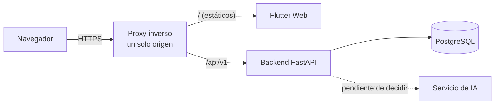

No se ha realizado ningún despliegue. En local, FastAPI sirve el cliente compilado y la API desde un único origen, que es la condición que el diseño exige al proxy inverso.

### **2.5. Seguridad**

**Implementado y comprobado en la Entrega 2:**

- **Contraseñas con Argon2id** (19 MiB, 2 iteraciones, paralelismo 1, configurables). Solo se guarda el hash; ninguna tabla contiene la contraseña en claro (comprobado recorriendo todas las tablas).
- **Sesiones revocables en el servidor**, guardadas en PostgreSQL. La cookie lleva un secreto aleatorio de 256 bits y la base solo guarda su hash SHA-256. Caduca por inactividad y por duración absoluta. Cerrar la sesión la revoca en el servidor, aunque se conserve la cookie.
- **Cookie `__Host-`** con `Secure`, `HttpOnly`, `SameSite=Strict` y sin `Domain`. Se comprobó en Chrome real que la acepta en `localhost` y que JavaScript no puede leerla.
- **CSRF:** token en una cabecera propia, derivado con HMAC del secreto de la sesión, más verificación del `Origin` (o `Referer`). Una petición que modifica sin token o desde otro origen se rechaza sin cambiar nada. En Chrome real, una petición entre sitios llegó sin cookie y las peticiones CORS previas fueron rechazadas.
- **Errores uniformes:** un identificador inexistente y una contraseña incorrecta dan la misma respuesta, con un coste de verificación comparable; un recurso inexistente y uno ajeno son indistinguibles.
- **Orden de evaluación** de las convenciones (identidad, acceso, formato, permiso, reglas) en una política de acceso única.
- **Privilegios mínimos en la base de datos:** la API no puede crear objetos, no borra nada, no edita planificaciones, y solo inserta y lee en la auditoría. La **auditoría es de solo anexado**: ni la aplicación ni el propietario pueden actualizarla o borrarla.
- **Idempotencia** de la planificación mediante `Idempotency-Key`, y escrituras de una jornada pasada auditadas en la misma transacción.
- **Datos de prueba protegidos:** la semilla se niega fuera de un servidor local y de una base `_dev` o `_test`; las pruebas abortan si no usan una base `_test`; no hay ninguna suplantación de identidad ni cabecera de elusión de la autenticación.
- Sin secretos en el repositorio: `backend/.env` está ignorado y solo se versiona `.env.example`.

**Diseñado y todavía no implementado:** códigos de un solo uso para el primer acceso y la recuperación, desactivación inmediata de accesos mediante órdenes de provisión, limitación de intentos fallidos del inicio de sesión (sus parámetros están pendientes, ADR-002 A9) y la IA con datos mínimos ([ADR-003](docs/arquitectura/adr/ADR-003-integracion-de-ia.md)).

### **2.6. Tests**

Resultado de la última ejecución, con las dos suites completas y sobre PostgreSQL real (no simulado):

| Suite | Resultado | Qué cubre |
|---|---|---|
| Backend (`pytest`) | **242 superadas, 1 omitida a propósito** (suite completa, sobre `smartwork_test` en el PostgreSQL local del puerto 5432) | Esquema y restricciones de la base de datos (DB-01 a DB-05 y DB-07), autenticación, CSRF y origen, consulta, apertura y planificación, concurrencia, idempotencia, auditoría, extremo a extremo, salud y disponibilidad (incluido un 503 real con la base inalcanzable), creación de cuentas y aislamiento de las propias pruebas |
| Frontend (`flutter test`) | **64 superadas** | Modelos, cliente HTTP, repositorios, pantallas con repositorios falsos inyectados y diseño responsive (escritorio, tableta y móvil, con la fuente real para detectar desbordamientos) |
| Frontend (`flutter analyze`) | Sin incidencias | Análisis estático |

Puntos que las pruebas comprueban de verdad:

- **Restricciones de la base de datos con intentos reales:** solapes de pertenencias, dos supervisores a la vez, título vacío, avance bloqueado sin motivo, y que el rol de la API no pueda borrar ni alterar la auditoría.
- **Concurrencia:** ocho aperturas simultáneas de la misma fecha dejan una sola bitácora; seis peticiones con la misma clave de idempotencia crean una sola actividad.
- **Atomicidad:** si falla la entrada de auditoría, no queda ni la actividad, ni la bitácora, ni la clave.
- **Extremo a extremo:** un servidor real en otro proceso recorre inicio de sesión, consulta, apertura, planificación y consulta, se **reinicia**, y comprueba que la sesión y los datos persisten y que un reintento no duplica.
- **Las pruebas detectan fallos:** se rompió el código a propósito en tres puntos (auditoría, idempotencia y conflicto de apertura) y las pruebas fallaron; restaurado, vuelven a pasar.
- **Aislamiento de las pruebas:** solo pueden tocar la base `smartwork_test`, en un servidor local, con un rol que no sea administrador y distinta de la de desarrollo. Se comprueba antes de importar la aplicación, al abrir la sesión (el servidor confirma `current_database()`, el rol y el puerto) y antes de cada limpieza; si algo no cuadra, se aborta sin ejecutar nada. 24 pruebas lo verifican, entre ellas el rechazo de `smartwork_app`, de otras bases del servicio (también las que terminan en `_test`), de servidores remotos y del puerto 5433. Una ejecución con la configuración de pruebas apuntada a propósito a `smartwork_app` abortó antes de tocarla, y tras la suite completa `smartwork_app` conservaba exactamente sus datos y su versión de migración.
- **Verificación manual en Chrome real** del flujo completo, de las cookies, el CSRF y el origen, y de la persistencia tras recargar y reiniciar.

**No hay prueba automatizada de la interfaz en un navegador** (por ejemplo, `integration_test` con `chromedriver`): no se instaló esa herramienta. El recorrido en el navegador se comprobó a mano, con las capturas de la sección 1.3. Antes de la Entrega 2 se comprobó la documentación con scripts de trabajo ajenos al repositorio (301 criterios con formato estricto y 35 contratos con trazabilidad completa).

---

## 3. Modelo de Datos

### **3.1. Diagrama del modelo de datos:**

Nueve entidades funcionales. Las estructuras técnicas de identidad, sesiones, códigos, operadores e idempotencia se describen aparte (sección 3.10 del [modelo](docs/modelo-datos/modelo-datos.md)).

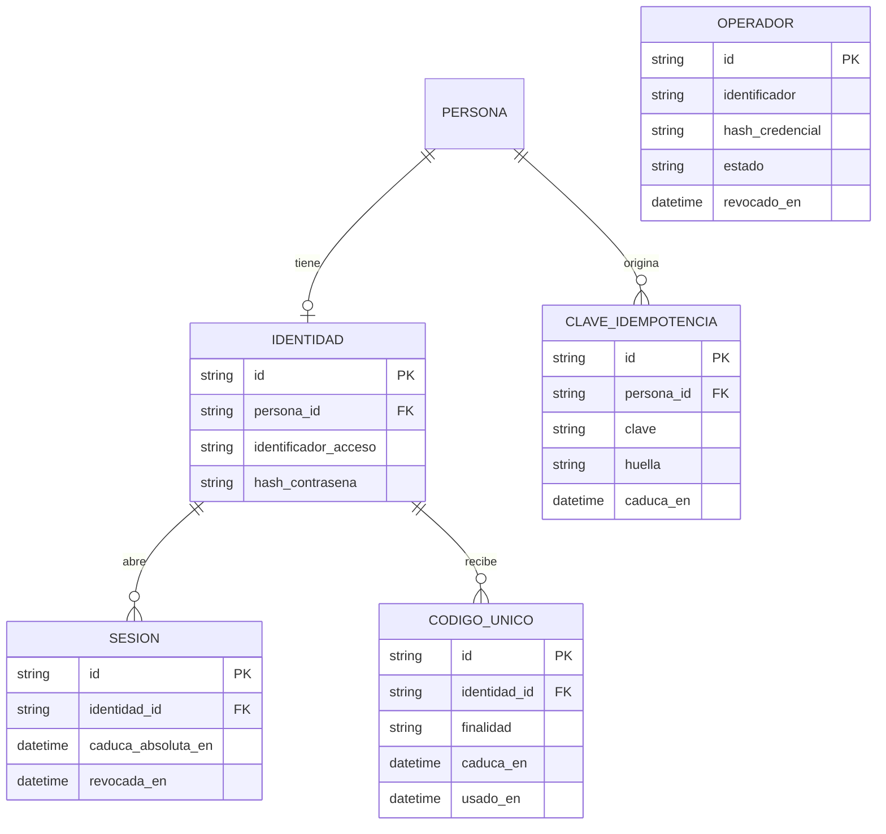

### **3.2. Descripción de entidades principales:**

| Entidad | Qué representa | Claves y relaciones principales |
|---|---|---|
| `ORGANIZACION` | La organización y su zona horaria única | 1 a N con `EQUIPO` |
| `EQUIPO` | Un equipo; «operativo» se deduce de sus pertenencias | N a 1 con `ORGANIZACION`; 1 a N con `PERTENENCIA` |
| `PERSONA` | Quien registra o consulta; sin credenciales; `acceso_desactivado_en` | 1 a N con `PERTENENCIA`, `BITACORA` y `ACTIVIDAD` |
| `PERTENENCIA` | Historial de equipo y rol por intervalo semiabierto de fechas laborales | Sin solapes; el equipo de un registro se deduce de ella |
| `BITACORA` | La jornada de una persona en una fecha laboral; única por persona y fecha | 1 a N con `ACTIVIDAD`, `PLANIFICACION` y `AVANCE` |
| `ACTIVIDAD` | Unidad de trabajo con propietaria inmutable, título obligatorio y `estado_actual` derivado | 1 a N con `PLANIFICACION` y `AVANCE` |
| `PLANIFICACION` | Lo previsto (original o continuación); no es un avance y no se edita | N a 1 con `ACTIVIDAD` y `BITACORA` |
| `AVANCE` | Registro de ejecución con estado histórico; ordenado por fecha laboral, momento e identificador | N a 1 con `ACTIVIDAD` y `BITACORA` |
| `AUDITORIA` | Entrada única por operación, de solo anexado | Referencia al registro afectado por tipo e identificador |

Atributos, tipos conceptuales, restricciones y las 39 reglas de integridad: [modelo de datos](docs/modelo-datos/modelo-datos.md).

---

## 4. Especificación de la API

La especificación completa son 35 contratos (propuestos): [docs/api/](docs/api/indice.md). **Implementados en la Entrega 2:** M1-01a, M1-01b, M1-01c, M2-01a, M2-01b y M2-03. Extracto de tres operaciones principales en formato OpenAPI:

```yaml
openapi: 3.0.3
info:
  title: SMARTWORK API (extracto)
  version: 0.5-propuesto
servers:
  - url: /api/v1
paths:
  /mi/bitacoras:
    post:
      summary: Abrir mi bitácora de una fecha laboral (M2-01b)
      description: Idempotente. Si la bitácora ya existe, devuelve la misma sin modificarla.
      requestBody:
        required: true
        content:
          application/json:
            schema:
              type: object
              required: [fecha_laboral]
              properties:
                fecha_laboral: {type: string, format: date, example: "2026-11-09"}
      responses:
        "201": {description: Bitácora creada (creada true)}
        "200": {description: Bitácora existente, sin cambios (creada false)}
        "422": {description: FECHA_NO_CUBIERTA, la fecha no está cubierta por una pertenencia de la persona}
        "403": {description: ACCESO_DESACTIVADO o SIN_PERTENENCIA_VIGENTE}
  /mi/actividades/{actividad_id}/avances:
    post:
      summary: Registrar un avance sobre una actividad propia (M2-05)
      parameters:
        - {name: actividad_id, in: path, required: true, schema: {type: string}}
        - {name: Idempotency-Key, in: header, required: true, schema: {type: string}}
      requestBody:
        required: true
        content:
          application/json:
            schema:
              type: object
              required: [fecha_laboral, estado, descripcion]
              properties:
                fecha_laboral: {type: string, format: date}
                estado: {type: string, enum: [Pendiente, En progreso, Bloqueada, Completada]}
                descripcion: {type: string, description: No vacía}
                motivo_bloqueo: {type: string, description: Obligatorio si el estado es Bloqueada}
      responses:
        "201": {description: Avance creado y actividad con su estado_actual recalculado}
        "409": {description: ACTIVIDAD_COMPLETADA o BITACORA_CERRADA}
        "422": {description: ESTADO_INVALIDO, MOTIVO_BLOQUEO_OBLIGATORIO, DESCRIPCION_OBLIGATORIA o FECHA_FUTURA_NO_PERMITIDA}
        "404": {description: RECURSO_NO_DISPONIBLE, indistinguible para actividad inexistente o ajena}
  /equipo/supervision:
    get:
      summary: Vista de supervisión del equipo en un período (M4-03)
      description: Solo supervisor con acceso efectivo. El corte es el último día del período.
      parameters:
        - {name: desde, in: query, required: true, schema: {type: string, format: date}}
        - {name: hasta, in: query, required: true, schema: {type: string, format: date}}
        - {name: limite, in: query, schema: {type: integer}}
        - {name: continuar_desde, in: query, schema: {type: string}}
      responses:
        "200":
          description: Actividades autorizadas con su estado al corte
          content:
            application/json:
              schema:
                type: object
                properties:
                  periodo: {type: object}
                  corte: {type: string, format: date}
                  totales_por_estado: {type: object}
                  elementos: {type: array, items: {type: object}}
                  siguiente: {type: string, nullable: true}
        "403": {description: OPERACION_NO_PERMITIDA para un colaborador}
```

Ejemplo de petición a `POST /api/v1/mi/actividades/{actividad_id}/avances` (datos ficticios): `{"fecha_laboral": "2026-11-09", "estado": "En progreso", "descripcion": "Revisión de los requisitos del módulo de acceso"}`.

### Salud y disponibilidad

Dos comprobaciones de infraestructura, en la raíz (sin `/api/v1`) y fuera de los contratos de negocio. No requieren autenticación, devuelven JSON mínimo y nunca incluyen credenciales, cadenas de conexión, nombres de servidor, datos de personas ni mensajes de error de la base de datos (ante un fallo solo se registra el tipo de excepción).

| Endpoint | Para qué sirve | Respuesta |
|---|---|---|
| `GET /health` | **Vivacidad:** el proceso de FastAPI atiende peticiones. No usa la base de datos | `200` `{"status": "ok"}` |
| `GET /health/ready` | **Disponibilidad:** ejecuta `SELECT 1` en PostgreSQL | `200` `{"status": "ok", "checks": {"database": "ok"}}`, o `503` `{"status": "unavailable", "checks": {"database": "unavailable"}}` |

La espera máxima a PostgreSQL la fija `DB_CONNECT_TIMEOUT_SECONDS` (3 s por defecto), de modo que una base caída responde 503 en pocos segundos en vez de colgarse. Las respuestas llevan `Cache-Control: no-store`.

Diseñados para AWS ECS (el despliegue no está hecho ni probado allí). Separar las dos comprobaciones evita que una caída de PostgreSQL haga que el orquestador reinicie en bucle contenedores que no tienen la culpa:

- **Comprobación de salud del contenedor:** `/health`, por ejemplo `curl -f http://localhost:8000/health` (la imagen necesitaría `curl` o un equivalente).
- **Comprobación del grupo de destino del balanceador:** `/health/ready`. Un 503 saca la tarea de la rotación sin matarla. Conviene que su tiempo de espera sea mayor que `DB_CONNECT_TIMEOUT_SECONDS`, y dar un periodo de gracia al arrancar.


---

## 5. Historias de Usuario

33 historias con criterios DADO / CUANDO / ENTONCES, trazadas a reglas de negocio y requisitos: [índice](docs/backlog/indice.md). Tres de las principales:

**HU-2.4 — Registrar avances conservando el estado histórico**

> Como colaborador, quiero que cada avance conserve el estado que tenía mi actividad en ese momento, para que el historial de la actividad no cambie cuando cambia su estado actual.

- **Reglas y requisitos:** RN-08, RN-17; RF-08, RF-40.
- **Criterios de aceptación (selección):**
  - **CA-45** (positivo): DADO una actividad mía CUANDO registro un avance en una jornada ENTONCES el avance conserva el estado que tenía la actividad en ese momento.
  - **CA-46** (positivo): DADO una actividad con avances anteriores CUANDO su estado actual cambia ENTONCES los avances anteriores siguen mostrando el estado que tenían.
  - **CA-47** (límite): DADO cualquier actividad CUANDO se consulta su estado ENTONCES es uno de estos cuatro: Pendiente, En progreso, Bloqueada o Completada.
  - **CA-48** (negativo): DADO una actividad CUANDO intento asignarle un valor que no es uno de los cuatro estados ENTONCES no se acepta.
- **Historia completa:** [HU-2.4](docs/backlog/M2-bitacoras-laborales-hibridas/HU-2.4-registrar-avances-conservando-el-estado-historico.md)

**HU-3.3 — Cerrar mi jornada**

> Como colaborador, quiero cerrar manualmente mi jornada, para dejarla consolidada sin perder el seguimiento de lo no terminado.

- **Reglas y requisitos:** RN-10, RN-21, RN-22, RN-46, RN-23, RN-109; RF-17, RF-18, RF-19, RF-44, RF-68, RF-119.
- **Criterios de aceptación (selección):**
  - **CA-90** (positivo): DADO una jornada con al menos una actividad creada en ella y un resumen con texto CUANDO la cierro ENTONCES queda cerrada.
  - **CA-92** (negativo): DADO una jornada sin ninguna actividad creada ni continuada CUANDO intento cerrarla ENTONCES no se permite.
  - **CA-93** (negativo): DADO una jornada con el resumen vacío CUANDO intento cerrarla ENTONCES no se permite.
  - **CA-97** (negativo): DADO una jornada con fecha laboral posterior a la actual CUANDO intento cerrarla ENTONCES no se permite.
- **Historia completa:** [HU-3.3](docs/backlog/M3-seguimiento-de-actividades-y-auditoria/HU-3.3-cerrar-mi-jornada.md)

**HU-4.3 — Supervisar mi equipo en un período**

> Como supervisor, quiero una vista consolidada de mi equipo para un período, para saber qué está pendiente, en progreso, bloqueado y completado.

- **Reglas y requisitos:** RN-13, RN-47, RN-48, RN-60, RN-36, RN-23, RN-75, RN-84, RN-85, RN-88, RN-89, RN-101, RN-105; RF-27, RF-69, RF-70, RF-45, RF-78, RF-25, RF-83, RF-94, RF-95, RF-98, RF-99, RF-111, RF-115.
- **Criterios de aceptación (selección):**
  - **CA-137** (positivo): DADO un supervisor CUANDO selecciona un período ENTONCES ve las actividades de su equipo clasificadas en Pendiente, En progreso, Bloqueada y Completada.
  - **CA-141** (negativo): DADO una actividad del equipo completada antes del período y sin avances en él CUANDO el supervisor consulta la vista de ese período ENTONCES no aparece en la vista.
  - **CA-146** (permisos): DADO un supervisor CUANDO consulta la vista ENTONCES solo incluye actividades de su equipo y no de otros equipos.
  - **CA-218** (positivo): DADO el supervisor de U y una actividad pendiente de P, iniciada en T y sin registros en U CUANDO consulta la vista ENTONCES ve una referencia mínima con el propietario, la indicación de que se inició en otro equipo y su estado actual.
- **Historia completa:** [HU-4.3](docs/backlog/M4-consulta-historica-y-supervision/HU-4.3-supervisar-mi-equipo-en-un-periodo.md)

---

## 6. Tickets de Trabajo

34 tickets documentales (base de datos, backend y frontend), con un flujo principal de extremo a extremo: [índice de tickets](docs/backlog/tickets/indice.md). Tres de ellos:

**BE-08 — Avances, secuencia y estado actual**
- **Prioridad:** P0 · **Capa:** Backend
- **Objetivo:** Registrar avances manteniendo una secuencia válida y el estado actual correcto.
- **Historias y criterios:** HU-2.4, HU-2.5, HU-2.8, HU-2.9 (CA-45 a CA-52, CA-66 a CA-80, CA-185, CA-186), HU-3.8 (CA-190, CA-203 a CA-208).
- **Contratos y documentos:** M2-05; modelo, secciones 8 y 9 (IR-09 a IR-12, DM-01, DM-02).
- **Descripción técnica:** Orden total por fecha laboral, momento de registro e identificador; validación de la secuencia (IR-11) para altas retroactivas; recálculo de `estado_actual` en la misma transacción; serialización por actividad; solo se exige abierta la bitácora de la fecha del avance.
- **Dependencias:** BE-07, DB-03.
- **Terminado cuando:**
  - Un avance retroactivo anterior a una finalización se acepta sin reactivar y no altera el estado de uno posterior.
  - Un avance tras una finalización sin reactivación se rechaza.
  - Dos registros simultáneos sobre una actividad dejan un estado actual coherente con la secuencia (comprobación DM-02).

**FE-05 — Actividades: planificar, registrar avances, listar y detalle**
- **Prioridad:** P0 · **Capa:** Frontend
- **Objetivo:** El flujo central de trabajo diario.
- **Historias y criterios:** HU-2.2 a HU-2.6, HU-2.8, HU-2.9 (CA-37 a CA-58, CA-66 a CA-80, CA-179 a CA-186), HU-3.1 y HU-3.2 (CA-81 a CA-88).
- **Contratos y documentos:** M2-03 a M2-08.
- **Descripción técnica:** Formularios de planificación, avance y actividad no planificada con estado, descripción y motivo de bloqueo condicional; selección explícita de la actividad que se continúa; detalle con la secuencia, el estado actual y la planificación diferenciados.
- **Dependencias:** FE-04, BE-07, BE-08.
- **Terminado cuando:**
  - El motivo de bloqueo solo se pide si el estado es Bloqueada.
  - Una actividad Completada indica que hay que reactivarla antes de continuarla.
  - La planificación se distingue visualmente del avance de ejecución.

**DB-03 — Bitácoras, actividades, planificaciones y avances**
- **Prioridad:** P0 · **Capa:** Base de datos
- **Objetivo:** Persistir el núcleo de M2 y M3 con sus invariantes.
- **Historias y criterios:** HU-2.1 a HU-2.9 (CA-32 a CA-80, CA-179 a CA-186, CA-209, CA-210, CA-263, CA-264, CA-280 a CA-282, CA-295, CA-296).
- **Contratos y documentos:** M2-01a a M2-08, M3-01 a M3-06; modelo, secciones 3.5 a 3.8 y 6.2 (IR-01, IR-06 a IR-18, IR-33).
- **Descripción técnica:** `BITACORA` (única por persona y fecha), `ACTIVIDAD` (propietaria inmutable, `estado_actual` derivado, marca de error), `PLANIFICACION` (original y continuación, sin edición), `AVANCE` (estado ∈ cuatro, descripción no vacía, motivo si Bloqueada, `registrado_en` e identificador asignados por el servidor). La secuencia válida (IR-11) y el recálculo de `estado_actual` (IR-12) se aplican en la capa de servicio, serializados por actividad (DM-01).
- **Dependencias:** DB-01.
- **Terminado cuando:**
  - Dos bitácoras de la misma persona y fecha no pueden coexistir.
  - No es posible cambiar la propietaria de una actividad ni borrar un avance.
  - Un avance con estado Bloqueada y sin motivo es rechazado por la base de datos.
  - Una actividad nueva sin título es rechazada.
  - Una consulta de comprobación (derivar y comparar) detecta cualquier `estado_actual` incoherente con la secuencia (DM-02).

---

## 7. Pull Requests

Todavía no hay pull requests. El trabajo de la Entrega 1 está en `feature/entrega-1-eq` y el de la Entrega 2 en `feature/entrega-2-eq`, creada desde la anterior sin modificarla.

---

## 8. Alcance de las siguientes entregas

| Entrega | Contenido |
|---|---|
| **Entrega 1** | Documentación técnica: alcance, requisitos, historias y criterios, arquitectura y decisiones, modelo de datos, contratos de la API, tickets, README y registro del uso de IA |
| **Entrega 2 (esta)** | Andamiaje de Flutter Web, FastAPI y PostgreSQL conectados, con un recorrido real de extremo a extremo: sesión, apertura y consulta de la bitácora, y registro de una actividad planificada con persistencia en PostgreSQL |
| **Posteriores (previstas)** | Completar el flujo principal FP-1 (avances, resumen, cierre y vista de supervisión), reapertura, correcciones, marca de error, consulta de equipo e histórico, provisión y códigos de acceso, informes con IA una vez decidido el proveedor, despliegue y pruebas de seguridad |

Las prioridades y dependencias están en el [índice de tickets](docs/backlog/tickets/indice.md).

---

## 9. Decisiones y limitaciones técnicas pendientes

| Pendiente | Efecto | Dónde se documenta |
|---|---|---|
| **Proveedor de IA, modelo, región, retención y marco legal** (PA-09). AWS Bedrock es el candidato prioritario y la API directa de Anthropic, la alternativa | La integración interna de M5; los contratos públicos no dependen de él | [ADR-003](docs/arquitectura/adr/ADR-003-integracion-de-ia.md) |
| **Mecanismo operativo de la provisión** y valores de sesión, códigos y contraseñas (PA-12) | Órdenes de M1; medio de entrega de códigos y verificación de identidad | [ADR-002](docs/arquitectura/adr/ADR-002-autenticacion-y-acceso.md) |
| Reactivación administrativa del acceso | Falta una regla de negocio | ADR-002, sección 11 |
| Despliegue y observabilidad (DT-07); estrategia de pruebas (DT-08) | No hay entorno ni pruebas definidos | [Arquitectura general](docs/arquitectura/arquitectura-general.md) |
| Retención de la auditoría (PA-06); objetivos de rendimiento y volumen (PA-13); métricas de éxito (PA-11) | Valores de parámetros configurables | [Alcance](docs/producto/alcance-mvp.md), sección 6.3 |
| Reincorporación de personas (PA-24); ajustes históricos de pertenencia (PA-25) | Fuera del MVP | Alcance |

**Límites de la Entrega 2.** Solo están implementadas las operaciones M1-01a, M1-01b, M1-01c, M2-01a, M2-01b y M2-03. No hay avances, resumen, cierre, reapertura, supervisión, consulta de compañeros ni informes con IA. No hay provisión: las personas ficticias las crea la semilla de desarrollo, que inserta directamente en la base y por eso no deja entradas de auditoría de provisión. No hay despliegue ni prueba automatizada de la interfaz en un navegador.

**Decisiones de implementación que no están en los contratos** (técnicas, sin cambiar ningún requisito):

- **M1-01c** (consultar la sesión) estaba como propuesta; la persona responsable la aprobó para que el cliente reciba el rol y la fecha actual del servidor.
- **Limitación de intentos fallidos del inicio de sesión:** el contrato la pide, pero sus parámetros están pendientes (ADR-002 A9). No está implementada.
- **El token CSRF no se almacena:** se deriva con HMAC del secreto de la sesión, porque M1-01c debe poder devolverlo. ADR-002 describía guardar su hash.
- **Rechazo por CSRF u origen:** el catálogo de errores no tiene un código para ello; se responde `SOLICITUD_INVALIDA` (400) con el motivo en `detalles`.
- **La planificación no renueva `modificada_en`** de la bitácora: el contrato M2-03 no lo dice (M2-02 sí lo dice para el resumen).
- **El esquema de `avance` no incluye `modificado_en`**, que el contrato de M2-05 prevé; se añadirá con la corrección de avances. La tabla existe sin operaciones que la escriban.
- **Política de contraseñas:** mínimo de **10 caracteres** (ADR-002, A8), decidido por la persona responsable. Se aparta a propósito de los 15 que recomienda NIST SP 800-63B-4, una referencia y no una obligación para SMARTWORK; el riesgo y sus mitigaciones constan en ADR-002 (Argon2id y almacenamiento solo del hash; la limitación de intentos fallidos todavía no está implementada). Hoy solo la aplica el script de cuentas, porque los flujos que fijan contraseñas (primer acceso y recuperación) no están implementados; el inicio de sesión no impone mínimo.
- **Valores locales** (zona horaria `America/Bogota` de la semilla, duración de sesión, longitudes máximas de texto, ventana de idempotencia): configurables y sin valor de requisito.
- **Pertenencias de la semilla:** empiezan 60 días atrás para poder demostrar jornadas pasadas; IR-30 lo impide por la vía ordinaria pero el modelo permite representar períodos históricos.

Flutter Web conserva riesgos conocidos de accesibilidad, carga inicial y pruebas. Todo contenido marcado `[PROPUESTO]` no es un requisito hasta que la persona responsable lo apruebe.

## Mapa de la documentación

| Documento | Contenido |
|---|---|
| [docs/producto/alcance-mvp.md](docs/producto/alcance-mvp.md) | Alcance del MVP y registro de decisiones |
| [docs/producto/prd.md](docs/producto/prd.md) | Requisitos funcionales y no funcionales, trazabilidad y matriz de permisos |
| [docs/backlog/indice.md](docs/backlog/indice.md) | 33 historias y 301 criterios de aceptación |
| [docs/backlog/tickets/indice.md](docs/backlog/tickets/indice.md) | Tickets de implementación y flujo principal |
| [docs/arquitectura/arquitectura-general.md](docs/arquitectura/arquitectura-general.md) | Arquitectura, riesgos y decisiones técnicas |
| [docs/arquitectura/adr/](docs/arquitectura/adr/) | ADR-001 (stack), ADR-002 (autenticación), ADR-003 (IA) |
| [docs/modelo-datos/modelo-datos.md](docs/modelo-datos/modelo-datos.md) | Modelo de datos y reglas de integridad |
| [docs/api/indice.md](docs/api/indice.md) | Contratos de la API |
| [docs/evidencia/](docs/evidencia/) | Capturas de la aplicación en ejecución |
| [backend/](backend/) y [frontend/](frontend/) | Código de la Entrega 2 |
| [prompts.md](prompts.md) | Uso de IA en el desarrollo |
